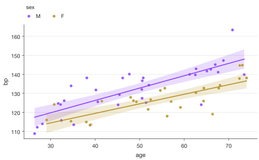
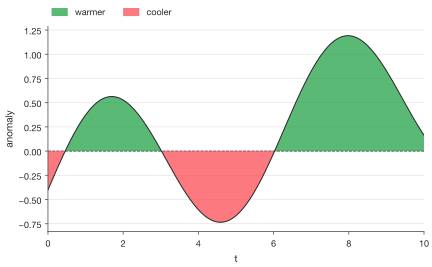
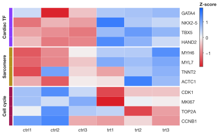
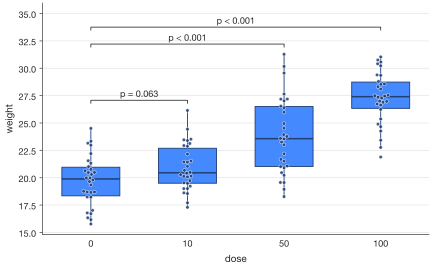

# Visual gallery

Choose the visual that answers your question, then open its guide for the
complete code, data setup, and options. Every image here is generated by
SecretPlots from the linked guide; all datasets are synthetic.

<div class="grid cards" markdown>

-   **Compare categories**

    [](plots/bar.md)

    Means, sums, or individual category values.

    `error="sd"` shows spread; `orient="h"` suits long names; `.values()` adds numbers.

    [Explore bar plots →](plots/bar.md)

-   **Reveal relationships**

    [](plots/scatter.md)

    Two numeric axes, with color, size, and shape for extra variables.

    `.fit("linear")` adds a fit and confidence band; `size=` creates bubbles.

    [Explore scatter plots →](plots/scatter.md)

-   **Follow the change**

    [](plots/line.md)

    Ordered values, repeated observations, and uncertainty through time.

    `error="ci"` adds confidence bands; `.errorbars(level=(0.5, 0.8, 0.95))` creates nested intervals.

    [Explore line plots →](plots/line.md)

-   **Show the whole**

    [](plots/area.md)

    Totals, composition, envelopes, or deviations above and below a baseline.

    `stack="percent"` shows shares; `.split()` separates signs; `.gradient()` fades toward a baseline.

    [Explore area plots →](plots/area.md)

-   **Understand the distribution**

    [](plots/histogram.md)

    Bins for the observations, with optional smooth density curves.

    `stat="density"` normalizes areas; `bins=` controls binning; `.kde()` adds a smooth curve.

    [Explore histogram plots →](plots/histogram.md)

-   **Find the pattern**

    [](plots/heatmap.md)

    Matrices, expression profiles, and correlations with a readable color scale.

    `.scale("row")` standardizes rows; `.groups()` adds structure; `.values()` labels cells.

    [Explore heatmap plots →](plots/heatmap.md)

-   **Keep the observations visible**

    [](plots/box.md)

    Medians, quartiles, and whiskers, with individual points and comparisons.

    `.points()` reveals the data; `.show_n()` reports sample sizes; `.compare()` adds test results.

    [Explore box plots →](plots/box.md)

-   **See the full shape**

    [](plots/violin.md)

    Density, a compact summary, and the individual observations in one view.

    `sp.raincloud()` combines a half violin, box, and points; `split=True` compares two hue groups.

    [Explore violin plots →](plots/violin.md)

</div>

## Move from the picture to its settings

```python
import SecretPlots as sp

sp.LinePlot.options()                # what can I change?
sp.LinePlot.options("errorbars")     # how can I change the intervals?
sp.theme_options()                  # which style fields are available?
```

For constructor arguments such as `hue`, `bins`, and `split`, use
`help(sp.violin)` (substitute your plot constructor). The
[option discovery guide](options.md) explains the distinction and shows how to
search names and descriptions.
