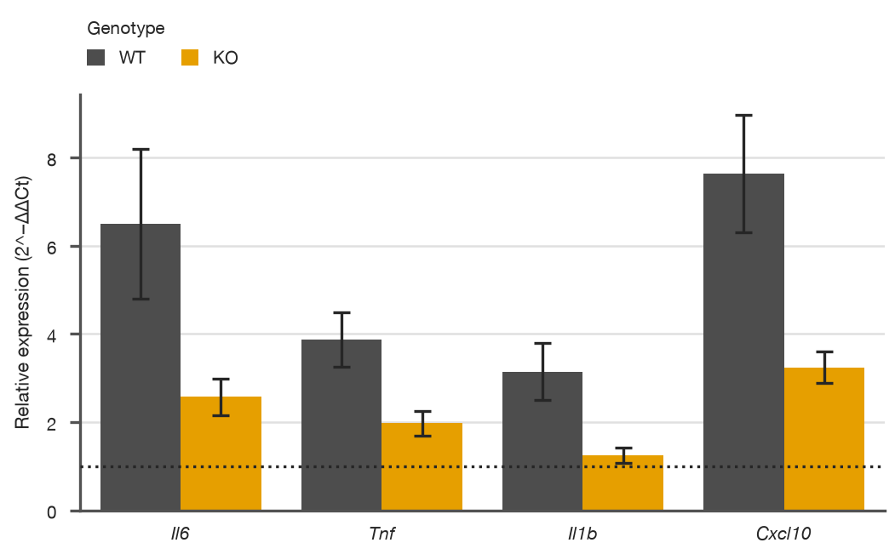
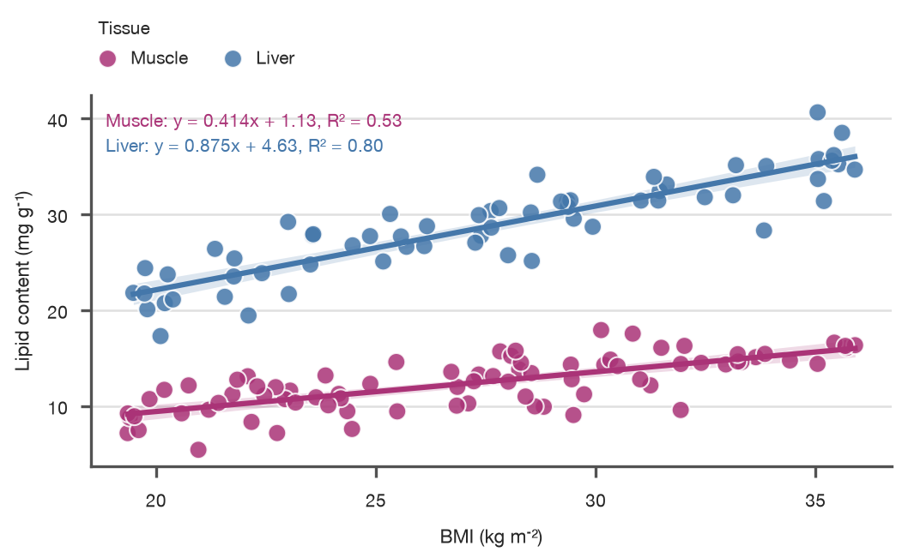
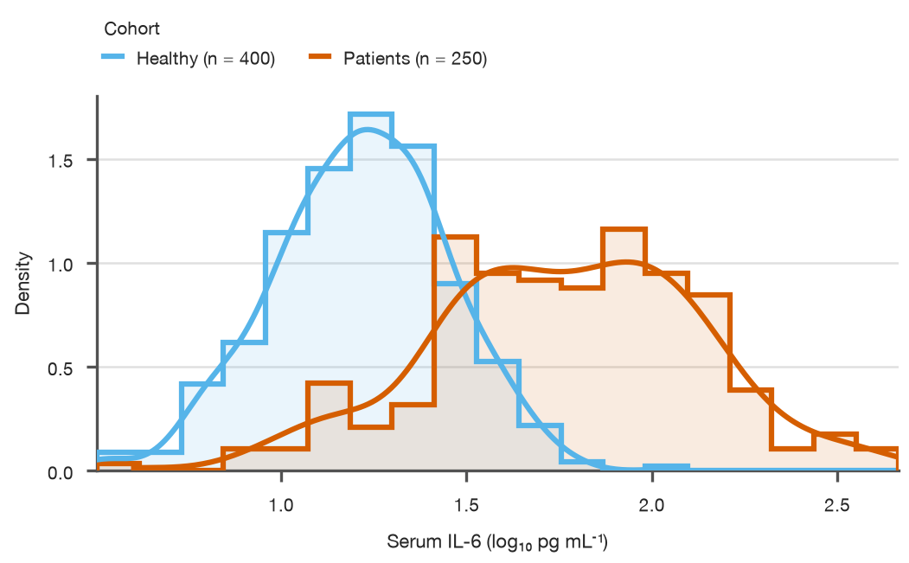
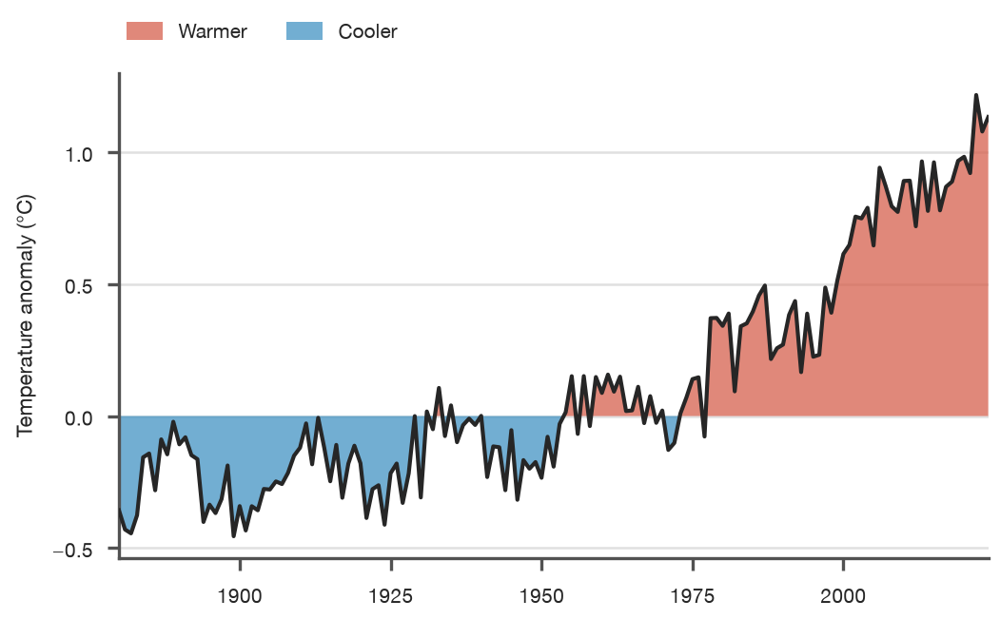
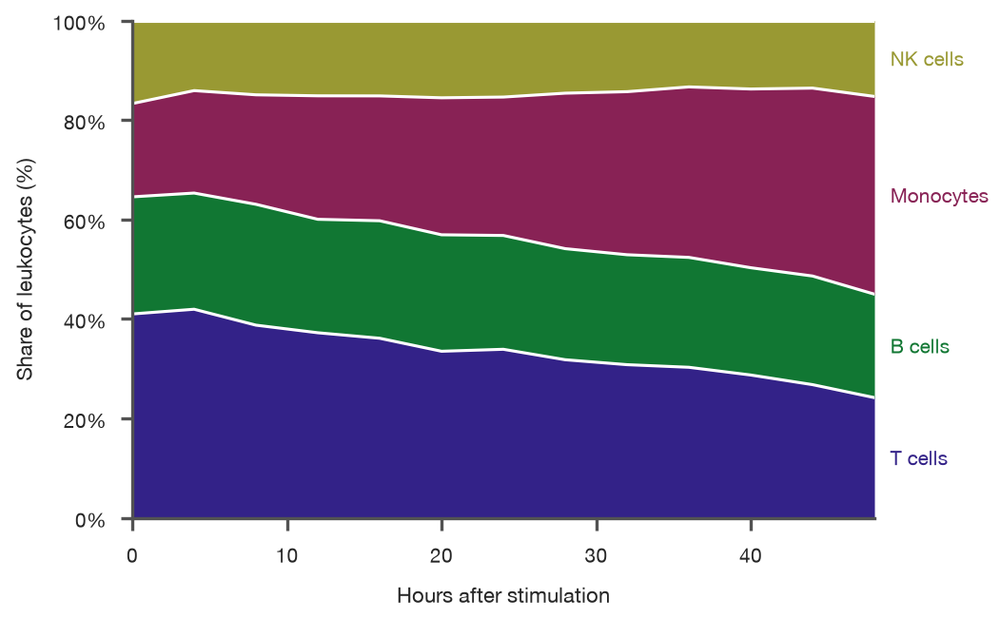
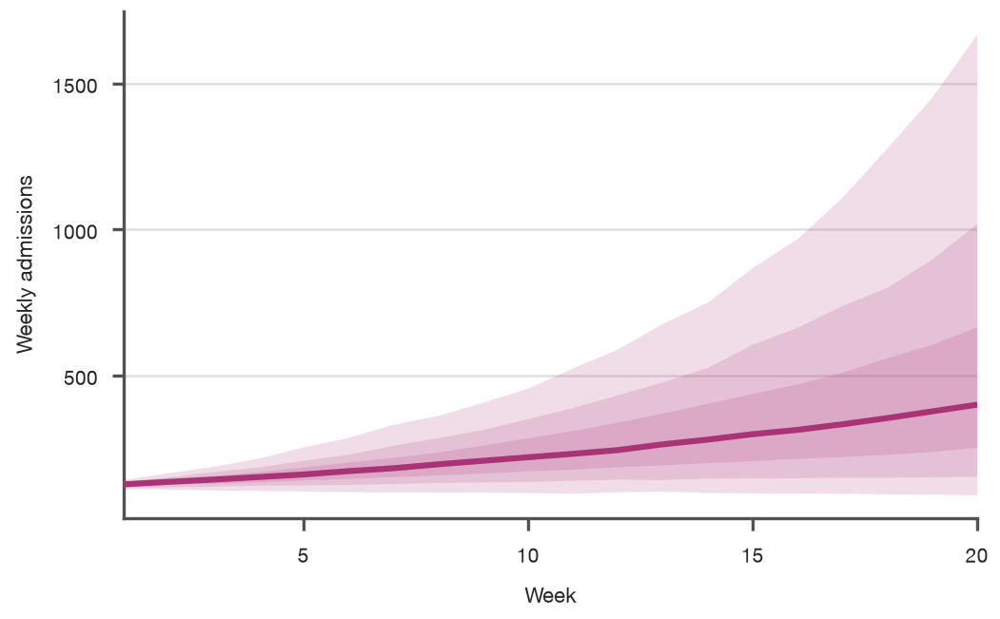

# Gallery

<p class="lead">Figures you could drop into a manuscript today. Every image below is
produced by the code beneath it, sized for a Nature single column (89 mm) and
exported with embedded fonts. Click a thumbnail to jump to the code.</p>

<div class="sp-mosaic" markdown>

[<span>Dose response<small>box · points · Holm-corrected tests</small></span>](#dose-response)
[<span>Tumour growth<small>individual units · 95% CI · end labels</small></span>](#tumour-growth)
[<span>Volcano plot<small>scatter · thresholds · highlight</small></span>](#volcano-plot)
[<span>Expression heatmap<small>z-score · groups · tracks · clustering</small></span>](#expression-heatmap)
[<span>Subgroup analysis<small>forest · table · interaction p-values</small></span>](#subgroup-analysis)
[<span>Overall survival<small>Kaplan-Meier · risk table · log-rank</small></span>](#overall-survival)
[<span>Correlation matrix<small>masked triangle · values · diverging map</small></span>](#correlation-matrix)
[<span>Raincloud<small>density · box · raw data · stars</small></span>](#raincloud)
[<span>Split violins<small>genotype × sex · quartiles</small></span>](#split-violins)
[<span>qPCR fold change<small>grouped bars · SD · reference line</small></span>](#qpcr-fold-change)
[<span>Pharmacokinetics<small>log axis · error bars · markers</small></span>](#pharmacokinetics)
[<span>Regression<small>per-group fits · equation · R²</small></span>](#regression)
[<span>Biomarker distribution<small>density · KDE · sample size</small></span>](#biomarker-distribution)
[<span>Temperature anomaly<small>fill between · split by sign</small></span>](#temperature-anomaly)
[<span>Cell composition<small>100% stacked area · end labels</small></span>](#cell-composition)
[<span>Forecast fan chart<small>nested 50/80/95% intervals</small></span>](#forecast-fan-chart)

</div>

!!! note "Synthetic data, real output"
    All datasets are simulated with a fixed random seed so every figure is
    reproducible. Nothing on this page is retouched: the images are the
    library's output, regenerated each time the documentation is built.

## Dose response

Cell viability after 48 h of drug exposure. Every well is visible, the box
summarises it, and `.compare()` runs Mann–Whitney tests against the vehicle with a
Holm correction. A light-to-dark ramp encodes the dose without needing a legend.

{ .narrow }

??? example "Show code"

    ```python
    import numpy as np
    import pandas as pd
    import SecretPlots as sp

    sp.use(preset="nature")
    rng = np.random.default_rng(7)

    doses = ["Vehicle", "1 µM", "5 µM", "10 µM"]
    viability = pd.DataFrame({
        "dose": np.repeat(doses, 12),
        "viability": np.concatenate(
            [rng.normal(mean, 7, 12) for mean in (100, 91, 70, 46)]
        ),
    })

    (
        sp.box(viability, x="dose", y="viability")
        .points()
        .compare(ref="Vehicle", correction="holm", format="stars")
        .colors(dict(zip(doses, ["#C6DBEF", "#6BAED6", "#2171B5", "#08306B"])))
        .labels(x="", y="Cell viability (% of vehicle)")
    )
    ```
    <!-- figure: gallery-dose-response.png -->

    Options used: [`.points()`](plots/box.md), [`.compare()`](plots/box.md),
    [`.colors()`](options.md).

## Tumour growth

Tumour volume of eight mice per arm on a log scale. Thin lines are individual
animals (`units=`), the band is the 95% confidence interval of the mean, and
end labels replace the legend.

{ .narrow }

??? example "Show code"

    ```python
    import numpy as np
    import pandas as pd
    import SecretPlots as sp

    sp.use(preset="nature")
    rng = np.random.default_rng(11)

    days = np.arange(0, 22, 2)
    arms = {"Vehicle": 0.16, "Drug A": 0.11, "Drug A + B": 0.05}
    rows = []
    for arm, rate in arms.items():
        for mouse in range(8):
            volume = 90 * np.exp(rate * days) * rng.lognormal(0, 0.14, days.size)
            rows += [
                {"day": d, "volume": v, "arm": arm, "mouse": f"{arm}-{mouse}"}
                for d, v in zip(days, volume)
            ]
    tumours = pd.DataFrame(rows)

    (
        sp.line(tumours, x="day", y="volume", hue="arm", units="mouse", error="ci")
        .endlabels()
        .log("y")
        .colors(["#555555", "#E69F00", "#0072B2"])
        .labels(x="Days after implantation", y="Tumour volume (mm³)")
    )
    ```
    <!-- figure: gallery-tumour-growth.png -->

## Volcano plot

Differential expression of 2,000 genes. Grey points fall inside the
fold-change and significance thresholds; reference lines mark both cut-offs.

{ .narrow }

??? example "Show code"

    ```python
    import numpy as np
    import pandas as pd
    import SecretPlots as sp

    sp.use(preset="nature")
    rng = np.random.default_rng(3)

    n = 2000
    lfc = rng.normal(0, 1.1, n)
    log_p = np.abs(lfc) ** 1.6 * rng.gamma(2.2, 1.0, n) + rng.uniform(0, 0.3, n)
    genes = pd.DataFrame({"lfc": lfc, "log_p": log_p})
    significant = genes["log_p"] > 2
    genes["call"] = np.select(
        [significant & (genes["lfc"] > 1), significant & (genes["lfc"] < -1)],
        ["Up", "Down"],
        "Not significant",
    )

    (
        sp.scatter(genes, x="lfc", y="log_p", hue="call")
        .colors({"Up": "#C0392B", "Down": "#2471A3", "Not significant": "#C8C8C8"})
        .refline(-1, 1, axis="x", linestyle=":")
        .refline(2, axis="y", linestyle=":")
        .theme(marker_size=3, grid="none")
        .labels(x="log₂ fold change", y="−log₁₀ P")
    )
    ```
    <!-- figure: gallery-volcano.png -->

## Expression heatmap

Sixteen genes in four pathways after myocardial infarction (MI). Rows are
z-scored, clustered within each pathway, and annotated with a condition
track. Gene names are italic, as journals require.


??? example "Show code"

    ```python
    import numpy as np
    import pandas as pd
    import SecretPlots as sp

    sp.use(preset="nature")
    rng = np.random.default_rng(5)

    genes = ["GATA4", "NKX2-5", "TBX5", "HAND2", "MYH6", "MYL7", "TNNT2", "ACTC1",
             "CDK1", "MKI67", "TOP2A", "CCNB1", "COL1A1", "COL3A1", "POSTN", "FN1"]
    samples = [f"Sham {i}" for i in range(1, 5)] + [f"MI {i}" for i in range(1, 5)]
    values = rng.normal(5, 0.7, (16, 8))
    values[:8, 4:] -= 1.6     # cardiac programme down after MI
    values[8:12, 4:] += 1.2   # proliferation up
    values[12:, 4:] += 2.2    # fibrosis up
    expression = pd.DataFrame(values, index=pd.Index(genes, name="gene"), columns=samples)
    expression["pathway"] = (
        ["Cardiac TF"] * 4 + ["Sarcomere"] * 4 + ["Cell cycle"] * 4 + ["Fibrosis"] * 4
    )

    (
        sp.heatmap(expression)
        .scale("row")
        .groups(rows="pathway")
        .cluster(cols=False)
        .tracks(cols={"Condition": ["Sham"] * 4 + ["MI"] * 4})
        .cmap("tol_sunset", center=0)
        .colorbar("Row z-score")
        .ticklabels(italic=True)
    )
    ```
    <!-- figure: gallery-expression-heatmap.png -->

## Subgroup analysis

Hazard ratios for the primary end point of a cardiovascular trial, overall and
in prespecified subgroups. Events per arm and the "HR (95% CI)" column sit in the
table, the P for interaction on each section header, and the overall estimate
is a diamond. Shaded rows guide the eye across the double-column width.


??? example "Show code"

    ```python
    import pandas as pd
    import SecretPlots as sp

    sp.use(preset="nature")

    trial = pd.DataFrame({
        "variable": [None, "Age", "Age", "Sex", "Sex", "Diabetes", "Diabetes",
                     "eGFR", "eGFR"],
        "subgroup": ["All patients", "<65 yr", "≥65 yr", "Male", "Female",
                     "Yes", "No", "<60 mL/min", "≥60 mL/min"],
        "drug": ["386/2373", "201/1271", "185/1102", "307/1809", "79/564",
                 "215/1075", "171/1298", "191/962", "195/1411"],
        "placebo": ["502/2371", "259/1242", "243/1129", "406/1826", "96/545",
                    "271/1064", "231/1307", "254/964", "248/1407"],
        "hr": [0.74, 0.76, 0.72, 0.73, 0.79, 0.75, 0.73, 0.71, 0.77],
        "lower": [0.65, 0.63, 0.60, 0.63, 0.59, 0.63, 0.60, 0.59, 0.64],
        "upper": [0.85, 0.92, 0.87, 0.85, 1.06, 0.90, 0.88, 0.86, 0.93],
    })

    (
        sp.forest(trial, label="subgroup", estimate="hr", lower="lower",
                  upper="upper", group="variable")
        .summary("All patients")
        .table(left={"Drug\nn/N": "drug", "Placebo\nn/N": "placebo"},
               right={"P for interaction": {"Age": 0.76, "Sex": 0.52,
                                            "Diabetes": 0.89, "eGFR": 0.54}},
               formats={"P for interaction": "p"})
        .favours("Drug better", "Placebo better")
        .stripes()
        .colors("#0072B2")
        .labels(x="Hazard ratio")
        .preset("nature", width="double")
    )
    ```
    <!-- figure: gallery-forest.png -->

    Options used: [`group=`, `.table()`, `.summary()`, `.favours()`](plots/forest.md).

## Overall survival

Overall survival in a two-arm trial, followed for up to four years. A tick
marks each censored patient, the table below counts who is still at risk, and
the log-rank p-value and Cox hazard ratio are computed from the data and
written on the plot. Dotted guides mark the median survival of each arm.

{ .narrow }

??? example "Show code"

    ```python
    import numpy as np
    import pandas as pd
    import SecretPlots as sp

    sp.use(preset="nature")
    rng = np.random.default_rng(1)

    n = 300
    arm = rng.choice(["Placebo", "Drug"], n)
    event_time = rng.exponential(np.where(arm == "Drug", 30, 18))
    censor_time = rng.uniform(6, 48, n)
    trial = pd.DataFrame({
        "months": np.minimum(event_time, censor_time).round(1),
        "died": event_time <= censor_time,
        "arm": arm,
    })

    (
        sp.survival(trial, time="months", event="died", hue="arm",
                    hue_order=["Placebo", "Drug"])
        .risk_table()
        .median()
        .pvalue()
        .hazard_ratio()
        .colors({"Placebo": "#BBBBBB", "Drug": "#0072B2"})
        .labels(x="Months since randomisation", y="Overall survival")
    )
    ```
    <!-- figure: gallery-survival.png -->

    Options used: [`.risk_table()`, `.median()`, `.pvalue()`, `.hazard_ratio()`](plots/survival.md).

## Correlation matrix

Pairwise Pearson correlations between clinical variables. The redundant upper
triangle is masked and the diverging colormap is centred on zero.

{ .narrow }

??? example "Show code"

    ```python
    import numpy as np
    import pandas as pd
    import SecretPlots as sp

    sp.use(preset="nature")
    rng = np.random.default_rng(21)

    variables = ["Age", "BMI", "SBP", "LDL", "HbA1c", "CRP", "eGFR"]
    latent = rng.normal(size=(7, 3))
    covariance = latent @ latent.T + np.eye(7)
    cohort = pd.DataFrame(
        rng.multivariate_normal(np.zeros(7), covariance, 300), columns=variables
    )

    (
        sp.heatmap(cohort.corr(), square=True)
        .mask("upper")
        .cmap("tol_bu_rd", center=0, vmin=-1, vmax=1)
        .values(".2f")
        .colorbar("Pearson r")
    )
    ```
    <!-- figure: gallery-correlation.png -->

## Raincloud

Reaction times in a Stroop task. The raincloud combines a half-violin, a box
and the raw trials, the honest way to show skewed data.

{ .narrow }

??? example "Show code"

    ```python
    import numpy as np
    import pandas as pd
    import SecretPlots as sp

    sp.use(preset="nature")
    rng = np.random.default_rng(42)

    conditions = ["Congruent", "Neutral", "Incongruent"]
    stroop = pd.DataFrame({
        "condition": np.repeat(conditions, 60),
        "rt": np.concatenate(
            [rng.lognormal(np.log(mu), 0.18, 60) for mu in (480, 515, 610)]
        ),
    })

    (
        sp.raincloud(stroop, x="condition", y="rt")
        .compare(ref="Congruent", format="stars")
        .colors(dict(zip(conditions, ["#44AA99", "#DDCC77", "#CC6677"])))
        .labels(x="Reaction time (ms)", y="")  # horizontal: values run along x
    )
    ```
    <!-- figure: gallery-raincloud.png -->

## Split violins

A behavioural score by genotype, with females and males sharing each violin.
Dashed lines mark the quartiles.

{ .narrow }

??? example "Show code"

    ```python
    import numpy as np
    import pandas as pd
    import SecretPlots as sp

    sp.use(preset="nature")
    rng = np.random.default_rng(8)

    behaviour = pd.DataFrame({
        "genotype": np.tile(np.repeat(["WT", "Het", "KO"], 40), 2),
        "sex": np.repeat(["Female", "Male"], 120),
    })
    effect = behaviour["genotype"].map({"WT": 0, "Het": 0.6, "KO": 1.6})
    behaviour["score"] = rng.normal(0, 1, 240) + effect + 0.5 * (behaviour["sex"] == "Male")

    (
        sp.violin(behaviour, x="genotype", y="score", hue="sex", split=True, inner="quartiles")
        .colors(["#CC79A7", "#009E73"])
        .labels(x="", y="Anxiety score (z)")
    )
    ```
    <!-- figure: gallery-split-violin.png -->

## qPCR fold change

Relative expression of four cytokines in wild-type and knockout macrophages
(mean ± SD, n = 6). The reference line at 1 marks no change.

{ .narrow }

??? example "Show code"

    ```python
    import numpy as np
    import pandas as pd
    import SecretPlots as sp

    sp.use(preset="nature")
    rng = np.random.default_rng(13)

    induction = {"Il6": 6.0, "Tnf": 4.0, "Il1b": 3.0, "Cxcl10": 8.0}
    qpcr = pd.DataFrame(
        [
            {"gene": gene, "genotype": genotype,
             "fold": fold * (0.4 if genotype == "KO" else 1) * rng.lognormal(0, 0.18)}
            for gene, fold in induction.items()
            for genotype in ("WT", "KO")
            for _ in range(6)
        ]
    )

    (
        sp.bar(qpcr, x="gene", y="fold", hue="genotype", error="sd")
        .refline(1, linestyle=":")
        .colors(["#4D4D4D", "#E69F00"])
        .ticklabels(italic=True)
        .labels(x="", y="Relative expression (2^−ΔΔCt)")
    )
    ```
    <!-- figure: gallery-qpcr.png -->

## Pharmacokinetics

Plasma concentration after a single oral dose at two dose levels (mean ± SD,
n = 10), on a log axis where first-order elimination is a straight line.

{ .narrow }

??? example "Show code"

    ```python
    import numpy as np
    import pandas as pd
    import SecretPlots as sp

    sp.use(preset="nature")
    rng = np.random.default_rng(17)

    hours = np.array([0.25, 0.5, 1, 2, 4, 6, 8, 12, 24])
    rows = []
    for dose, scale in (("10 mg kg⁻¹", 1.0), ("30 mg kg⁻¹", 3.0)):
        for subject in range(10):
            ka, ke = rng.normal(1.6, 0.2), rng.normal(0.18, 0.02)
            conc = scale * 900 * ka / (ka - ke) * (np.exp(-ke * hours) - np.exp(-ka * hours))
            rows += [{"hours": h, "conc": c * rng.lognormal(0, 0.12), "dose": dose}
                     for h, c in zip(hours, conc)]
    pk = pd.DataFrame(rows)

    (
        sp.line(pk, x="hours", y="conc", hue="dose", error="sd")
        .errorbars("bars")
        .markers()
        .log("y")
        .colors(["#56B4E9", "#0072B2"])
        .labels(x="Time after dose (h)", y="Plasma concentration (ng mL⁻¹)")
    )
    ```
    <!-- figure: gallery-pharmacokinetics.png -->

## Regression

Hepatic and muscle lipid content against BMI with one least-squares fit per
tissue, its 95% confidence band, and the fitted equation with R².

{ .narrow }

??? example "Show code"

    ```python
    import numpy as np
    import pandas as pd
    import SecretPlots as sp

    sp.use(preset="nature")
    rng = np.random.default_rng(29)

    biopsies = pd.DataFrame({
        "bmi": rng.uniform(19, 36, 140),
        "tissue": rng.choice(["Liver", "Muscle"], 140),
    })
    offset = np.where(biopsies["tissue"] == "Liver", 6, 0)
    slope = np.where(biopsies["tissue"] == "Liver", 0.82, 0.45)
    biopsies["lipid"] = slope * biopsies["bmi"] + offset + rng.normal(0, 2.2, 140)

    (
        sp.scatter(biopsies, x="bmi", y="lipid", hue="tissue")
        .fit("linear", stats=True)
        .colors(["#AA3377", "#4477AA"])
        .labels(x="BMI (kg m⁻²)", y="Lipid content (mg g⁻¹)")
    )
    ```
    <!-- figure: gallery-regression.png -->

## Biomarker distribution

Serum biomarker levels in healthy donors and patients, normalised to
densities so cohorts of different sizes compare fairly. Group sizes are added to
the legend automatically.

{ .narrow }

??? example "Show code"

    ```python
    import numpy as np
    import pandas as pd
    import SecretPlots as sp

    sp.use(preset="nature")
    rng = np.random.default_rng(31)

    serum = pd.DataFrame({
        "cohort": np.repeat(["Healthy", "Patients"], [400, 250]),
        "level": np.concatenate([rng.normal(1.2, 0.25, 400), rng.normal(1.75, 0.32, 250)]),
    })

    (
        sp.histogram(serum, x="level", hue="cohort", stat="density")
        .kde()
        .show_n()
        .colors(["#56B4E9", "#D55E00"])
        .labels(x="Serum IL-6 (log₁₀ pg mL⁻¹)", y="Density")
    )
    ```
    <!-- figure: gallery-biomarker.png -->

## Temperature anomaly

Annual global temperature anomaly relative to a 1951–1980 baseline. `.split()`
colours the area by sign, so warm and cool years read at a glance.

{ .narrow }

??? example "Show code"

    ```python
    import numpy as np
    import pandas as pd
    import SecretPlots as sp

    sp.use(preset="nature")
    rng = np.random.default_rng(1880)

    years = np.arange(1880, 2025)
    trend = -0.25 + 1.45 * ((years - 1880) / 144) ** 3
    climate = pd.DataFrame({
        "year": years,
        "anomaly": trend + 0.12 * np.sin(years / 3.7) + rng.normal(0, 0.09, years.size),
    })

    (
        sp.fill_between(climate, x="year", y1="anomaly", y2=0)
        .split(colors=("#D6604D", "#4393C3"), labels=("Warmer", "Cooler"))
        .labels(x="", y="Temperature anomaly (°C)")
    )
    ```
    <!-- figure: gallery-temperature.png -->

## Cell composition

Share of immune cell types in blood after stimulation. A 100% stacked area
keeps the total fixed so shifts in composition are easy to follow.

{ .narrow }

??? example "Show code"

    ```python
    import numpy as np
    import pandas as pd
    import SecretPlots as sp

    sp.use(preset="nature")
    rng = np.random.default_rng(48)

    hours = np.arange(0, 49, 4)
    cell_types = {"T cells": (42, -0.35), "B cells": (24, -0.05),
                  "Monocytes": (19, 0.42), "NK cells": (15, -0.02)}
    blood = pd.DataFrame(
        [
            {"hours": h, "cell_type": name,
             "cells": max(1.0, base + slope * h + rng.normal(0, 0.8))}
            for name, (base, slope) in cell_types.items()
            for h in hours
        ]
    )

    (
        sp.area(blood, x="hours", y="cells", hue="cell_type", stack="percent")
        .endlabels()
        .colors(["#332288", "#117733", "#882255", "#999933"])
        .labels(x="Hours after stimulation", y="Share of leukocytes (%)")
    )
    ```
    <!-- figure: gallery-composition.png -->

## Forecast fan chart

Nested 50%, 80% and 95% intervals from 500 simulated trajectories of weekly
hospital admissions. Darker bands are more likely.

{ .narrow }

??? example "Show code"

    ```python
    import numpy as np
    import pandas as pd
    import SecretPlots as sp

    sp.use(preset="nature")
    rng = np.random.default_rng(2024)

    weeks = np.arange(1, 21)
    growth = rng.normal(0.06, 0.035, (500, 1))
    paths = 120 * np.exp(np.cumsum(growth + rng.normal(0, 0.05, (500, 20)), axis=1))
    simulations = pd.DataFrame({
        "week": np.tile(weeks, 500),
        "admissions": paths.ravel(),
    })

    (
        sp.line(simulations, x="week", y="admissions", error="pi", estimator="median")
        .errorbars(level=(0.5, 0.8, 0.95))
        .colors("#AA3377")
        .labels(x="Week", y="Weekly admissions")
    )
    ```
    <!-- figure: gallery-forecast.png -->

## Want more?

Each plot type has a guide with every option illustrated:
[bar](plots/bar.md) · [scatter](plots/scatter.md) · [line](plots/line.md) ·
[area](plots/area.md) · [histogram](plots/histogram.md) ·
[heatmap](plots/heatmap.md) · [forest](plots/forest.md) ·
[survival](plots/survival.md) · [box](plots/box.md) ·
[violin & raincloud](plots/violin.md). To prepare a figure for a specific
journal, read [journal-ready figures](publication.md).
