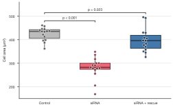

---
hide:
  - navigation
  - toc
---

<div class="sp-hero" markdown>

<p class="eyebrow">Python · matplotlib · journal presets</p>

<h1>Figures that are <span class="accent">ready for the paper</span>.</h1>

SecretPlots turns a pandas table into a publication-ready figure in a few
readable lines. It sizes figures to journal columns, keeps text inside the
journal's font limits, embeds the fonts, and adds the statistics reviewers ask
for.

[Make your first figure](quickstart.md){ .md-button .md-button--primary }
[Browse the gallery](gallery.md){ .md-button }

`pip install SecretPlots`

</div>

<div class="sp-banner" markdown>


</div>

## From table to Nature figure

<div class="grid" markdown>

```python
import numpy as np
import pandas as pd
import SecretPlots as sp

sp.use(preset="nature")   # 89 mm, 5–7 pt, fonts embedded

rng = np.random.default_rng(1)
cells = pd.DataFrame({
    "treatment": np.repeat(["Control", "siRNA", "siRNA + rescue"], 15),
    "area": np.concatenate([rng.normal(m, 45, 15) for m in (420, 290, 400)]),
})

(
    sp.box(cells, x="treatment", y="area")
    .points()
    .compare(ref="Control", correction="holm")
    .colors({"Control": "#BBBBBB", "siRNA": "#EE6677",
             "siRNA + rescue": "#4477AA"})
    .labels(x="", y="Cell area (µm²)")
)
```
<!-- figure: home-example -->



</div>

Then call `.save("figure1.pdf")`. The file is 89 mm wide with TrueType fonts
embedded, the format Nature's production team asks for.

## Why SecretPlots?

<div class="grid cards" markdown>

-   :material-ruler-square-compass:{ .lg } **Journal presets**

    ---

    Nature, Science, Cell, PNAS, IEEE, Springer, Elsevier and more: column
    widths, font limits, dpi and formats from the publishers' guidelines.

    [:octicons-arrow-right-24: Journal-ready figures](publication.md)

-   :material-sigma:{ .lg } **Statistics built in**

    ---

    Significance brackets with Holm or Bonferroni correction, confidence
    bands, linear fits with R², KDEs and clustering, with the numbers
    available as tables.

    [:octicons-arrow-right-24: Box plots](plots/box.md)

-   :material-dots-hexagon:{ .lg } **Show every observation**

    ---

    Points over boxes, individual trajectories under means, rainclouds and
    rug plots: the patterns reviewers expect for small samples.

    [:octicons-arrow-right-24: Violin & raincloud](plots/violin.md)

-   :material-palette-swatch-variant:{ .lg } **Colour-blind safe**

    ---

    Palettes and colormaps from [SecretColors](https://github.com/secretBiology/SecretColors),
    with unsafe maps flagged and a greyscale `print-bw` theme.

    [:octicons-arrow-right-24: Presets & themes](presets.md)

-   :material-magnify-scan:{ .lg } **Discoverable**

    ---

    `plot.options()` lists every step you can chain;
    `plot.options("legend")` explains one. No need to search the web.

    [:octicons-arrow-right-24: Find any option](options.md)

-   :material-shield-check-outline:{ .lg } **Honest by default**

    ---

    Missing data raises instead of being silently dropped. Font and colour
    fallbacks are reported, and `plot.explain()` says where each style came from.

    [:octicons-arrow-right-24: Data handling](usage.md)

</div>

## Gallery

<div class="sp-mosaic" markdown>

[<span>Dose response<small>box · points · stats</small></span>](gallery.md#dose-response)
[<span>Expression heatmap<small>groups · tracks · clusters</small></span>](gallery.md#expression-heatmap)
[<span>Tumour growth<small>units · 95% CI</small></span>](gallery.md#tumour-growth)
[<span>Volcano plot<small>thresholds · highlight</small></span>](gallery.md#volcano-plot)
[<span>Raincloud<small>density · box · raw data</small></span>](gallery.md#raincloud)
[<span>Correlation matrix<small>masked · annotated</small></span>](gallery.md#correlation-matrix)
[<span>Pharmacokinetics<small>log axis · error bars</small></span>](gallery.md#pharmacokinetics)
[<span>Split violins<small>two factors · quartiles</small></span>](gallery.md#split-violins)

</div>

[See all 14 examples with code :octicons-arrow-right-24:](gallery.md){ .md-button }

## Choose a plot

| Your question | Plot | Highlights |
| --- | --- | --- |
| How do groups compare? | [Box](plots/box.md) · [Violin / raincloud](plots/violin.md) | `.points()`, `.compare()`, `.show_n()`, `split=True` |
| What are the means and errors? | [Bar](plots/bar.md) | `error="sd"`, `hue=`, `stack=`, `.values()` |
| How are two variables related? | [Scatter](plots/scatter.md) | `hue=`, `size=`, `.fit("linear", stats=True)` |
| How does a response change over time? | [Line](plots/line.md) | `error="ci"`, `units=`, `.errorbars()`, `.endlabels()` |
| How do parts of a whole evolve? | [Area / fill between](plots/area.md) | `stack="percent"`, `.split()`, `.gradient()` |
| What does a distribution look like? | [Histogram](plots/histogram.md) | `stat="density"`, `.kde()`, `.rug()`, `cumulative=` |
| Where are the patterns in a matrix? | [Heatmap](plots/heatmap.md) | `.scale("row")`, `.cluster()`, `.groups()`, `.tracks()` |
