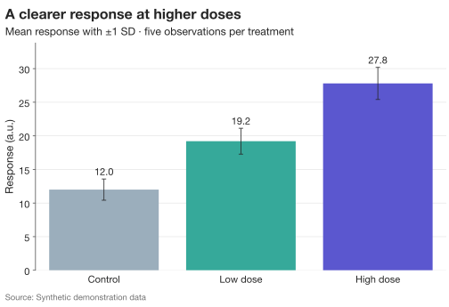

# SecretPlots

<div class="hero" markdown>

<p class="eyebrow">Python · Scientific figures · Visual storytelling</p>

## Let the data make an impression.

Turn a table into a thoughtful figure with a few readable steps. Explore
uncertainty, show individual observations, and shape the result for a paper,
a presentation, or the web.

[Make your first figure](quickstart.md){ .md-button .md-button--primary }
[Explore the gallery](gallery.md){ .md-button }

</div>



*Real SecretPlots output, generated from the [quickstart example](quickstart.md).
All datasets in the visual guides are synthetic.*

## A small API with room to explore

```python
import SecretPlots as sp

plot = (
    sp.bar({"Control": 12, "Low dose": 19, "High dose": 28})
    .colors({
        "Control": "#9baebc",
        "Low dose": "#36a99a",
        "High dose": "#5b57cf",
    })
    .values(".0f")
    .labels(y="Response (a.u.)")
)
plot.save("response.svg")
```

!!! tip "Don't memorize options—ask the plot"
    `plot.options()` lists the steps you can chain.
    `plot.options("legend")` shows one step's parameters, allowed values, and defaults.
    `sp.BarPlot.options("values")` works without data.
    `sp.theme_options()` lists visual style fields.
    Follow the **[option discovery guide](options.md)** to search all of these tables.

<div class="grid cards" markdown>

-   **Start with a working example**

    ---

    Install, create, label, style, and export a complete figure.

    [Your first figure →](quickstart.md)

-   **Choose by what you want to show**

    ---

    Compare categories, follow a trend, or explore a distribution.

    [Visual gallery →](gallery.md)

-   **Find the setting you need**

    ---

    Search methods, inspect sub-options, and explain resolved styles.

    [Find any option →](options.md)

-   **Design for your destination**

    ---

    Reuse the same data with journal, screen, and presentation presets.

    [Presets and themes →](presets.md)

</div>

## Choose a plot

| Your question | Start here | Useful options |
| --- | --- | --- |
| How do categories compare? | [Bar](plots/bar.md) | `error`, `orient`, `.values()`, `.highlight()` |
| How are two variables related? | [Scatter](plots/scatter.md) | `hue`, `size`, `style`, `.fit()` |
| How does a response change? | [Line](plots/line.md) | `error`, `units`, `.errorbars()`, `.endlabels()` |
| How does a total or interval evolve? | [Area / fill between](plots/area.md) | `stack`, `.split()`, `.gradient()` |
| What is the shape of one distribution? | [Histogram](plots/histogram.md) | `bins`, `stat`, `.kde()`, `.rug()` |
| Where are the patterns in a matrix? | [Heatmap](plots/heatmap.md) | `.scale()`, `.cmap()`, `.cluster()`, `.values()` |
| How do medians and spreads compare? | [Box](plots/box.md) | `.points()`, `.mean()`, `.show_n()` |
| How do whole distributions compare? | [Violin / raincloud](plots/violin.md) | `inner`, `split`, `bw_adjust`, `.points()` |

## From exploration to a finished figure

The [plot guides](gallery.md) pair runnable code with rendered figures and option
tables. [Data and workflow](usage.md) covers missing values, independent copies,
axis formatting, and Matplotlib integration. The [API reference](api.md) provides
signatures and detailed method documentation.
