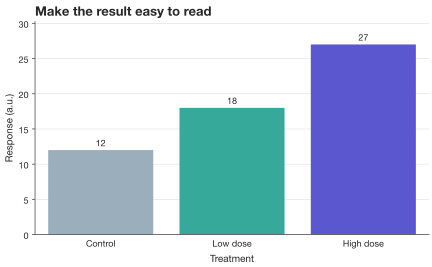
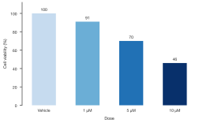

# Find any option from Python

**Start with a plot, list its steps, then drill into one step.** You do not need
to memorize the API or leave your notebook to discover what is available.

!!! tip "The spelling to remember"
    With `import SecretPlots as sp`, there are three tables to remember:

    - **`sp.BarPlot.arguments()`**: what you pass to `sp.bar(...)`
    - **`sp.BarPlot.options()`**: the steps you chain afterwards
    - **`sp.theme_options()`**: the style fields accepted by `.theme(...)`

    `arguments()` and `options()` also work on a plot (`plot.options("legend")`).
    There is no module-level `sp.options()`.

## 1. List the steps you can chain

```python
import SecretPlots as sp

sp.use(preset="nature")
plot = sp.bar({"Vehicle": 100, "1 µM": 91, "5 µM": 70, "10 µM": 46})
steps = plot.options()
steps
```

The result is a pandas DataFrame indexed by `verb`, with `options` and
`description` columns. In a notebook, the final expression displays a table.
In a terminal or script, use `print(steps.to_string())` to see every row.

You can explore without constructing data:

```python
sp.BarPlot.options()
sp.LinePlot.options()
sp.HeatmapPlot.options()
```

Each class includes its own steps and the shared ones. For example, line plots
have `errorbars` and `endlabels`; heatmaps have `cmap`, `cluster`, and `colorbar`.
`sp.Plot.options()` lists the shared steps alone.

## 2. Drill into a step's options

Pass the method name **without a dot or parentheses**:

```python
plot.options("legend")
```

The resulting table is indexed by `option` and contains:

| Column | What it tells you |
| --- | --- |
| `allowed` | Declared types or literal choices, such as `"top"`, `"right"`, or `"inside"`. |
| `default` | The parameter's default; `required` means you must provide it. |
| `description` | What that parameter controls. |

For example, the `legend` table describes `position`, `title`, `loc`, `anchor`,
`ncols`, and `fontsize`. Discover a setting, then apply it:

```python
plot.options("values")
plot.values(".0f").colors(
    {"Vehicle": "#C6DBEF", "1 µM": "#6BAED6", "5 µM": "#2171B5", "10 µM": "#08306B"}
).labels(x="Dose", y="Cell viability (%)")
```
<!-- figure: options-values -->



*`.values(".0f")` adds whole-number labels. `.colors(...)` assigns the palette;
`.labels(...)` names the axes and adds the title.*

Some parameters accept broad types such as `str`, callables, or `**kwargs`.
The table describes the declared API; it is not a complete validator for every
combination. Read the description, use `help(...)`, or follow the plot guide
for restrictions and examples.

## 3. Search instead of scrolling

Because these are pandas tables, you can filter them using familiar tools.
Search both method names and descriptions:

```python
steps = sp.LinePlot.options()
query = "error|interval|marker"
matches = (
    steps.index.to_series().str.contains(query, case=False, regex=True)
    | steps["description"].str.contains(query, case=False, regex=True, na=False)
)
steps.loc[matches]
```

Then inspect just the step you need:

```python
sp.LinePlot.options("errorbars")
sp.ScatterPlot.options("fit")
sp.BoxPlot.options("points")
sp.ViolinPlot.options("points")
sp.HeatmapPlot.options("colorbar")
```

A misspelled step raises a `ValueError` listing available steps, with a spelling
suggestion when one is found.

## 4. Find constructor arguments

`options()` describes the **chainable steps**. The arguments you pass when you
create the plot, such as `hue=`, `error=`, `bins=`, `stack=` and `missing=`,
are listed by **`arguments()`**, in the same table format:

```python
sp.BarPlot.arguments()
```

The table is indexed by `option` and has the same `allowed`, `default` and
`description` columns as a step's table. Pass a name to see one argument, on
the class or on a plot you have already made:

```python
sp.HistogramPlot.arguments("bins")
plot.arguments("error")
```

A misspelled argument raises a `ValueError` with a suggestion. `sp.area()` and
`sp.fill_between()` both make a `FillBetweenPlot`;
`sp.FillBetweenPlot.arguments()` describes `sp.fill_between()`, the more
general of the two.

The [plot guides](gallery.md) place constructor signatures, allowed choices,
and rendered examples together.

## 5. Search theme fields, palettes, and presets

```python
fields = sp.theme_options()
fields.loc[fields.index.str.contains("font|grid|marker", case=False)]
```

Theme tables use `value` for the selected theme's value, alongside `allowed`
and `description`. The default table describes the built-in `secret` theme;
it does not report the resolved style of your current plot.

```python
sp.theme_options("dark")
sp.list_themes()
sp.colormaps()
sp.presets.list()
sp.presets.list(kind="journal")
```

Look up individual fields directly:

```python
sp.theme_options().loc[["font_size", "grid", "palette", "marker_size"]]
```

Use these fields as keyword arguments to `.theme(...)`:

```python
plot.copy().theme(grid="none", bar_gap=0.45, spines=("left",))
```
<!-- figure: options-theme -->



*`grid="none"` removes the grid, `bar_gap=0.45` widens the gaps, and
`spines=("left",)` drops the bottom axis line. The underlying data are unchanged.*

## 6. Explain the style you actually see

```python
plot.explain("primary")
plot.style_report()
```

`explain()` traces one style field; `style_report()` reports resolved values,
their sources, and preset adjustments. These are useful when a preset or an
explicit plot override changes the theme's defaults. See [presets and themes](presets.md).

## Quick lookup

| I want to… | Run this |
| --- | --- |
| List shared steps | `sp.Plot.options()` |
| Discover methods on my plot | `plot.options()` |
| Inspect one method | `plot.options("legend")` |
| Explore a plot type without data | `sp.ScatterPlot.options("fit")` |
| Find constructor arguments | `sp.ScatterPlot.arguments()` |
| Inspect one constructor argument | `sp.ScatterPlot.arguments("hue")` |
| Find style keywords | `sp.theme_options()` |
| Browse named themes | `sp.list_themes()` |
| Browse colormaps | `sp.colormaps()` |
| Find journal presets | `sp.presets.list(kind="journal")` |
| Check a preset's widths | `sp.presets.get("nature").target.widths` |
| Explain an unexpected style | `plot.explain("font_size")` |
