# Area plots and fill between

`sp.fill_between()` fills the area between two edges along x, `y1` and `y2`.
When `y2` is a number (0 by default) the result is an area chart; when it is a
column, a band. `sp.area()` is the same plot with `y=` and `baseline=`. Use
areas for magnitudes read against a baseline (an anomaly, an exposure, a
total), bands for ranges and intervals, and stacked areas for how a whole
splits into parts over time.

The examples on this page run top to bottom like notebook cells. This first
block builds the datasets (all data on this page are synthetic) and selects
the Nature preset:

```python
import numpy as np
import pandas as pd
import SecretPlots as sp

sp.use(preset="nature")
rng = np.random.default_rng(21)

# Global mean surface temperature anomaly relative to 1951–1980 (°C).
year = np.arange(1880, 2025)
trend = np.interp(year, [1880, 1910, 1940, 1950, 1975, 2000, 2024],
                  [-0.20, -0.40, 0.05, -0.05, 0.00, 0.40, 1.15])
temperature = pd.DataFrame({"year": year, "anomaly": trend + rng.normal(0, 0.09, year.size)})

# Electricity generation by source (TWh), one column per source.
t = np.arange(2000, 2025) - 2000
energy = pd.DataFrame({
    "year": t + 2000,
    "Coal": 420 - 9 * t + rng.normal(0, 8, t.size),
    "Gas": 180 + 4 * t + rng.normal(0, 6, t.size),
    "Wind": 4 + 7.5 * t + rng.normal(0, 4, t.size).clip(0),
    "Solar": 0.5 * np.exp(0.2 * t),
})

# Immune cells in blood after vaccination (cells µL⁻¹), long form.
days = np.arange(0, 29, 2)
cells = {
    "CD4⁺ T": 700 + 250 * np.exp(-((days - 14) / 6) ** 2),
    "CD8⁺ T": 400 + 350 * np.exp(-((days - 10) / 4) ** 2),
    "B cells": 250 + 300 * np.exp(-((days - 7) / 3) ** 2),
    "NK cells": 200 + 120 * np.exp(-((days - 3) / 2) ** 2),
    "Monocytes": 450 + 200 * np.exp(-((days - 2) / 2) ** 2),
}
immune = pd.DataFrame([
    {"day": d, "cell_type": name, "count": v * rng.lognormal(0, 0.05)}
    for name, values in cells.items()
    for d, v in zip(days, values)
])
```

The classic area chart in climate science: one series, colored by whether it
lies above or below the reference period. `.split()` changes color exactly
where the curve crosses zero.

```python
(
    sp.fill_between(temperature, x="year", y1="anomaly")
    .split(colors=("#D55E00", "#0072B2"), labels=("Warmer", "Cooler"))
    .lines("top", width=0.5)
    .refline(0)
    .labels(x="", y="Temperature anomaly (°C)")
    .size(width="double", height="60mm")
)
```
<!-- figure: area-hero -->

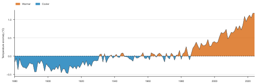{ .wide }

*Annual temperature anomaly relative to the 1951–1980 mean. A double-column
figure (183 mm) because the long time axis needs the width; `.lines("top",
width=0.5)` keeps the outline thin so 145 years of noise stay readable.*

## Contents

- [Signature](#signature)
- [Input data](#input-data)
- [Bands between two columns](#bands-between-two-columns)
- [Overlapping, stacked or percent](#overlapping-stacked-or-percent)
- [Composition over time](#composition-over-time)
- [Above and below: split by sign](#above-and-below-split-by-sign)
- [Gradients](#gradients)
- [Highlighting a layer](#highlighting-a-layer)
- [Labels, reference lines and source data](#labels-reference-lines-and-source-data)
- [Style fields](#style-fields)
- [Discovering options](#discovering-options)
- [Warnings and errors](#warnings-and-errors)

## Signature

```text
sp.fill_between(data=None, x=None, y1=None, y2=0, hue=None, *,
                stack=False, sort=True, order=None, hue_order=None,
                missing="raise") -> FillBetweenPlot

sp.area(data=None, x=None, y=None, hue=None, *,
        baseline=0, stack=False, sort=True, order=None, hue_order=None,
        missing="raise") -> FillBetweenPlot
```

| Argument | Meaning |
|---|---|
| `data` | Long DataFrame or dict of columns; a wide DataFrame (index or `x` column → x, one area per numeric column); a Series (index → x); a list/array of values. Can be left out when `x` and `y1` are sequences. |
| `x` | Column name or sequence: numbers, dates or categories. |
| `y1` (`y` in `area`) | The top (or first) edge. |
| `y2` | `fill_between` only: the other edge, a number (baseline, default 0), a column name or a sequence. With a column the plot is a band. |
| `baseline` | `area` only: the number the area fills down (or up) to, default 0. A column raises; use `fill_between` for bands. |
| `hue` | Column with groups: one area per group. |
| `stack` | `False` (default) overlaps the groups; `True` stacks them; `"percent"` scales every x to 100%. Needs a number as `y2`. |
| `sort` | `True` (default) connects points in x order; `False` keeps the data order. |
| `order`, `hue_order` | Order of category x values / of groups. |
| `missing` | `"raise"` (default), `"drop"` or `"gap"`; see [Input data](#input-data) and [data handling](../usage.md). |

### Chainable methods

| Method | What it does |
|---|---|
| `.lines(which="auto", *, width=None)` | Which edges get a line: `"auto"`, `"top"`, `"both"` or `"none"`, and their width in pt. |
| `.gradient(show=True)` | Fade each area from its `y1` edge (twice `fill_alpha`) to transparent at `y2`. Not for stacks. |
| `.split(show=True, *, colors=None, labels=None)` | Color where `y1` is above `y2` and where it is below; `(above, below)` colors and legend labels. Single area only. |
| `.endlabels(show=True, *, values=None, label=None, pad=4.0)` | Name each area at its right end (stacked layers at their middle) instead of a legend. |
| `.grouplabels(labels)` | Rename hue groups (list in group order or `{old: new}`). |
| `.ticklabels(*, rotation=None)` | Rotate x tick labels. |
| `.refline(*values, axis=None, label=False, color=None, linestyle="--", linewidth=None)` | Dashed reference lines; each call adds lines. |
| `.source_data()` | The plotted numbers; for stacks each layer's lower and upper edge. |

Shared with every plot: `.labels()`, `.legend()`, `.colors()`, `.highlight()`,
`.xlim()`, `.ylim()`, `.log()`, `.format_axis()`, `.chrome()`, `.size()`,
`.preset()`, `.theme()`, `.copy()`, `.save()`. See [usage](../usage.md) and
[presets](../presets.md).

## Input data

```python
sp.area(x=[0, 1, 2, 3, 4], y=[1, 3, 2, 5, 4])                 # sequences
```

```python
sp.area(immune, x="day", y="count", hue="cell_type")          # long form
```

```python
sp.area(energy, x="year")                                     # wide: one area per column
```

```python
sp.area(energy.set_index("year")["Solar"])                    # Series: index → x
```

```python
sp.area(energy, x="year", y="Coal", baseline=200)             # fill to another baseline
```

Each x appears once per area: summarize replicates first, or use
[`sp.line(..., error=...)`](line.md) to draw a summary with an error band.
Missing or infinite values raise an error by default. `missing="drop"` removes
affected rows; `missing="gap"` leaves a break in the filled area. For stacks,
every group needs a value at each x: `"drop"` removes incomplete x positions
from all layers and `"gap"` breaks all layers there. Missing values are never
silently replaced with zeros.

## Bands between two columns

With `y2` as a column the area becomes a band: a reference range, a min–max
envelope, or an interval you computed yourself. Here, the 3rd–97th centile
band of a growth reference chart. `.lines()` decides which edges are drawn:

```python
age = np.arange(0, 61)
median_height = 50 + 26 * (1 - np.exp(-age / 14)) + 0.22 * age
centiles = pd.DataFrame({
    "age": age,
    "p3": median_height * (1 - 0.075),
    "p97": median_height * (1 + 0.075),
})
```

=== "lines(\"auto\")"

    ```python
    (
        sp.fill_between(centiles, x="age", y1="p97", y2="p3")
        .colors(["#44AA99"])
        .labels(x="Age (months)", y="Height (cm)")
    )
    ```
    <!-- figure: area-band-auto -->

    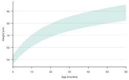

    *The default for bands: fill only, no edge lines.*

=== "lines(\"both\")"

    ```python
    (
        sp.fill_between(centiles, x="age", y1="p97", y2="p3")
        .lines("both", width=0.8)
        .colors(["#44AA99"])
        .labels(x="Age (months)", y="Height (cm)")
    )
    ```
    <!-- figure: area-band-both -->

    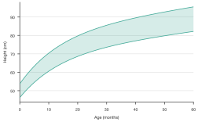

    *`"both"` outlines the 3rd and 97th centiles, so the limits can be read
    precisely.*

=== "lines(\"top\")"

    ```python
    (
        sp.fill_between(centiles, x="age", y1="p97", y2="p3")
        .lines("top", width=0.8)
        .colors(["#44AA99"])
        .labels(x="Age (months)", y="Height (cm)")
    )
    ```
    <!-- figure: area-band-top -->

    

    *`"top"` draws only the `y1` edge (the 97th centile).*

`"auto"` means: the top edge for areas, thin background-colored separators for
stacks, nothing for bands, and both edges for a band split by sign. `"none"`
removes every line.

!!! tip "A line with its confidence band"
    For a fitted curve or a mean with an interval, use
    [`sp.line(..., yerr=("minus", "plus"))`](line.md#your-own-error-values-and-log-axes):
    it draws the line and its band together in one plot. Use `fill_between`
    when the band itself is the message.

## Overlapping, stacked or percent

With `hue=` (or a wide table), each group gets its own area. `stack=` decides
how they combine. Overlapping areas compare absolute levels; a stack shows the
total and its parts; a percent stack shows only the shares.

=== "stack=False"

    ```python
    (
        sp.area(energy, x="year")
        .colors(["#332288", "#88CCEE", "#44AA99", "#DDCC77"])
        .legend(title="")
        .labels(x="", y="Electricity generation (TWh)")
    )
    ```
    <!-- figure: area-stack-none -->

    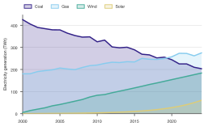

    *Overlapping areas are see-through (`fill_alpha`), each with its top edge
    in the group color. Best for two or three groups.*

=== "stack=True"

    ```python
    (
        sp.area(energy, x="year", stack=True)
        .endlabels()
        .colors(["#332288", "#88CCEE", "#44AA99", "#DDCC77"])
        .labels(x="", y="Electricity generation (TWh)")
    )
    ```
    <!-- figure: area-stack-true -->

    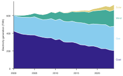

    *Stacked: the top edge is total generation. Thin background-colored lines
    separate the layers; end labels sit at the middle of each layer.*

=== "stack=\"percent\""

    ```python
    (
        sp.area(energy, x="year", stack="percent")
        .endlabels()
        .colors(["#332288", "#88CCEE", "#44AA99", "#DDCC77"])
        .labels(x="", y="Share of generation (%)")
    )
    ```
    <!-- figure: area-stack-percent -->

    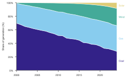

    *`stack="percent"` rescales every year to 100%: the shares change even
    where the total does not.*

The legend of a stack lists the top layer first, in reading order. Only the
bottom layer of a stack has a straight baseline, so judge the middle layers by
their thickness, not their position.

## Composition over time

A percent stack is the standard way to show the composition of a population
over a time course, such as cell types in blood, taxa in a microbiome, or
species in a survey. Direct labels at the layer centers replace the legend:

```python
(
    sp.area(immune, x="day", y="count", hue="cell_type", stack="percent")
    .endlabels()
    .colors(["#0072B2", "#56B4E9", "#009E73", "#E69F00", "#CC79A7"])
    .labels(x="Days after vaccination", y="Share of blood leukocytes (%)")
)
```
<!-- figure: area-composition -->

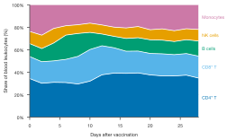

*Relative abundance of five leukocyte populations. Innate cells (monocytes, NK
cells) peak in the first days, B and T cells later.*

## Above and below: split by sign

`.split()` colors the part where `y1` is above `y2` differently from the part
where it is below, interpolating every crossing so the color changes exactly
where the lines meet. With a number as `y2` it splits by sign (the
[hero figure](#area-plots-and-fill-between)); with two columns it shades the
gap between two series. Both lines are drawn by default.

Excess mortality is the textbook case: observed deaths against the number
expected from previous years.

```python
weeks = pd.date_range("2019-01-07", periods=156, freq="W-MON")
season = 10500 + 1800 * np.cos(2 * np.pi * (weeks.dayofyear - 20) / 365.25)
waves = sum(
    height * np.exp(-0.5 * ((weeks - peak).days / width) ** 2)
    for peak, height, width in [(pd.Timestamp("2020-04-13"), 5200, 14),
                                (pd.Timestamp("2021-01-18"), 3800, 25)]
)
deaths = pd.DataFrame({
    "week": weeks,
    "expected": season,
    "observed": season + waves - 300 + rng.normal(0, 280, weeks.size),
})

(
    sp.fill_between(deaths, x="week", y1="observed", y2="expected")
    .split(colors=("#CC3311", "#BBBBBB"), labels=("Excess", "Below expected"))
    .format_axis("x", "date", date_format="%b %Y")
    .labels(x="", y="Deaths per week")
)
```
<!-- figure: area-split-two-columns -->

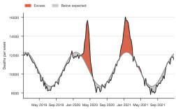

*Observed against expected weekly deaths. Red marks excess mortality; grey
de-emphasises weeks below expectation.*

Without `colors=` the theme's `positive` and `negative` colors are used.
`labels=` adds a legend; without it there is none. `.split(False)` returns to a
single color.

## Gradients

`.gradient()` fades each area from its `y1` edge to transparent at `y2`. It
draws attention to the curve and lightens a large filled area, for example
the area under a concentration-time curve (AUC):

```python
hours = np.linspace(0, 24, 241)
profile = pd.DataFrame({
    "hours": hours,
    "conc": 320 * 2.1 / (2.1 - 0.16) * (np.exp(-0.16 * hours) - np.exp(-2.1 * hours)),
})
```

=== "Even fill"

    ```python
    (
        sp.area(profile, x="hours", y="conc")
        .colors(["#AA3377"])
        .labels(x="Time after dose (h)", y="Plasma concentration (ng mL⁻¹)")
    )
    ```
    <!-- figure: area-fill-even -->

    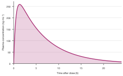

    *The default: an even fill at the theme's `fill_alpha`.*

=== ".gradient()"

    ```python
    (
        sp.area(profile, x="hours", y="conc")
        .gradient()
        .colors(["#AA3377"])
        .labels(x="Time after dose (h)", y="Plasma concentration (ng mL⁻¹)")
    )
    ```
    <!-- figure: area-fill-gradient -->

    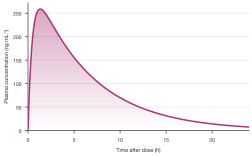

    *`.gradient()`: strongest at the curve, transparent at the baseline.*

Gradients also work on bands, but not on stacks (they would blur the layers),
and fall back to an even fill on a log y axis.

## Highlighting a layer

`.highlight()` keeps the named groups in color and greys out the rest: the
reader sees one layer in the context of the total. Here the growth of solar
within the whole generation mix:

```python
(
    sp.area(energy, x="year", stack=True)
    .highlight("Solar")
    .colors({"Solar": "#E69F00"})
    .endlabels(values=".0f")
    .labels(x="", y="Electricity generation (TWh)")
)
```
<!-- figure: area-highlight -->

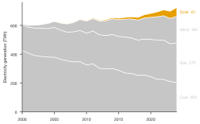

*`.highlight("Solar")` mutes the other layers; `values=".0f"` prints each
layer's own last value.*

## Labels, reference lines and source data

`.endlabels()` names each area at its right end instead of a legend (stacked
layers at their middle). `values=` adds the last value: the layer's own value
in a stack, its share in a percent stack. `label=` changes the text, with
`{group}` for the group name; `pad=` sets the gap in points.

`.refline()` adds dashed reference lines, horizontal or (`axis="x"`)
vertical; values can be numbers, dates or date strings. Each call can set its
own `label`, `color`, `linestyle` and `linewidth`:

```python
sp.area(energy, x="year", y="Wind").refline(2015, axis="x", label="Subsidy reform")
```

`.source_data()` returns the plotted numbers for a journal's source-data file;
for stacks it includes each layer's value and its lower and upper edge:

```python
sp.area(energy, x="year", stack=True).source_data().head()
```

## Style fields

| Field | Effect |
|---|---|
| `fill_alpha` | Opacity of overlapping areas and bands (0.22 by default); gradients start at twice this. |
| `line_width` | Width of edge lines (stack separators are half as wide). |
| `positive`, `negative` | Default `.split()` colors above and below. |
| `muted` | Color of de-emphasized groups with `.highlight()`. |

```python
sp.area(energy, x="year").theme(fill_alpha=0.35)
```

## Discovering options

```python
sp.FillBetweenPlot.options()            # every chainable step
```

```python
sp.FillBetweenPlot.options("split")     # one step's parameters, allowed values, defaults
```

```python
sp.theme_options()                      # style fields
```

The [option discovery guide](../options.md) shows how to search these tables.

## Warnings and errors

- Each x can appear only once per area (`DataShapeError` with a hint to
  summarize first or use `sp.line(error=...)`).
- Stacks need a number as `y2` (or `baseline`), not a column.
- `stack` must be `True`, `False` or `"percent"`.
- Stacked areas need every group at each x; use `missing="drop"` or `"gap"`.
- Percent stacks need non-negative values and a positive total at every x.
- `.gradient()` can't be used with stacks; `.split()` works on a single area
  without `hue=` or `stack=`.
- `sp.area(baseline=...)` must be a number; for a band use `sp.fill_between`.
