# Bar plots

`sp.bar()` draws one bar per category. When a category has several rows
(biological replicates, mice, wells), they are summarized into one value, with
optional SD or SEM error bars. Use bars for quantities that start at zero:
fold changes, counts, proportions, enrichment scores.

The examples on this page run top to bottom like notebook cells and share one
namespace. All data are synthetic. The main dataset is a qPCR experiment:
cytokine expression in LPS-stimulated macrophages from wild-type (WT) and
knockout (KO) mice, n = 6 mice per genotype.

```python
import numpy as np
import pandas as pd
import SecretPlots as sp

sp.use(preset="nature")            # 89 mm single column, 5–7 pt text
rng = np.random.default_rng(7)

genes = ["Il6", "Tnf", "Il1b", "Cxcl10", "Ccl2"]
wt_mean = {"Il6": 6.0, "Tnf": 4.2, "Il1b": 3.1, "Cxcl10": 8.5, "Ccl2": 2.4}
ko_ratio = {"Il6": 0.45, "Tnf": 0.40, "Il1b": 0.90, "Cxcl10": 0.15, "Ccl2": 0.80}

qpcr = pd.DataFrame(
    [
        {
            "gene": gene,
            "genotype": genotype,
            "mouse": mouse,
            "fold": wt_mean[gene]
            * (ko_ratio[gene] if genotype == "KO" else 1)
            * rng.lognormal(0, 0.25),
        }
        for gene in genes
        for genotype in ["WT", "KO"]
        for mouse in range(1, 7)
    ]
)
GENOTYPE = {"WT": "#0072B2", "KO": "#E69F00"}   # Okabe–Ito blue and orange
```

```python
(
    sp.bar(qpcr, x="gene", y="fold", hue="genotype", error="sd")
    .colors(GENOTYPE)
    .ticklabels(italic=True)
    .labels(x="", y="Relative expression (2^−ΔΔCt)")
    .legend(title="")
    .refline(1, color="#888888", linestyle=":")
)
```
<!-- figure: bar-overview -->

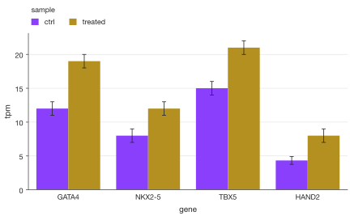

*Cytokine induction after LPS. Bars show mean ± SD of n = 6 mice per genotype;
the dotted line marks no change (2^−ΔΔCt = 1). Gene names are italic, as
journals require.*

Nothing is drawn until the plot is displayed in a notebook, saved, shown, or you
access `.fig` / `.ax`, so you can chain as many steps as you like.

!!! tip "Explore the options from Python"
    `sp.BarPlot.options()` lists every chainable step, and
    `sp.BarPlot.options("values")` shows one step's parameters and defaults.
    See [Discovering options](#discovering-options).

## Contents

- [Signature](#signature)
- [Input data](#input-data)
- [Summary value and error bars](#summary-value-and-error-bars)
- [Groups: side by side or stacked](#groups-side-by-side-or-stacked)
- [Orientation and sorting](#orientation-and-sorting)
- [Highlighting](#highlighting)
- [Value labels](#value-labels)
- [Colors](#colors)
- [Reference lines](#reference-lines)
- [Category and group names](#category-and-group-names)
- [Axes: titles, limits, log scale, tick format](#axes-titles-limits-log-scale-tick-format)
- [Legend](#legend)
- [Headline, subtitle, source and note](#headline-subtitle-source-and-note)
- [Size, presets and themes](#size-presets-and-themes)
- [Saving and output](#saving-and-output)
- [Discovering options](#discovering-options)
- [Warnings and errors](#warnings-and-errors)

## Signature

```text
sp.bar(data, x=None, y=None, hue=None, *,
       stack=False, error=None, estimator="mean", orient="v",
       sort=None, order=None, hue_order=None, missing="raise") -> BarPlot
```

| Argument | Default | Meaning |
|---|---|---|
| `data` | required | Your data; see [Input data](#input-data). |
| `x` | `None` | Column with the categories (one bar, or one cluster of bars, each). |
| `y` | `None` | Column with the numeric values. Required for a long DataFrame. |
| `hue` | `None` | Column with the groups (colored bars within each category). |
| `stack` | `False` | `True` stacks groups on top of each other instead of side by side. Cannot be combined with `error`. |
| `error` | `None` | Error bars from replicates: `"sd"` (standard deviation) or `"sem"` (standard error of the mean). |
| `estimator` | `"mean"` | Bar height: `"mean"`, `"median"`, `"sum"`, or any function of one bar's values, e.g. `np.max`. |
| `orient` | `"v"` | `"v"` vertical or `"h"` horizontal bars. |
| `sort` | `None` | `"desc"` / `"asc"` orders categories by value; `None` keeps data order. |
| `order` | `None` | Explicit category order (a list). |
| `hue_order` | `None` | Explicit group order (a list). |
| `missing` | `"raise"` | `"raise"` rejects missing or non-finite plotted values; `"drop"` ignores the affected rows before summarizing. See [data handling](../usage.md). |

`x`, `y` and `hue` always name **data columns**. Which side of the plot they end
up on depends on `orient`.

### Chainable methods

Specific to bar plots:

| Method | What it does |
|---|---|
| `.values(fmt=".3g", *, inside=None)` | Print each bar's value; see [Value labels](#value-labels). |
| `.sort(order="desc")` | Order categories by value: `"desc"`, `"asc"` or `None` (data order). |
| `.orient(orient)` | Switch to `"v"` or `"h"` bars. |
| `.ticklabels(labels=None, *, rotation=None, italic=False)` | Rename categories and style their labels. |
| `.grouplabels(labels)` | Rename the `hue` groups shown in the legend. |

Shared by every plot type:

| Method | What it does |
|---|---|
| `.labels(x=, y=, title=)` | Axis titles and plot title. |
| `.legend(position="auto", *, title, ncols, fontsize, loc, anchor)` | Place and format the legend. |
| `.colors(colors=None, *, alpha=None)` | One color, a palette, or a `{name: color}` mapping. |
| `.highlight(*names)` | Emphasize categories or groups; mute the rest. |
| `.xlim(low, high)`, `.ylim(low, high)` | Axis limits (axes as drawn). |
| `.log(axis="y")` | Log scale on `"x"`, `"y"` or `"xy"` (axes as drawn). |
| `.format_axis(axis="y", kind="number", *, decimals, prefix, suffix, scale, date_format)` | Tick label format: `"number"`, `"percent"`, `"currency"`, `"date"`. |
| `.refline(*values, axis, label, color, linestyle, linewidth)` | Reference lines across the plot. |
| `.chrome(title, subtitle, source, note)` | Headline and source text around the figure. |
| `.preset(name, width, height)`, `.size(width, height, scale_text)` | Journal preset and figure size. |
| `.theme(theme, **overrides)` | Switch theme or override style fields. |
| `.save(path, dpi, **kwargs)`, `.show()`, `.render(ax)` | Output. |
| `.copy()` | Independent copy of the plot specification. |
| `.options(verb)`, `.explain(field)`, `.style_report()` | Introspection. |

## Input data

A long ("tidy") DataFrame with one row per replicate is the most explicit form,
and the only one that gives you error bars from named columns:

```python
sp.bar(qpcr, x="gene", y="fold", hue="genotype")
```

Quick sketches don't need a DataFrame. Without column names, these shapes are
understood:

```python
# dict: one value per category
sp.bar({"Il6": 6.1, "Tnf": 4.3, "Il1b": 3.0})
```

```python
# dict of lists: replicates per category (summarized, so error bars work)
sp.bar({"Il6": [5.8, 6.4, 6.1], "Tnf": [4.0, 4.6, 4.2]}, error="sem")
```

```python
# nested dict: categories -> groups
sp.bar({"Il6": {"WT": 6.1, "KO": 2.7}, "Tnf": {"WT": 4.3, "KO": 1.7}})
```

```python
# Series: index -> categories, values -> bars
sp.bar(pd.Series({"Il6": 6.1, "Tnf": 4.3}, name="fold"))
```

```python
# wide DataFrame: index -> categories, numeric columns -> groups
wide = qpcr.pivot_table(index="gene", columns="genotype", values="fold")
sp.bar(wide)
```

```python
# flat list: categories are 0, 1, 2, ... (rename them with .ticklabels)
sp.bar([3.1, 5.4, 2.2]).ticklabels(["Day 0", "Day 3", "Day 7"])
```

```python
# list of equal-length lists / 2-D array: rows -> categories, columns -> groups
sp.bar([[1.0, 2.1], [3.2, 4.0], [5.1, 6.3]]).grouplabels(["Vehicle", "Drug"])
```

Category and group order follows the order of first appearance in your data,
or the category order of a pandas `Categorical` column. Set it explicitly with
`order=` and `hue_order=`.

## Summary value and error bars

Use `error=` whenever a bar summarizes replicates: readers need to see the
spread. SD describes the variability between mice; SEM describes how precisely
the mean is known and shrinks with n. Click through the tabs to compare them on
the same data (these figures keep the `nature` default palette).

=== "error=None"

    ```python
    sp.bar(qpcr, x="gene", y="fold", hue="genotype").ticklabels(italic=True).labels(
        x="", y="Relative expression (2^−ΔΔCt)"
    )
    ```
    <!-- figure: bar-error-none -->

    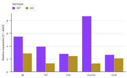

    *Means only. Fine for totals, misleading for replicate measurements.*

=== "error=\"sd\""

    ```python
    sp.bar(qpcr, x="gene", y="fold", hue="genotype", error="sd").ticklabels(
        italic=True
    ).labels(x="", y="Relative expression (2^−ΔΔCt)")
    ```
    <!-- figure: bar-error-sd -->

    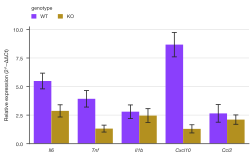

    *Mean ± SD: the spread between individual mice.*

=== "error=\"sem\""

    ```python
    sp.bar(qpcr, x="gene", y="fold", hue="genotype", error="sem").ticklabels(
        italic=True
    ).labels(x="", y="Relative expression (2^−ΔΔCt)")
    ```
    <!-- figure: bar-error-sem -->

    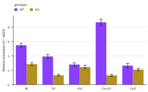

    *Mean ± SEM: SD / √6, so the bars are about 2.4× shorter.*

`estimator=` decides the bar height and works with either error type:

```python
sp.bar(qpcr, x="gene", y="fold", estimator="median")     # robust to outliers
```

```python
sp.bar(qpcr, x="gene", y="fold", estimator=np.max)       # any function works
```

??? info "Statistics details"
    - `error="sd"` is the sample standard deviation (`ddof=1`); `error="sem"`
      is SD / √n, with n the number of rows in that bar.
    - Error bars are computed from the same rows as the bar, whatever
      `estimator` is. With `estimator="median"`, consider whether mean-based
      error bars are what you want to show.
    - Error bars need replicates. If every bar has a single value, `error=`
      raises an error explaining that.
    - Spellings from other tools (`"std"`, `"se"`, `"stderr"`) are rejected
      with a hint to the right name, and so is putting an error kind in
      `estimator=`.
    - Error bars on stacked bars are refused: a segment's error is not the
      error of the stack.

!!! note "Journal checklist"
    - State n and the error type (SD or SEM) in the legend or caption.
    - For n below about 10, many journals (including Nature) ask for the
      individual data points. Bar plots summarize; show the points with
      [`sp.box(...).points()`](box.md) or a strip plot instead, or as well.
    - Bars encode length, so the value axis must start at zero. If your data
      need a log axis or a non-zero baseline, use points or lines.

## Groups: side by side or stacked

`hue=` splits each category into colored groups. Side by side compares groups
within a category; stacked shows how a total is made up. Here: flow cytometry
counts of four immune cell types in four tissues (n = 5 mice).

```python
tissues = ["Spleen", "Lymph node", "Blood", "Bone marrow"]
cell_types = ["T cells", "B cells", "Myeloid", "NK cells"]
mix = {
    "Spleen": [32, 45, 15, 8],
    "Lymph node": [56, 33, 5, 6],
    "Blood": [28, 22, 40, 10],
    "Bone marrow": [8, 18, 66, 8],
}
immune = pd.DataFrame(
    [
        {"tissue": t, "cell_type": c, "count": share * rng.lognormal(0, 0.15)}
        for t in tissues
        for c, share in zip(cell_types, mix[t])
        for _ in range(5)
    ]
)
TOL_MUTED = ["#332288", "#88CCEE", "#CC6677", "#DDCC77"]
```

=== "stack=False"

    ```python
    (
        sp.bar(immune, x="tissue", y="count", hue="cell_type", error="sem")
        .colors(TOL_MUTED)
        .labels(x="", y="Cells (×10³)")
        .legend(title="")
    )
    ```
    <!-- figure: bar-stack-false -->

    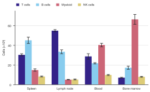

    *Side by side (default): compare one cell type across tissues. Mean ± SEM, n = 5.*

=== "stack=True"

    ```python
    (
        sp.bar(immune, x="tissue", y="count", hue="cell_type", stack=True)
        .colors(TOL_MUTED)
        .labels(x="", y="Cells (×10³)")
        .legend(title="")
    )
    ```
    <!-- figure: bar-stack-true -->

    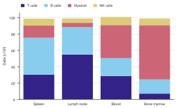

    *Stacked: the bar height is the total cellularity of each tissue.*

=== "Stacked to 100%"

    ```python
    means = immune.groupby(["tissue", "cell_type"], sort=False)["count"].mean()
    shares = (means / means.groupby(level="tissue").transform("sum")).reset_index()

    (
        sp.bar(shares, x="tissue", y="count", hue="cell_type", stack=True)
        .colors(TOL_MUTED)
        .values("{:.0%}")
        .format_axis("y", "percent")
        .labels(x="", y="Share of CD45⁺ cells")
        .legend(title="")
    )
    ```
    <!-- figure: bar-stack-percent -->

    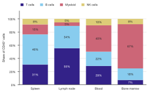

    *Composition: normalize each tissue to 1 first, then stack. Labels sit
    inside the segments automatically; any that don't fit are hidden with a
    `LabelsHiddenWarning`.*

- `stack=True` stacks positive values upward and negative values downward.
- There is no built-in percent mode: divide by the category total with pandas
  (as in the third tab) and use `.format_axis("y", "percent")`.
- Reorder groups with `hue_order=["NK cells", "Myeloid", ...]`; the first group
  sits at the bottom of a stack and on the left of a cluster.
- A legend is added automatically when there are groups; see [Legend](#legend).

## Orientation and sorting

Horizontal bars suit long category names, such as pathway terms from an
enrichment analysis. Sorting by value turns the chart into a ranking.

```python
enrichment = pd.DataFrame(
    {
        "term": [
            "Response to type I interferon",
            "Antigen processing via MHC class I",
            "Interferon-γ signalling",
            "Oxidative phosphorylation",
            "Cell cycle G2/M transition",
            "Extracellular matrix organization",
            "Fatty acid β-oxidation",
        ],
        "fdr": [1e-12, 3e-9, 2e-10, 4e-6, 8e-4, 2e-3, 1e-2],
    }
)
enrichment["score"] = -np.log10(enrichment["fdr"])
```

=== "orient=\"v\""

    ```python
    (
        sp.bar(enrichment, x="term", y="score", sort="desc")
        .colors("#4477AA")
        .labels(x="", y="−log₁₀ FDR")
    )
    ```
    <!-- figure: bar-orient-v -->

    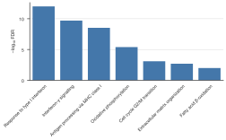

    *Vertical: long names are rotated automatically and eat the figure height.*

=== "orient=\"h\""

    ```python
    (
        sp.bar(enrichment, x="term", y="score", sort="desc", orient="h")
        .colors("#4477AA")
        .labels(x="−log₁₀ FDR", y="")
    )
    ```
    <!-- figure: bar-orient-h -->

    

    *Horizontal: names read naturally; the first category is drawn on top.*

- `.orient("h")` switches an existing plot. With `orient="h"` the values run
  along the plot's x axis. Methods that talk about axes (`.labels()`,
  `.xlim()`, `.ylim()`, `.log()`, `.format_axis()`) always mean **the axes as
  drawn**, so for horizontal bars the value axis is `x`.
- `sort="desc"` (or `.sort("desc")`; `.sort()` alone means `"desc"`) puts the
  largest first, `"asc"` the smallest, `None` returns to data order. With
  groups, categories are ranked by their tallest bar; with `stack=True`, by
  their stack total.
- `order=[...]` sets any order you like, e.g. a biological sequence.

## Highlighting

Use `.highlight()` when the figure makes one point, for example that the
interferon pathways dominate. Named categories (or groups) keep the theme's
highlight color; everything else is muted to grey.

=== "Without highlight"

    ```python
    sp.bar(enrichment, x="term", y="score", sort="desc", orient="h").labels(
        x="−log₁₀ FDR", y=""
    )
    ```
    <!-- figure: bar-highlight-off -->

    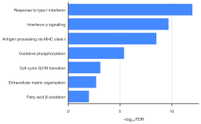

    *Default `nature` theme color: every term has equal weight.*

=== ".highlight(...)"

    ```python
    (
        sp.bar(enrichment, x="term", y="score", sort="desc", orient="h")
        .highlight("Response to type I interferon", "Interferon-γ signalling")
        .labels(x="−log₁₀ FDR", y="")
    )
    ```
    <!-- figure: bar-highlight-on -->

    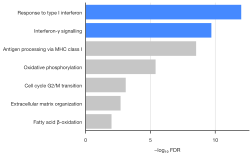

    *Highlighted: the two interferon terms stand out; the rest give context.*

With groups, a group name highlights that group in every category:
`sp.bar(qpcr, x="gene", y="fold", hue="genotype").highlight("KO")`. The
highlight and muted colors come from the theme fields `highlight` and `muted`.
Names are case-sensitive and follow any `.ticklabels()` renames.

## Value labels

Print the numbers on the bars when readers need exact values, such as response
rates in a dose-finding trial. `.values()` takes a format spec (`".1f"`) or a
full format string (`"{:.0%}"`).

```python
trial = {"Placebo": 0.12, "10 mg": 0.31, "30 mg": 0.47, "100 mg": 0.52}

(
    sp.bar(trial)
    .colors("#332288")
    .colors({"Placebo": "#BBBBBB"})
    .values("{:.0%}")
    .format_axis("y", "percent")
    .labels(x="Dose", y="Responders")
)
```
<!-- figure: bar-values -->

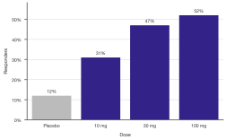

*Response rate by dose arm. Placebo is grey so the active arms carry the color.*

| Option | Default | Effect |
|---|---|---|
| `fmt` | `".3g"` | Format spec like `".1f"` or format string like `"{:.0%}"`. |
| `inside` | `None` | `True` puts labels inside the bars, `False` past their end; `None` decides automatically (inside only for stacked bars). |

- Labels outside the bars sit just past the end of each bar, above the error
  bar if there is one.
- Inside labels switch between dark and white text for contrast with the bar
  color.
- Labels that don't fit their bar are hidden, and a `LabelsHiddenWarning` tells
  you how many. Try a wider figure, a shorter format (`".2g"`), or horizontal
  bars.

## Colors

`.colors()` accepts one color, a palette (list), or a mapping. Use a mapping to
give controls a fixed neutral color, so the treatment bars carry the meaning.
Here: a viability screen of eight compounds at 10 µM (n = 3 wells), with DMSO
as vehicle and staurosporine as the positive control.

```python
compounds = ["DMSO", "Staurosporine"] + [f"SP-{i}" for i in range(101, 109)]
viability_mean = [100, 6, 94, 88, 41, 97, 63, 22, 85, 71]
screen = pd.DataFrame(
    [
        {"compound": c, "viability": m * rng.normal(1, 0.06)}
        for c, m in zip(compounds, viability_mean)
        for _ in range(3)
    ]
)

(
    sp.bar(screen, x="compound", y="viability", error="sd")
    .colors("#44AA99")
    .colors({"DMSO": "#BBBBBB", "Staurosporine": "#555555"})
    .labels(x="", y="Cell viability (% of DMSO)")
)
```
<!-- figure: bar-colors -->

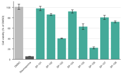

*One color for the compounds, a mapping for the controls. Mean ± SD, n = 3.*

```python
sp.bar(qpcr, x="gene", y="fold", hue="genotype").colors(["#4477AA", "#EE6677"])  # palette
```

```python
sp.bar(qpcr, x="gene", y="fold", hue="genotype").colors(alpha=0.6)  # see-through
```

- Without groups, a mapping colors individual categories and a single color
  sets every bar; with groups, a list or mapping colors the groups.
- Mappings add up across calls, so `.colors("#44AA99").colors({...})` combines
  a base color with exceptions.
- If there are more groups than palette colors, extra shades are generated and
  a `PaletteExtendedWarning` says so.

!!! tip "Colorblind-safe palettes"
    About 1 in 12 men has a color vision deficiency. Avoid red against green;
    the Okabe–Ito (`#E69F00 #56B4E9 #009E73 #0072B2 #D55E00 #CC79A7`) and
    Paul Tol palettes used on this page stay distinct for all common types and
    in grayscale print.

## Reference lines

`.refline()` marks a baseline, a threshold or a target across the whole plot,
like matplotlib's `axhline` / `axvline`. In a screen, a hit threshold makes the
call visible.

```python
(
    sp.bar(screen, x="compound", y="viability", error="sd", sort="desc")
    .colors("#BBBBBB")
    .colors({c: "#D55E00" for c in ["SP-103", "SP-106"]})
    .refline(50, label="Hit threshold", color="#D55E00")
    .labels(x="", y="Cell viability (% of DMSO)")
)
```
<!-- figure: bar-refline -->

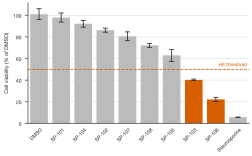

*Compounds below 50% viability (dashed line) are called as hits. Sorting makes
the cut-off easy to read.*

```text
.refline(*values, axis=None, label=False, color=None, linestyle="--", linewidth=None)
```

| Option | Effect |
|---|---|
| `*values` | Where the lines go: numbers, or category names on the category axis. |
| `axis` | `"y"`: horizontal lines; `"x"`: vertical lines (axes as drawn). Default: the value axis, so `"y"` for vertical bars and `"x"` with `orient="h"`. |
| `label` | `True` writes the value next to each line; text (e.g. `"target"`) writes that text instead, one value per call. |
| `color` | Line color; default: the theme's text color. |
| `linestyle` | `"--"` (default), `":"`, `"-."` or `"-"`. |
| `linewidth` | Width in pt; default: the theme's `axis_line_width`. |

Each call adds lines, so lines can differ in style. `.refline()` with no values
removes them all; `.refline(axis="x")` removes only the vertical ones. On the
category axis, a name puts the line through that category's center, wherever
sorting has moved it:

```python
sp.bar(screen, x="compound", y="viability", sort="desc").refline("DMSO", axis="x")
```

On bars the lines are drawn above the bars so they stay visible.

## Category and group names

`.ticklabels()` renames categories and styles their labels; `.grouplabels()`
renames groups (the legend entries). Both take a list in data order or a
partial mapping `{old: new}`:

```python
(
    sp.bar(qpcr, x="gene", y="fold", hue="genotype")
    .ticklabels({"Cxcl10": "Cxcl10 (IP-10)"}, italic=True)
    .grouplabels({"KO": "Ifnar1⁻/⁻"})
)
```

- Renaming changes the categories themselves, so later calls such as
  `.highlight()` and `.colors({...})` use the **new** names.
- `italic=True` is the convention for gene symbols in most journals.
- Long category labels on vertical bars are rotated automatically (45°, or
  90° if space is very tight). `.ticklabels(rotation=30)` sets the angle and
  turns off the automatic rotation.

## Axes: titles, limits, log scale, tick format

Axis titles default to your column names. Replace them with a quantity and its
unit; `""` hides one:

```python
sp.bar(qpcr, x="gene", y="fold").labels(x="", y="Relative expression (2^−ΔΔCt)")
```

```python
sp.bar(qpcr, x="gene", y="fold").ylim(0, 12)              # fixed range across panels
```

```python
sp.bar(qpcr, x="gene", y="fold").log("y")                 # log value axis
```

```python
sp.bar(trial).format_axis("y", "percent", decimals=0)   # 0.3 -> 30%
```

- `.xlim()` / `.ylim()` take `(low, high)`; pass `None` for an end to keep it
  automatic. Use the same limits on panels that readers will compare.
- `.theme(axis_titles=False)` hides automatic titles; titles you set with
  `.labels()` still show.
- `.format_axis()` changes only the tick labels: `kind="percent"` for
  fractions (`scale=0.01` if the data are already percentages), `"currency"`,
  `"number"` with `decimals`, `prefix`, `suffix`, and `scale=1e-3` for
  thousands.

## Legend

```python
sp.bar(qpcr, x="gene", y="fold", hue="genotype").legend("right", title="Genotype")
```

| Option | Meaning |
|---|---|
| `position` | `"auto"` (top for up to 4 groups or narrow figures, else right), `"top"`, `"right"`, `"inside"` (emptiest spot in the axes), or `False`/`"none"` to hide it. |
| `title` | Legend title; defaults to the `hue` column name. `""` hides it. |
| `ncols` | Fixed number of columns. Without it, a top legend wraps to fit the figure. |
| `fontsize` | Text size in pt. |
| `loc` | Which corner of the legend to place (`"upper right"`, `"center left"`, ...). |
| `anchor` | `(x, y)` in axes fractions where that corner sits; `(0, 0)` is the bottom-left of the plot area. |

```python
sp.bar(qpcr, x="gene", y="fold", hue="genotype").legend(
    "inside", loc="upper left", anchor=(0.02, 0.98), title=""
)
```

Outside legends (`"top"`, `"right"`) automatically move past tick labels and
axis titles on their side. Each `.legend()` call resets the options it doesn't
pass. A plot title from `.labels(title=...)` moves a top legend to the right.

## Headline, subtitle, source and note

`.chrome()` adds text around the whole figure. Journal figures usually leave it
off (the caption carries that text), but it is handy for talks, posters and
reports.

```python
(
    sp.bar(qpcr[qpcr["genotype"] == "WT"], x="gene", y="fold", error="sd")
    .ticklabels(italic=True)
    .labels(x="", y="Fold change")
    .chrome(
        title="Cxcl10 is the most LPS-induced cytokine",
        subtitle="WT macrophages, mean ± SD, n = 6 mice",
        source="Synthetic qPCR data",
        note="Normalized to Actb",
    )
)
```
<!-- figure: bar-chrome -->

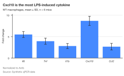

*`.chrome()` on a plot in the default `nature` theme.*

Each call only changes the fields you pass. Chrome is drawn only when
SecretPlots creates the figure (not with `.render(ax=...)`).

## Size, presets and themes

```python
sp.bar(qpcr, x="gene", y="fold").preset("nature", width="double")
```

A preset sets the figure size and the publisher's limits (text sizes, line
widths, fonts). See [Presets](../presets.md) for the list, or
`sp.presets.list()`. `sp.use(preset="nature")`, as at the top of this page,
makes it the default for every plot.

```python
sp.bar(qpcr, x="gene", y="fold").size("89mm", "60mm")
```

Widths can be a preset width name (`"single"`, `"double"`), a number in inches,
or text such as `"89mm"`, `"8.9cm"`, `"3.5in"`, `"600px"`. Without a height,
the preset's aspect ratio is used. Text keeps its point size when you resize;
`.size(..., scale_text=True)` grows it with the width instead.

`.theme()` switches theme and/or overrides individual style fields. Fields that
matter most for bar plots:

| Field | Effect |
|---|---|
| `bar_gap` | Empty fraction of each category slot, 0 to 1. |
| `bar_edge_width` | Outline width around bars in pt (outline uses the axes background color). |
| `errorbar_capsize` | Error bar cap length in pt. |
| `grid` | `"value"` / `"category"` follow the bars when you switch orientation; also `"x"`, `"y"`, `"both"`, `"none"`. |
| `value_axis_side` | Draw the value axis on the `"left"` (default) or `"right"` (top for horizontal bars). |
| `spines` | Which axis lines to draw, e.g. `["left", "bottom"]` (swapped automatically for horizontal bars). |

```python
sp.bar(qpcr, x="gene", y="fold").theme(bar_gap=0.4, grid="none", errorbar_capsize=0)
```

`sp.theme_options()` lists every field with its allowed values. Values you set
yourself win over a preset's limits: `font_size=12` under `nature` (5–7 pt) is
kept, with a `LimitExceededWarning`. Set `sp.config.enforce_limits = True` to
apply the limits instead, and `sp.config.strict = True` to turn every
SecretPlots warning into an error (useful in CI before submission). See
[Journal-ready figures](../publication.md) for a full submission workflow.

## Saving and output

```python
plot = (
    sp.bar(qpcr, x="gene", y="fold", hue="genotype", error="sd")
    .colors(GENOTYPE)
    .ticklabels(italic=True)
    .labels(x="", y="Relative expression (2^−ΔΔCt)")
)
plot.save("fig2b.pdf")
```

- `.save(path, dpi=None, **kwargs)` uses the preset's dpi and embeds fonts as
  TrueType in PDF/PS. Extra keyword arguments go to matplotlib's `savefig`.
  Saving in a format the preset's publisher doesn't list gives a
  `FormatWarning`.
- `.show()` opens a window (or displays inline) through pyplot. In Jupyter, a
  plot at the end of a cell displays itself.
- `.fig` and `.ax` give the matplotlib `Figure` / `Axes` for anything not
  covered here, e.g. `plot.ax.text(...)` for a significance mark.
- `.render(ax=...)` draws into an axes you created yourself.
- `.copy()` gives an independent plot to vary without touching the original.

## Discovering options

Every chainable step documents itself:

```python
sp.BarPlot.options()            # all steps you can chain, with a summary
```

```python
sp.BarPlot.options("legend")    # one step's options, allowed values and defaults
```

```python
sp.theme_options()              # every style field for .theme()
```

`plot.explain("palette")` tells you where a style value came from (your
settings, a preset, a theme), and `plot.style_report()` lists every resolved
value plus any adjustments made for the preset. See the
[option discovery guide](../options.md) for more, and the
[gallery](../gallery.md) for complete figures.

## Warnings and errors

| Message | What it means |
|---|---|
| `error='sd' needs replicates ...` | Every bar has one value; there is nothing to compute an SD from. |
| `Unknown error='std'. Did you mean error='sd'?` | Use `"sd"` or `"sem"`. |
| `estimator='sd' looks like an error bar` | `estimator` sets bar height; use `error=` for error bars. |
| `Error bars on stacked bars are misleading` | Drop `error=` or use side-by-side groups. |
| `Column 'genes' not found. Available: ...` | Check the column name. |
| `Values in 'fold' must be numeric` | The `y` column has text in it. |
| `Cannot highlight [...]: not in the data` | Names are case-sensitive and follow `.ticklabels()` renames. |
| `LabelsHiddenWarning` | Some value labels didn't fit their bars and were hidden. |
| `PaletteExtendedWarning` | More groups than palette colors; extra shades were generated. |
| `LimitExceededWarning` | A value you set breaks the preset's limits and was kept. |
| `FormatWarning` | The file format isn't one the preset's publisher lists. |
