# Box plots

`sp.box()` (alias `sp.boxplot()`) summarizes each category with the median,
the quartiles and whiskers. Chain a few steps to draw every value on top,
mark means, print sample sizes and add significance brackets with exact
p-values: everything a reviewer expects from a box plot in a paper.

The examples on this page share one setup, like cells in a notebook. All data
are synthetic: a viability assay of two cancer cell lines treated with four
doses of a drug (n = 12 wells each), and plasma IL-6 in a small patient cohort.

```python
import numpy as np
import pandas as pd
import SecretPlots as sp

sp.use(preset="nature")                      # 89 mm single column, 7 pt text
rng = np.random.default_rng(12)

doses = ["Vehicle", "1 µM", "5 µM", "10 µM"]
means = {"HeLa": (100, 94, 70, 46), "MCF-7": (100, 97, 84, 58)}
viability = pd.DataFrame(
    [
        {"cell_line": line, "dose": dose, "viability": value}
        for line, mus in means.items()
        for dose, mu in zip(doses, mus)
        for value in rng.normal(mu, 6 + (100 - mu) / 10, 12)
    ]
)
hela = viability[viability["cell_line"] == "HeLa"]

severity = ["Mild", "Moderate", "Severe"]
il6 = pd.DataFrame(
    {
        "severity": np.repeat(severity, [48, 27, 11]),
        "il6": np.concatenate(
            [rng.lognormal(np.log(m), 0.7, n) for m, n in ((4, 48), (11, 27), (38, 11))]
        ),
    }
)

dose_colors = dict(zip(doses, ["#D6E4F0", "#92BCE0", "#4A8BC4", "#1F5596"]))
```

```python
(
    sp.box(hela, x="dose", y="viability")
    .points()
    .compare(ref="Vehicle", correction="holm")
    .show_n()
    .colors(dose_colors)
    .labels(x="", y="Cell viability (% of vehicle)")
)
```
<!-- figure: box-hero -->

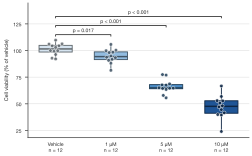

*HeLa viability falls with dose. Dots are individual wells, brackets give
two-sided Mann–Whitney p-values against vehicle (Holm-adjusted), and the
sample size sits under each label. A light-to-dark ramp encodes dose.*

Nothing is drawn until the plot is displayed, saved or shown, or until you
access `.fig` / `.ax`. For the shape of a distribution rather than its
summary, use [violin plots and rainclouds](violin.md): they take the same data
and the same steps.

!!! tip "Explore the options from Python"
    `sp.BoxPlot.options()` lists every chainable step and
    `sp.BoxPlot.options("compare")` shows one step's parameters, allowed values
    and defaults. See the [option discovery guide](../options.md).

## Signature

```text
sp.box(data, x=None, y=None, hue=None, *,
       whis=1.5, notch=False, varwidth=False, fill=True, outliers=None,
       caps=False, edgecolor=None, linewidth=None, orient="v",
       order=None, hue_order=None, missing="raise") -> BoxPlot
```

| Argument | Default | Meaning |
|---|---|---|
| `data` | | A long DataFrame (with `y=`, and optionally `x=` / `hue=`), a wide DataFrame (one box per numeric column), a dict `{category: values}` or `{category: {group: values}}`, a Series or list (one box), a 2-D array (one box per column) or a list of value lists. See [Input data](#input-data). |
| `x`, `y`, `hue` | `None` | Column names for categories, values and groups. |
| `whis` | `1.5` | Whisker reach: a multiple of the IQR (Tukey's rule), two percentiles such as `(5, 95)` (low below 25, high above 75), or `"range"` (minimum to maximum, no outliers). |
| `notch` | `False` | Notches of median ± 1.58 × IQR / √n (R's `notch = TRUE`). |
| `varwidth` | `False` | Box widths proportional to √n. |
| `fill` | `True` | Filled boxes, or (`False`) outlines in the box colour. |
| `outliers` | `None` | Draw values beyond the whiskers. `None`: yes, unless `.points()` already draws every value. |
| `caps` | `False` | Short lines at the whisker ends. |
| `edgecolor` | `None` | Colour of outlines, whiskers and medians (default: a dark shade of the fill). `"none"` removes only the outline. |
| `linewidth` | `None` | Outline width in pt (default: from the theme); `0` removes it. |
| `orient` | `"v"` | `"v"` (values up) or `"h"` (values to the right). Also a step: `.orient("h")`. |
| `order`, `hue_order` | `None` | Explicit category and group order. |
| `missing` | `"raise"` | `"raise"` rejects missing or infinite values; `"drop"` ignores those observations. See [data handling](../usage.md). |

### Chainable methods

Steps shared by box plots, [violins and rainclouds](violin.md):

| Step | What it does |
|---|---|
| `.points(show=True, *, kind="auto", size, alpha, color, edgecolor, linewidth, seed=0)` | Draw every value as a dot; see [Showing every value](#showing-every-value). |
| `.mean(show=True)` | Mark each mean with a white diamond. |
| `.show_n(show=True, *, label="n = {n}", sep=", ")` | Print the sample size under each category label. |
| `.compare(*pairs, ref, test="mann-whitney", correction, p, format="p", hide_ns=False)` | Significance brackets; see [Significance brackets](#significance-brackets). |
| `.refline(*values, axis, label, color, linestyle="--", linewidth)` | Reference lines, e.g. a control mean or a threshold. |
| `.ticklabels(labels, *, rotation, italic=False)` | Rename categories (list or `{old: new}`) and style their labels. |
| `.grouplabels(labels)` | Rename `hue` groups in the legend. |
| `.orient("v" \| "h")` | Direction of the value axis. |

They also have the general steps of every plot (`.colors()`, `.highlight()`,
`.labels()`, `.legend()`, `.log()`, `.xlim()` / `.ylim()`, `.refline()`,
`.size()`, `.preset()`, `.theme()`, `.save()`, …) and three methods that
return information instead of a plot: `.test_results()`, `.caption()` and
`.source_data()`.

## Input data

Most of the time you pass a long DataFrame with one row per observation:

```python
sp.box(hela, x="dose", y="viability")
```

Dicts, wide frames and arrays work too, which is handy for quick checks:

```python
sp.box({"Vehicle": rng.normal(100, 6, 12), "Drug": rng.normal(60, 9, 8)})   # any sizes
```

```python
wide = hela.assign(well=hela.groupby("dose").cumcount()).pivot(
    index="well", columns="dose", values="viability"
)
sp.box(wide[doses])                                    # one box per column
```

```python
sp.box({"HeLa": {"Vehicle": rng.normal(100, 6, 12), "10 µM": rng.normal(46, 11, 12)},
        "MCF-7": {"Vehicle": rng.normal(100, 6, 12), "10 µM": rng.normal(58, 10, 12)}})
```

A categorical `x` column keeps its category order; otherwise categories appear
in data order unless you pass `order=`. Missing and infinite values raise an
error unless you select `missing="drop"`.

## What the box shows

The centre line is the median and the box spans the first to third quartile
(the interquartile range, IQR; quartiles interpolated as in R's default type
7). `whis=` decides how far the whiskers reach. Values beyond them are drawn
as separate points.

=== "whis=1.5 (Tukey, default)"

    ```python
    sp.box(hela, x="dose", y="viability").colors(dose_colors).labels(
        x="", y="Cell viability (% of vehicle)"
    )
    ```
    <!-- figure: box-whis-tukey -->

    

    *Tukey's rule, the default in R, ggplot2 and matplotlib: whiskers reach
    the most extreme values within 1.5 × IQR of the box.*

=== "whis=(5, 95)"

    ```python
    sp.box(hela, x="dose", y="viability", whis=(5, 95)).colors(dose_colors).labels(
        x="", y="Cell viability (% of vehicle)"
    )
    ```
    <!-- figure: box-whis-percentiles -->

    

    *Whiskers at the 5th and 95th percentiles, common in clinical papers.
    Say so in the legend: readers assume Tukey otherwise.*

=== "whis=\"range\""

    ```python
    sp.box(hela, x="dose", y="viability", whis="range").colors(dose_colors).labels(
        x="", y="Cell viability (% of vehicle)"
    )
    ```
    <!-- figure: box-whis-range -->

    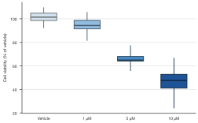

    *Minimum to maximum: no value is singled out as an outlier.*

## Box styles

=== "notch=True"

    ```python
    sp.box(hela, x="dose", y="viability", notch=True).labels(
        x="", y="Cell viability (% of vehicle)"
    )
    ```
    <!-- figure: box-notch -->

    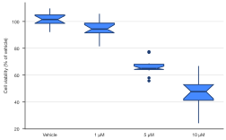

    *Notches show median ± 1.58 × IQR / √n (McGill et al. 1978). When two
    notches don't overlap, the medians differ, roughly at the 5 % level. This
    figure keeps the default theme colours.*

=== "fill=False, caps=True"

    ```python
    (
        sp.box(hela, x="dose", y="viability", fill=False, caps=True)
        .points(kind="jitter")
        .colors(dose_colors | {"Vehicle": "#7F7F7F"})
        .labels(x="", y="Cell viability (% of vehicle)")
    )
    ```
    <!-- figure: box-outline -->

    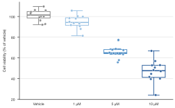

    *Outlined boxes with caps, the GraphPad Prism / ggpubr look. Dots take
    the box colour; the palest ramp colour is swapped for grey so it stays
    visible without a fill.*

=== "edgecolor, linewidth"

    ```python
    (
        sp.box(hela, x="dose", y="viability", edgecolor="black", linewidth=0.5)
        .points(color="black", size=2.5)
        .colors("#E69F00", alpha=0.6)
        .labels(x="", y="Cell viability (% of vehicle)")
    )
    ```
    <!-- figure: box-edges -->

    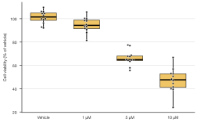

    *One colour for every box (a single colour string), thin black lines and
    black dots: a restrained look for figures where colour carries no
    meaning.*

## Skewed data and unequal groups

Concentrations, intensities and reaction times are often right-skewed. On a
`.log()` axis the box statistics are computed on the log scale, as ggplot2
does, so whiskers and outliers follow the axis. With very unequal group sizes,
`varwidth=True` makes box widths proportional to √n.

```python
(
    sp.box(il6, x="severity", y="il6", varwidth=True)
    .points()
    .log("y")
    .show_n()
    .colors({"Mild": "#DDCC77", "Moderate": "#CC6677", "Severe": "#882255"})
    .labels(x="COVID-19 severity", y="Plasma IL-6 (pg mL⁻¹)")
)
```
<!-- figure: box-log-varwidth -->

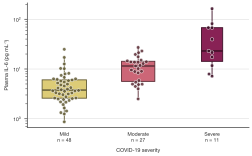

*Plasma IL-6 on a log axis. The box for 11 severe patients is narrower than
the one for 48 mild patients (`varwidth=True`), so the eye does not give it
equal weight.*

## Groups

Add `hue=` to place groups side by side within each category. Rename them
with `.grouplabels({"HeLa": "Cervical (HeLa)"})` and drop the legend title
with `.legend(title="")` when the entries speak for themselves.

```python
(
    sp.box(viability, x="dose", y="viability", hue="cell_line")
    .points()
    .colors({"HeLa": "#0072B2", "MCF-7": "#E69F00"})
    .legend(title="")
    .labels(x="", y="Cell viability (% of vehicle)")
)
```
<!-- figure: box-groups -->

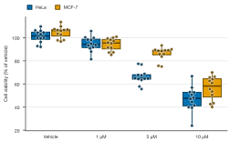

*Two cell lines side by side (Okabe–Ito blue and orange, safe for colour
vision deficiency). MCF-7 is less sensitive at every dose.*

## Showing every value

A box plot hides how many values there are and how they are spread, so
journals ask authors to show them when samples are small (Weissgerber et al.,
*PLoS Biol* 2015). `.points()` draws every value on top; values beyond the
whiskers are then not drawn twice. `kind=` decides how dots are spread:

=== "kind=\"swarm\""

    ```python
    (
        sp.box(il6, x="severity", y="il6")
        .points(kind="swarm")
        .log("y")
        .colors("#88CCEE")
        .labels(x="COVID-19 severity", y="Plasma IL-6 (pg mL⁻¹)")
    )
    ```
    <!-- figure: box-points-swarm -->

    

    *Beeswarm (seaborn `swarmplot`, R `geom_beeswarm`): no dot overlaps
    another. The default `kind="auto"` uses a swarm whenever it fits the box
    width.*

=== "kind=\"quasirandom\""

    ```python
    (
        sp.box(il6, x="severity", y="il6")
        .points(kind="quasirandom")
        .log("y")
        .colors("#88CCEE")
        .labels(x="COVID-19 severity", y="Plasma IL-6 (pg mL⁻¹)")
    )
    ```
    <!-- figure: box-points-quasirandom -->

    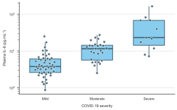

    *Quasirandom (R `geom_quasirandom`): the spread follows the local
    density, like a violin. `"auto"` falls back to this when a swarm would
    not fit.*

=== "kind=\"jitter\""

    ```python
    (
        sp.box(il6, x="severity", y="il6")
        .points(kind="jitter", seed=1)
        .log("y")
        .colors("#88CCEE")
        .labels(x="COVID-19 severity", y="Plasma IL-6 (pg mL⁻¹)")
    )
    ```
    <!-- figure: box-points-jitter -->

    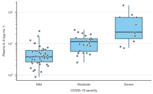

    *Random jitter (ggpubr `add = "jitter"`), reproducible through `seed=`.
    Dots may overlap.*

`kind="strip"` puts every dot on the centre line; lower `alpha=` so that
overlapping values show up as darker spots.

On filled boxes the dots take a dark shade of the box colour; on outlined
boxes (`fill=False`) the box colour itself. `color=` sets one colour for all
dots, `size=` the diameter in pt, `alpha=` the opacity, and `edgecolor=` /
`linewidth=` the ring that separates overlapping dots.

## Means, sample sizes and reference lines

`.mean()` adds a white diamond at each mean, which helps when the mean is the
quantity you test. `.show_n()` prints the sample size under each label, and
`.refline()` draws a line at a reference value such as 100 % viability.

```python
(
    sp.box(hela, x="dose", y="viability")
    .mean()
    .show_n(label="({n})")
    .refline(100, label="Vehicle level")
    .labels(x="", y="Cell viability (% of vehicle)")
)
```
<!-- figure: box-mean-n -->

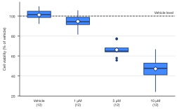

*Means as diamonds, sample sizes in brackets via `label="({n})"`, and a
labelled reference line, all in the default theme colours.*

With `hue`, `.show_n()` prints one number per group in legend order, joined by
`sep=` (e.g. `sep=" / "`).

## Significance brackets

`.compare()` runs a test for each pair and draws a bracket with the result.
Without arguments it compares every pair; `ref=` compares every category with
one control, and explicit pairs choose the comparisons yourself. Exact
p-values are what most journals now ask for; stars save space.

=== "format=\"p\" (default)"

    ```python
    (
        sp.box(hela, x="dose", y="viability")
        .points()
        .compare(ref="Vehicle", correction="holm")
        .colors(dose_colors)
        .labels(x="", y="Cell viability (% of vehicle)")
    )
    ```
    <!-- figure: box-compare-p -->

    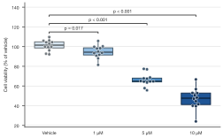

    *Exact p-values with two significant digits (`p = 0.017`), or `p < 0.001`
    below one in a thousand.*

=== "format=\"stars\""

    ```python
    (
        sp.box(hela, x="dose", y="viability")
        .points()
        .compare(ref="Vehicle", correction="holm", format="stars")
        .colors(dose_colors)
        .labels(x="", y="Cell viability (% of vehicle)")
    )
    ```
    <!-- figure: box-compare-stars -->

    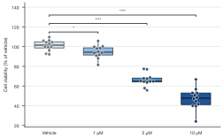

    *Stars as in ggpubr and GraphPad Prism: `*` p ≤ 0.05, `**` ≤ 0.01,
    `***` ≤ 0.001, `****` ≤ 0.0001, `ns` otherwise. Define them in the
    legend; `.caption()` does it for you.*

Choose the comparisons your hypothesis needs: fewer tests mean a milder
multiple-comparison correction.

```python
sp.box(hela, x="dose", y="viability").compare(("Vehicle", "10 µM"), ("1 µM", "5 µM"))
```

With `hue`, pairs name groups and are compared within every category. Use
`((category, group), (category, group))` to compare anything else, and
`hide_ns=True` to leave out brackets with p > 0.05:

```python
(
    sp.box(viability, x="dose", y="viability", hue="cell_line")
    .points()
    .compare(("HeLa", "MCF-7"), correction="holm", format="stars")
    .colors({"HeLa": "#0072B2", "MCF-7": "#E69F00"})
    .legend(title="")
    .labels(x="", y="Cell viability (% of vehicle)")
)
```
<!-- figure: box-compare-hue -->

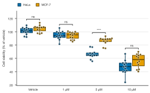

*HeLa versus MCF-7 within each dose, Holm-adjusted over the four tests.
Brackets marked `ns` stay visible here; that is honest reporting.*

??? info "Which test does `.compare()` run?"
    | `test=` | Test |
    |---|---|
    | `"mann-whitney"` (default) | Two-sided Mann–Whitney U test (Wilcoxon rank-sum, R's `wilcox.test`). No normality assumption. Exact p-values when both groups have fewer than 50 values and there are no ties, as in R; otherwise the normal approximation with tie and continuity corrections. |
    | `"welch"` | Two-sided Welch's t-test (unequal variances; R's `t.test` default). |
    | `"t-test"` | Two-sided Student's t-test (equal variances). |

    All three are for **independent** samples and are implemented in numpy
    (no scipy needed). Spellings such as `"wilcoxon"`, `"mwu"`, `"ttest"` or
    `"student"` are accepted as aliases.

    `correction="holm"` (step-down, recommended) or `"bonferroni"` adjusts
    the p-values over the comparisons of this one plot. The default is no
    correction.

    For paired or repeated measures, a post-hoc test after ANOVA or a mixed
    model, run the test yourself and pass the p-values, one per comparison
    in order: `.compare(("Vehicle", "10 µM"), p=[0.004])`. No test is run
    then.

`.test_results()` returns what was computed, ready for a supplementary table:

```python
(
    sp.box(hela, x="dose", y="viability")
    .compare(ref="Vehicle", correction="holm")
    .test_results()
)
#     group1 group2  n1  n2          test  statistic             p  p_adjusted      label
# 0  Vehicle   1 µM  12  12  mann-whitney      113.0  1.727119e-02    0.017271  p = 0.017
# 1  Vehicle   5 µM  12  12  mann-whitney      144.0  7.396023e-07    0.000002  p < 0.001
# 2  Vehicle  10 µM  12  12  mann-whitney      144.0  7.396023e-07    0.000002  p < 0.001
```

## Orientation and emphasis

Horizontal boxes suit long category names and ranked lists. `.highlight()`
mutes everything except the categories (or groups) you name, to guide the
reader to the point of a figure.

```python
(
    sp.box(hela, x="dose", y="viability", orient="h")
    .points()
    .highlight("10 µM")
    .labels(x="Cell viability (% of vehicle)", y="")
)
```
<!-- figure: box-horizontal -->

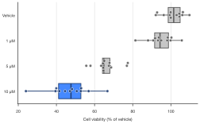

*`orient="h"` puts values on the x axis (`.labels(x=...)` names the axis as
drawn); `.highlight("10 µM")` greys out the rest.*

## Figure legend text and source data

Journals ask authors to define the box plot elements in the figure legend.
`.caption()` writes that text from the plot's actual settings:

```python
(
    sp.box(hela, x="dose", y="viability")
    .points()
    .compare(ref="Vehicle", correction="holm")
    .caption()
)
# 'Box plots show the median (centre line), the first and third quartiles (box
# limits) and the most extreme values within 1.5x the interquartile range of
# the box (whiskers). Dots show individual values. n = 12 per distribution.
# P values: two-sided Mann-Whitney U test, Holm-adjusted for multiple comparisons.'
```

`.source_data()` returns n, mean, SD, minimum, quartiles, median, maximum,
whisker ends and the number of outliers for each box, for a journal's
source-data file:

```python
sp.box(viability, x="dose", y="viability", hue="cell_line").source_data()
```

!!! note "Journal checklist"
    - **Define the elements**: centre line, box limits, whiskers, points.
      `.caption()` writes this.
    - **Show the data when n is small.** Box plots need at least 5 values
      (Krzywinski & Altman, *Nat Methods* 11:119, 2014); SecretPlots warns
      below that. Below about 20 values per group, add `.points()`.
    - **Report n** per box (`.show_n()`) and **name the test** and the
      multiple-comparison correction. Prefer exact p-values to stars.
    - **Use the right test** for paired or repeated measures and pass its
      p-values with `p=`.
    - **Never** draw a mean ± SD as a box. Use a [bar plot](bar.md) with
      error bars, or points.

    The [journal-ready figures guide](../publication.md) covers sizes, fonts
    and file formats; the [presets page](../presets.md) lists journal
    presets.

## Warnings and errors

| Message | What it means |
|---|---|
| `SmallSampleWarning: Fewer than 5 values` | Add `.points()` so readers see the individual values. |
| `Cannot compare '5 µM': not a category` | Pair names must be categories, or groups with `hue`. Check spelling and units. |
| `Got 1 p-values for 2 comparisons` | Pass one p-value per comparison, in order. |
| `A test needs at least 2 values per group` | Too few values to test; drop that comparison. |
| `A t-test needs values that vary within the groups` | All values in both groups are equal. |
| `Unknown whis=...` | Use a number, two percentiles such as `(5, 95)`, or `"range"`. |
| `A log axis needs positive values` | Drop values ≤ 0 before `.log()`. |

More examples live in the [gallery](../gallery.md).
