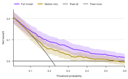
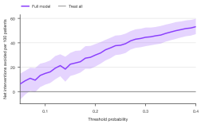

# Decision curves

`sp.decision_curve()` (alias `sp.dca()`) draws a decision curve analysis
(Vickers & Elkin, 2006). It answers the question that ROC curves and
calibration plots leave open: *would acting on this model help patients,
compared with treating everyone or no one?*

Each curve shows a model's **net benefit** across threshold probabilities.
The threshold `pt` is the risk at which a clinician would treat. A patient is
treated when the model's predicted risk is at least `pt`, and

```text
net benefit = TP/n − FP/n × pt / (1 − pt)
```

A false positive therefore costs `pt / (1 − pt)` true positives. The two
reference strategies are "treat all" and "treat none" (net benefit 0). At a
given threshold, a model is useful where its curve lies above both.

The examples on this page share one setup, like cells in a notebook. The data
are synthetic: 750 patients referred for biopsy, with predicted cancer risks
from a full model and from a single marker.

```python
import numpy as np
import pandas as pd
import SecretPlots as sp

sp.use(preset="nature")                      # 89 mm single column, 7 pt text

rng = np.random.default_rng(7)
n = 750
score = rng.normal(size=n)
logit = -1.6 + 1.3 * score
biopsy = pd.DataFrame({
    "cancer": rng.random(n) < 1 / (1 + np.exp(-logit)),
    "Full model": 1 / (1 + np.exp(-(logit + rng.normal(0, 0.3, n)))),
    "Marker only": 1 / (1 + np.exp(-(-1.6 + 0.6 * score
                                    + rng.normal(0, 0.8, n)))),
})
```

```python
(
    sp.decision_curve(biopsy, outcome="cancer",
                      models=["Full model", "Marker only"],
                      thresholds=np.arange(0.01, 0.61, 0.01))
    .ci()
)
```
<!-- figure: decision-hero -->



*Net benefit of biopsying patients whose predicted risk is at or above each
threshold. From about 5% upward the full model beats biopsying everyone, and it
stays above biopsying no one across the range. The marker alone is never
better than the full model. Shaded bands are 95% bootstrap intervals.*

!!! tip "Explore the options from Python"
    `sp.DecisionCurvePlot.arguments()` lists what `sp.decision_curve(...)`
    accepts, and `sp.DecisionCurvePlot.options()` lists every chainable step.
    See the [option discovery guide](../options.md).

## Signature

```text
sp.decision_curve(data, outcome, models, *, thresholds=None,
                  measure="net_benefit", missing="raise") -> DecisionCurvePlot
```

| Argument | Default | Meaning |
|---|---|---|
| `data` | | A DataFrame (or dict of columns) with one row per patient. |
| `outcome` | | Column marking the outcome (`1`/`True`) or its absence (`0`/`False`). |
| `models` | | A column, or list of columns, of predicted probabilities between 0 and 1. Each becomes a curve labelled with the column name. |
| `thresholds` | `None` | Threshold probabilities to evaluate: increasing and strictly between 0 and 1. Default 0.01 to 0.99 in steps of 0.01. |
| `measure` | `"net_benefit"` | `"net_benefit"` or `"interventions_avoided"` (net interventions avoided per 100 patients, relative to treating all). |
| `missing` | `"raise"` | `"raise"` rejects missing outcomes or predictions; `"drop"` leaves those patients out. See [data handling](../usage.md). |

### Chainable methods

Every plot also has the shared steps (`.labels()`, `.legend()`, `.chrome()`,
`.preset()`, `.size()`, `.theme()`, `.colors()`, `.highlight()`, `.xlim()`,
`.ylim()`, `.format_axis()`, `.refline()`, `.save()`...). Decision curves add:

| Step | What it does |
|---|---|
| `.ci(show=True, *, level=0.95, n_boot=500, seed=0, alpha)` | Percentile bootstrap bands around each model curve. `seed` keeps the figure reproducible. |
| `.references(*, treat_all=True, treat_none=True)` | Show or hide the reference strategies. |
| `.source_data()` | Every plotted value (and its bounds) per model, reference strategy and threshold. |

## Input data

Use one row per patient, with the observed outcome and each model's
**predicted probability**. Scores on other scales (a biomarker level,
log-odds) must be turned into risks first, for example with a logistic
regression of the outcome on the score. Fitted risks should come from a
validation set or from cross-validation; in-sample risks overstate the
benefit.

Pick thresholds that a clinician might reasonably use. Net benefit at a 90%
threshold for a biopsy decision means little, and limiting the range keeps
the interesting part of the plot readable:

```python
sp.dca(biopsy, outcome="cancer", models="Full model",
       thresholds=np.arange(0.05, 0.41, 0.01)).format_axis("x", "percent")
```

The y axis runs from just below zero to just above the highest net benefit,
so the treat-all curve is clipped once it falls steeply past the prevalence.
`.ylim(-0.1, 0.25)` sets the range yourself.

## Interventions avoided

`measure="interventions_avoided"` re-expresses the same comparison as the
number of unnecessary interventions (here, biopsies) avoided per 100
patients, without missing any cases, compared with treating everyone. Treating
all is then the zero line.

```python
(
    sp.dca(biopsy, outcome="cancer", models="Full model",
           measure="interventions_avoided",
           thresholds=np.arange(0.05, 0.41, 0.01))
    .ci()
)
```
<!-- figure: decision-avoided -->



*Net biopsies avoided per 100 patients by acting on the full model instead of
biopsying everyone.*

## Source data

`.source_data()` returns one row per model and threshold (plus the reference
strategies), with the bootstrap bounds when `.ci()` is on, ready for a
journal's source-data file:

```python
sp.dca(biopsy, outcome="cancer", models="Full model",
       thresholds=[0.1, 0.2, 0.3]).source_data()
```
