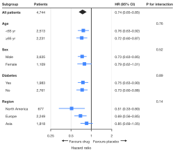
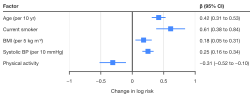
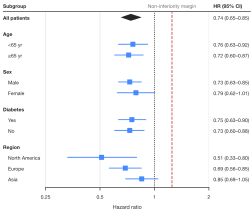
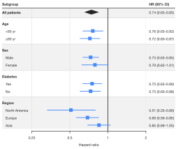
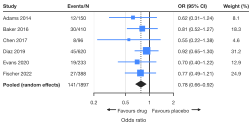
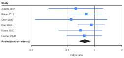
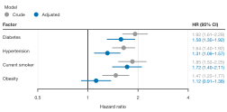
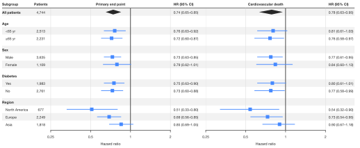

# Forest plots

`sp.forest()` draws one estimate and its confidence interval per row, beside a
table of the numbers behind it: the figure of subgroup analyses, meta-analyses
and regression models. The layout follows clinical journals. Labels and data
columns sit on the left, intervals in the middle against the line of no
effect, and "estimate (95% CI)" text on the right.

The examples on this page share one setup, like cells in a notebook. All data
are synthetic: hazard ratios from a cardiovascular trial with prespecified
subgroups, six studies of a smoking-cessation drug, and a cohort study of
risk factors.

```python
import numpy as np
import pandas as pd
import SecretPlots as sp

sp.use(preset="nature")                      # 89 mm single column, 7 pt text

trial = pd.DataFrame({
    "variable": [None, "Age", "Age", "Sex", "Sex", "Diabetes", "Diabetes",
                 "Region", "Region", "Region"],
    "subgroup": ["All patients", "<65 yr", "≥65 yr", "Male", "Female", "Yes", "No",
                 "North America", "Europe", "Asia"],
    "patients": [4744, 2513, 2231, 3635, 1109, 1983, 2761, 677, 2249, 1818],
    "hr": [0.74, 0.76, 0.72, 0.73, 0.79, 0.75, 0.73, 0.51, 0.69, 0.85],
    "lower": [0.65, 0.63, 0.60, 0.63, 0.62, 0.63, 0.60, 0.33, 0.56, 0.69],
    "upper": [0.85, 0.92, 0.87, 0.85, 1.01, 0.90, 0.88, 0.80, 0.85, 1.05],
})
interaction = {"Age": 0.76, "Sex": 0.52, "Diabetes": 0.89, "Region": 0.14}

studies = pd.DataFrame({
    "study": ["Adams 2014", "Baker 2016", "Chen 2017", "Diaz 2019", "Evans 2020",
              "Fischer 2022", "Pooled (random effects)"],
    "events": ["12/150", "30/410", "8/96", "45/620", "19/233", "27/388", "141/1897"],
    "or": [0.62, 0.81, 0.55, 0.92, 0.70, 0.77, 0.78],
    "lower": [0.31, 0.52, 0.22, 0.65, 0.40, 0.49, 0.66],
    "upper": [1.24, 1.27, 1.38, 1.30, 1.22, 1.21, 0.92],
    "weight": [8.1, 18.3, 4.6, 31.2, 12.9, 24.9, np.nan],
})
```

```python
(
    sp.forest(trial, label="subgroup", estimate="hr", lower="lower",
              upper="upper", group="variable")
    .summary("All patients")
    .table(left={"Patients": "patients"},
           right={"P for interaction": interaction})
    .favours("Favours drug", "Favours placebo")
    .labels(x="Hazard ratio")
)
```
<!-- figure: forest-hero -->



*Each subgroup's hazard ratio with its 95% CI, on a log axis with no effect
at 1. Sections come from `group=` and the overall estimate is a summary
diamond. The P for interaction values sit on the section headers.*

Rows are drawn in data order, so sort or arrange your DataFrame the way the
figure should read. Nothing is drawn until the plot is displayed, saved or
shown, or until you access `.fig` / `.ax`.

!!! tip "Explore the options from Python"
    `sp.ForestPlot.options()` lists every chainable step and
    `sp.ForestPlot.options("table")` shows one step's parameters, allowed
    values and defaults. See the [option discovery guide](../options.md).

## Signature

```text
sp.forest(data, label=None, estimate="estimate", lower="lower", upper="upper", *,
          group=None, hue=None, panel=None, weight=None, scale="ratio",
          null=None, hue_order=None, panel_order=None, missing="raise")
          -> ForestPlot
```

| Argument | Default | Meaning |
|---|---|---|
| `data` | | A DataFrame (or dict of columns) with one row per estimate. |
| `label` | `None` | Column of row labels; default the index. Its name becomes the column header. |
| `estimate`, `lower`, `upper` | `"estimate"`, `"lower"`, `"upper"` | Columns of the point estimate and confidence limits. |
| `group` | `None` | Sections such as "Age" and "Sex": a bold header row each, rows indented below. Rows with an empty group (e.g. "Overall") stand alone. |
| `hue` | `None` | Several estimates per row (models, arms), dodged and colored, with a legend. |
| `panel` | `None` | Side-by-side forests that share the row labels (e.g. outcomes). |
| `weight` | `None` | Study weights; marker area is proportional. |
| `scale` | `"ratio"` | `"ratio"` (odds, hazard, risk and rate ratios): a log axis, no effect at 1. `"difference"` (mean or risk differences, coefficients): a linear axis, no effect at 0. |
| `null` | `None` | Position of the line of no effect (default 1 or 0 by `scale`); `False` hides it. `.null()` also styles and labels it. |
| `hue_order`, `panel_order` | `None` | Explicit order of the `hue` values and panels. |
| `missing` | `"raise"` | `"raise"` rejects missing or infinite estimates and limits; `"drop"` leaves those rows out. See [data handling](../usage.md). |

### Chainable methods

Every plot also has the shared steps (`.labels()`, `.legend()`, `.chrome()`,
`.preset()`, `.size()`, `.theme()`, `.colors()`, `.highlight()`, `.xlim()`,
`.format_axis()`, `.save()`...). Forest plots add:

| Step | What it does |
|---|---|
| `.table(left, right, *, formats, align)` | Extra columns before the forest and after the estimates; see [Table columns](#table-columns). |
| `.estimates(show=True, *, decimals=2, header, side="right")` | The "estimate (95% CI)" column; `False` hides it. |
| `.summary(*labels)` | Draw rows as diamonds with bold labels (overall or pooled estimates). |
| `.null(value=True, *, label, color, linestyle="-", linewidth)` | Position, style and label of the line of no effect; see [The line of no effect](#the-line-of-no-effect). |
| `.favours(left, right)` | Direction labels with arrows under the axis. |
| `.groups(*, gap=0.5, headers=True, indent)` | Spacing, headers and indent of `group=` sections. |
| `.stripes(show=True, *, by="row", color)` | Shade every other row, or every other `group=` section (`by="group"`), across table and forest. |
| `.dividers(show=True, *, by="group", color, linewidth, linestyle="-")` | Rules between `group=` sections, or between rows (`by="row"`); see [Shading and dividers](#shading-and-dividers). |
| `.markers(marker="s", *, size)` | Shape and size of the point estimates. |
| `.refline(*values, ...)` | Extra vertical lines, e.g. at the overall estimate; `label_position="start"`/`"center"`/`"end"`, `label_rotation=90` and `label_side="left"`/`"right"` move and turn the label. |
| `.source_data()` | The plotted rows and estimate text as a DataFrame. |

## Input data

One row per estimate, with the confidence limits in their own columns. Most
statistics packages give you this directly: a `statsmodels` result's
`conf_int()`, R's `broom::tidy(conf.int = TRUE)` output, or a meta-analysis
table. Hazard, odds and rate ratios go in as ratios, not logs. If you have
log-odds coefficients, exponentiate the estimate and both limits first.

The estimate column name becomes the axis title and the estimate header:
short lowercase names are read as abbreviations, so `hr` gives "HR (95% CI)".
Use `.labels(x=...)` and `.estimates(header=...)` to write them out. The
header assumes 95% intervals; pass `header=` for other levels.

## Ratios and differences

A ratio scale is logarithmic, so a halving and a doubling of risk sit the same
distance from 1. The ticks bracket the data with doublings (0.25, 0.5, 1, 2, 4)
when they fit, and with 1-2-5 steps or decades for wider ranges. For mean
differences or regression coefficients use `scale="difference"`.

```python
risk = pd.DataFrame({
    "factor": ["Age (per 10 yr)", "Current smoker", "BMI (per 5 kg m⁻²)",
               "Systolic BP (per 10 mmHg)", "Physical activity"],
    "beta": [0.42, 0.61, 0.18, 0.25, -0.31],
    "lower": [0.31, 0.38, 0.05, 0.16, -0.52],
    "upper": [0.53, 0.84, 0.31, 0.34, -0.10],
})

(
    sp.forest(risk, label="factor", estimate="beta", lower="lower",
              upper="upper", scale="difference")
    .estimates(header="β (95% CI)")
    .labels(x="Change in log risk")
)
```
<!-- figure: forest-difference -->



*`scale="difference"` gives a linear axis, a null line at 0 and estimates
written "a (b to c)", so negative limits read clearly.*

Limits that go past `.xlim()` are cut with an arrowhead, as journals require.
Use `.xlim()` to keep one extreme interval from squeezing the others.

## The line of no effect

The solid vertical line marks no effect: a ratio of 1 or a difference of 0.
Intervals that cross it are compatible with no effect. `.null()` moves, styles
or labels it. A non-inferiority trial, for example, compares the upper limits
with a margin rather than with 1. `.null(False)` (or `null=False` in
`sp.forest()`) hides the line, and `.null()` restores the default. For a second
line, such as the pooled estimate, add `.refline()`.

```python
(
    sp.forest(trial, label="subgroup", estimate="hr", lower="lower",
              upper="upper", group="variable")
    .summary("All patients")
    .null(1.25, label="Non-inferiority margin", linestyle="--", color="#C0392B")
    .refline(1, linestyle=":")
    .labels(x="Hazard ratio")
)
```
<!-- figure: forest-null -->



*Every upper limit stays left of the 1.25 margin, so non-inferiority holds in
each subgroup. The label sits above the line in the header row.*

## Sections and headers

`group=` splits the rows into sections with a bold header each and indents the
rows below, as in the subgroup figure at the top. Each section starts after a
small gap. `.groups(headers=False)` keeps the gap but drops the header rows.
That suits rows that are self-explanatory, such as a list of drugs by class.

Values that belong to a whole section, typically the P for interaction, go in a
table column given as a `{group: value}` mapping instead of a column name.
They are printed on the header row, as in the `interaction` column above.

## Shading and dividers

Long tables are easier to read with a visual break between sections or rows.
`.stripes()` shades every other row across the table and forest. With
`hue=`, a row holds all of a label's estimates, so they share one band.
`.stripes(by="group")` shades every other section instead, header included.
`.dividers()` draws thin rules between sections, or between rows with
`by="row"`. Both take a `color`. Dividers also take `linewidth` and
`linestyle`. Without `group=`, every row counts as its own section.

```python
(
    sp.forest(trial, label="subgroup", estimate="hr", lower="lower",
              upper="upper", group="variable")
    .summary("All patients")
    .stripes(by="group")
    .dividers()
    .labels(x="Hazard ratio")
)
```
<!-- figure: forest-sections -->



*Alternate sections are shaded and each one is closed off by a rule, so the
eye can follow a section across the table and the forest.*

## Table columns

`.table(left=..., right=...)` adds columns before the forest and after the
estimates. Pass a list of column names (the names become headers) or a
`{header: column}` mapping. Each call replaces the columns, and `.table()`
removes them. Numbers are formatted automatically: thousands separators for
counts, three significant digits otherwise. Use `formats=` to choose a format
per header: a format spec such as `".1f"`, a template such as `"{:.1f}%"`,
`"p"` for p-values (`<0.001`, `0.004`, `0.42`), or a function. Text columns
like "12/150" are printed as they are.

=== "Meta-analysis"

    ```python
    (
        sp.forest(studies, label="study", estimate="or", lower="lower",
                  upper="upper", weight="weight")
        .summary("Pooled (random effects)")
        .table(left={"Events/N": "events"}, right={"Weight (%)": "weight"},
               formats={"Weight (%)": ".1f"})
        .favours("Favours drug", "Favours placebo")
        .refline(0.78, linestyle=":")
        .labels(x="Odds ratio")
    )
    ```
    <!-- figure: forest-meta -->

    

    *`weight=` scales the square areas, `.summary()` draws the pooled
    estimate as a diamond (it needs no weight), and `.refline()` marks the
    pooled odds ratio.*

=== "Labels and forest only"

    ```python
    (
        sp.forest(studies, label="study", estimate="or", lower="lower",
                  upper="upper")
        .summary("Pooled (random effects)")
        .estimates(False)
        .labels(x="Odds ratio")
    )
    ```
    <!-- figure: forest-no-table -->

    

    *`.estimates(False)` leaves only the labels and the forest, for a
    figure that sits next to a separate table.*

`.estimates(side="left")` moves the estimate column beside the labels.
`align={header: "left"}` changes a column's alignment (default center).

## Several estimates per row

`hue=` shows several estimates in each row, such as crude and adjusted models
or two treatment arms. They are dodged within the row, colored, and named in a
legend. The estimate text is colored to match.

```python
cohort = pd.DataFrame({
    "factor": np.repeat(["Diabetes", "Hypertension", "Current smoker", "Obesity"], 2),
    "model": ["Crude", "Adjusted"] * 4,
    "hr": [1.92, 1.58, 1.64, 1.31, 1.85, 1.72, 1.47, 1.12],
    "lower": [1.61, 1.30, 1.40, 1.09, 1.52, 1.40, 1.22, 0.91],
    "upper": [2.29, 1.92, 1.92, 1.57, 2.25, 2.11, 1.77, 1.38],
})

(
    sp.forest(cohort, label="factor", estimate="hr", lower="lower",
              upper="upper", hue="model")
    .markers("o")
    .colors(["#999999", "#0072B2"])
    .labels(x="Hazard ratio")
)
```
<!-- figure: forest-hue -->



*Adjustment shrinks every hazard ratio. With `hue=` the estimate column
lists one line per model in the model's color.*

## Side-by-side panels

`panel=` splits the forest into side-by-side panels that share the row labels,
one per outcome or analysis. Each panel has its own axis, estimate column and
`right=` table columns. `left=` columns are shared, so their values must agree
between panels.

```python
outcomes = pd.concat([
    trial.assign(outcome="Primary end point"),
    trial.assign(outcome="Cardiovascular death",
                 hr=trial["hr"] * 1.06,
                 lower=trial["lower"] * 0.97,
                 upper=trial["upper"] * 1.12),
])

(
    sp.forest(outcomes, label="subgroup", estimate="hr", lower="lower",
              upper="upper", group="variable", panel="outcome")
    .summary("All patients")
    .table(left={"Patients": "patients"})
    .stripes()
    .labels(x="Hazard ratio")
    .preset("nature", width="double")
)
```
<!-- figure: forest-panels -->



*`panel=` names each panel above its forest. `.stripes()` shades alternate
rows across the whole width so a row is easy to follow. Wide figures need the
double-column width.*

## Size and layout

Without an explicit height, the figure is as tall as its rows need, up to the
preset's maximum height. `.size(height=...)` fixes it. The table columns keep
a fixed physical spacing and the forest takes the remaining width. If the
table leaves too little room, SecretPlots raises an error rather than
squeezing the intervals into a sliver. Widen the figure, shorten the labels or
drop columns.

`.highlight("Asia")` mutes every other row. `.colors({"Asia": "#D55E00"})`
recolors chosen rows (or `hue` groups) and `.colors("#333333")` recolors all
of them. `.source_data()` returns the rows in display order with the estimate
text, ready for a journal's source-data file.
