# Heatmaps

`sp.heatmap()` draws a matrix as coloured cells: expression across samples,
fold changes over time, correlation matrices, confusion matrices. It covers
what journal heatmaps usually need: a colorbar with a title, colour-blind-safe
maps centred where they should be, values in the cells, row and column
groups, annotation tracks, z-scoring and hierarchical clustering.

Every example on this page runs top to bottom like notebook cells, starting
from this setup. All data are synthetic.

```python
import numpy as np
import pandas as pd
import SecretPlots as sp

sp.use(preset="nature")                     # 89 mm single column, 7 pt text
rng = np.random.default_rng(5)

# log2 expression of 20 genes in four pathways: 6 sham and 6 MI hearts
pathways = {
    "Cardiac TF": ["GATA4", "NKX2-5", "TBX5", "HAND2", "MEF2C"],
    "Sarcomere": ["MYH6", "MYL7", "TNNT2", "ACTC1", "MYL2"],
    "Cell cycle": ["CDK1", "MKI67", "TOP2A", "CCNB1", "AURKB"],
    "Fibrosis": ["COL1A1", "COL3A1", "POSTN", "FN1", "TGFB1"],
}
genes = [g for members in pathways.values() for g in members]
samples = [f"Sham {i}" for i in range(1, 7)] + [f"MI {i}" for i in range(1, 7)]
condition = {s: s.split()[0] for s in samples}             # "Sham" or "MI"
batch = {s: f"Batch {1 + i % 2}" for i, s in enumerate(samples)}

level = rng.uniform(3, 11, (20, 1))                         # each gene's own level
shift = np.repeat([-1.0, -1.4, 1.3, 2.2], 5)[:, None] * rng.uniform(0.6, 1.2, (20, 1))
values = level + rng.normal(0, 0.45, (20, 12))
values[:, 6:] += shift                                      # MI changes each pathway
expr = pd.DataFrame(values, index=pd.Index(genes, name="Gene"), columns=samples)
expr["pathway"] = np.repeat(list(pathways), 5)              # text column: not drawn
```

The overview is a typical figure panel from a transcriptomics paper: rows
z-scored, genes split by pathway and clustered within each pathway, sample
annotations on top, and italic gene names.

```python
(
    sp.heatmap(expr)
    .scale("row")
    .groups(rows="pathway")
    .cluster(cols=False)
    .tracks(cols={"Condition": condition, "Batch": batch})
    .cmap("tol_bu_rd", center=0)
    .colorbar("Row z-score")
    .ticklabels(italic=True)
    .colors(["#4477AA", "#EE6677", "#228833", "#CCBB44",    # pathways
             "#BBBBBB", "#AA3377",                          # Sham, MI
             "#DDDDDD", "#555555"])                         # Batch 1, Batch 2
    .size(height="80mm")
)
```
<!-- figure: heatmap-overview.png -->

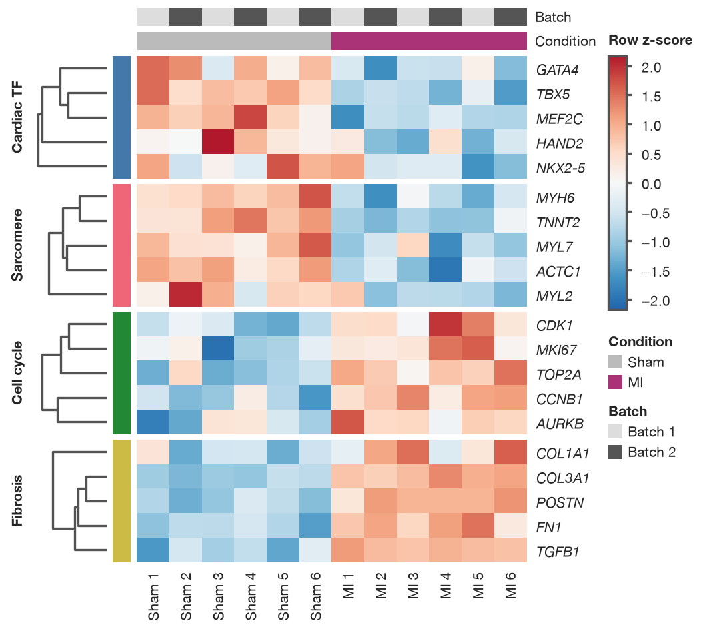

*Expression of 20 genes in sham and MI hearts. Rows z-scored; genes grouped
by pathway and clustered within each group (average linkage, Euclidean
distance); samples in their original order.*

Like every SecretPlots plot, nothing is drawn until the plot is displayed,
saved, or you access `.fig` / `.ax`.

## Contents

- [Signature](#signature)
- [Input data](#input-data)
- [Colormap and limits](#colormap-and-limits)
- [Colorbar](#colorbar)
- [Values in the cells](#values-in-the-cells)
- [Scaling rows or columns](#scaling-rows-or-columns)
- [Clustering](#clustering)
- [Groups](#groups)
- [Annotation tracks](#annotation-tracks)
- [Correlation matrices and masks](#correlation-matrices-and-masks)
- [Row and column labels](#row-and-column-labels)
- [Reference lines](#reference-lines)
- [Size, presets and saving](#size-presets-and-saving)
- [Recipes](#recipes)
- [Journal checklist](#journal-checklist)
- [Discovering options](#discovering-options)
- [Warnings and errors](#warnings-and-errors)

## Signature

```text
sp.heatmap(data, x=None, y=None, value=None, *,
           aggfunc="mean", row_order=None, col_order=None, square=False,
           missing="raise") -> HeatmapPlot
```

| Argument | Default | Meaning |
|---|---|---|
| `data` | required | Wide DataFrame (rows × columns), long DataFrame with `x`/`y`/`value` columns, 2-D array, list of lists, or dict of columns. In a wide table, numeric columns become heatmap columns; text columns stay available to `.groups()` and `.tracks()`. |
| `x` | `None` | Long table: column holding the heatmap's column labels. |
| `y` | `None` | Column holding the row labels (long or wide table). Without it, a wide table's index labels the rows. |
| `value` | `None` | Long table: column holding the values; its name becomes the colorbar title. |
| `aggfunc` | `"mean"` | Long table: how repeated (x, y) pairs combine: `"mean"`, `"median"`, `"sum"` or a function. |
| `row_order`, `col_order` | `None` | Explicit order of rows / columns (also selects them). |
| `square` | `False` | Square cells. |
| `missing` | `"raise"` | `"raise"` rejects missing or infinite cells; `"gap"` draws them grey; `"drop"` removes incomplete rows. See [data handling](../usage.md). |

### Chainable methods

Heatmap-specific steps, on top of the shared ones (`.labels()`, `.colors()`,
`.legend()`, `.size()`, `.refline()`, `.save()`, …; see [usage](../usage.md)).
`.cmap()` and `.colorbar()` reset any option they don't pass; the others keep
earlier settings.

| Method | Options (default) | What it does |
|---|---|---|
| `.cmap()` | `name=None`, `center=None`, `vmin=None`, `vmax=None`, `robust=False`, `reverse=False`, `log=False`, `levels=None` | Colormap and colour limits. See [Colormap and limits](#colormap-and-limits). |
| `.colorbar()` | `label=None`, `position="right"`, `ticks=None`, `fmt=None`, `pad=None` (about 4 pt) | Colorbar title, place, ticks, tick format and spacing. |
| `.values()` | `fmt=".2g"`, `labels=None` | Print each cell's value (or your own text) in black or white, whichever reads better. |
| `.scale()` | `axis="row"`, `method="zscore"` | Z-score (or `"minmax"`) each row or column; `axis=None` undoes it. |
| `.cluster()` | `rows=True`, `cols=True`, `method="average"`, `metric="euclidean"`, `dendrogram=True`, `split_rows=None`, `split_cols=None` | Hierarchical clustering with dendrograms. |
| `.groups()` | `rows=None`, `cols=None`, `gap=2.0`, `labels=True`, `bar=True` | Split rows/columns into labelled groups with gaps. |
| `.tracks()` | `rows=None`, `cols=None` | Annotation colour bars with a legend. |
| `.mask()` | `which="upper"`, `diagonal=False` | Leave cells blank: a triangle or a boolean matrix. `None` shows every cell. |
| `.ticklabels()` | `rows=None`, `cols=None`, `rotation=None`, `italic=False` | Show, hide, select or rename row/column labels; italic row labels. |
| `.source_data()` | | The matrix as drawn (scaled, ordered, masked). |

`.log()` is not available (heatmap axes are categories); use
`.cmap(log=True)` for a logarithmic colour scale.

## Input data

A wide table: numeric columns become heatmap columns and the index labels the
rows. Text columns like `pathway` are not drawn, but `.groups()` and
`.tracks()` can refer to them by name.

```python
sp.heatmap(expr)
```

A long ("tidy") table, one row per measurement. Repeated `(sample, gene)`
pairs are averaged (`aggfunc="mean"`) and the value column's name becomes the
colorbar title:

```python
long = expr.drop(columns="pathway").reset_index().melt(
    id_vars="Gene", var_name="Sample", value_name="log2 TPM"
)
sp.heatmap(long, x="Sample", y="Gene", value="log2 TPM")
```

A plain matrix of numbers:

```python
sp.heatmap([[1.0, 0.4, 0.1], [0.4, 1.0, 0.7], [0.1, 0.7, 1.0]])
```

## Colormap and limits

The colormap is the most important choice on a heatmap. Use a **sequential**
map (light to dark) for magnitudes such as expression or counts, and a
**diverging** map, centred on a meaningful value, for signed quantities such
as fold changes, z-scores or correlations. The tabs use a time course of
log₂ fold changes after myocardial infarction (MI); *NPPB*, a classic injury
marker, rises far more than anything else.

```python
days = ["Day 1", "Day 3", "Day 7", "Day 14", "Day 28"]
profile = {                                      # mean log2 FC per pathway over time
    "Cardiac TF": [-0.6, -1.0, -0.7, -0.3, -0.1],
    "Sarcomere": [-1.2, -1.8, -1.3, -0.6, -0.2],
    "Cell cycle": [0.6, 2.0, 1.1, 0.3, 0.0],
    "Fibrosis": [0.2, 1.1, 2.6, 1.9, 1.1],
}
fc = np.vstack([np.array(profile[p]) * rng.uniform(0.6, 1.3) + rng.normal(0, 0.2, 5)
                for p in expr["pathway"]])
lfc = pd.DataFrame(fc, index=genes, columns=days)
lfc.loc["NPPB"] = [3.1, 6.8, 5.2, 3.0, 2.1]     # the outlier
```

=== "Default (sequential)"

    ```python
    sp.heatmap(lfc).colorbar("log₂ fold change").ticklabels(italic=True)
    ```
    <!-- figure: heatmap-cmap-default -->

    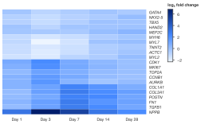

    *The theme's default sequential map. Fine for magnitudes, but here
    up- and down-regulation are just "lighter" and "darker", and NPPB
    compresses everything else.*

=== "center=0"

    ```python
    (
        sp.heatmap(lfc)
        .cmap("tol_bu_rd", center=0)
        .colorbar("log₂ fold change")
        .ticklabels(italic=True)
    )
    ```
    <!-- figure: heatmap-cmap-center -->

    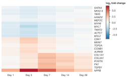

    *A diverging map centred at 0: blue down, red up, white unchanged. The
    limits are symmetric, but NPPB still sets them.*

=== "robust=True"

    ```python
    (
        sp.heatmap(lfc)
        .cmap("tol_bu_rd", center=0, robust=True)
        .colorbar("log₂ fold change")
        .ticklabels(italic=True)
    )
    ```
    <!-- figure: heatmap-cmap-robust -->

    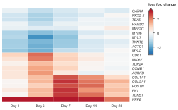

    *`robust=True` takes limits from the 2nd–98th percentiles, so the
    pathway patterns show. Arrow ends on the colorbar mark clipped values.*

=== "vmin/vmax + levels"

    ```python
    (
        sp.heatmap(lfc)
        .cmap("tol_bu_rd", center=0, vmin=-3, vmax=3, levels=7)
        .colorbar("log₂ fold change", ticks=[-3, -2, -1, 0, 1, 2, 3])
        .ticklabels(italic=True)
    )
    ```
    <!-- figure: heatmap-cmap-levels -->

    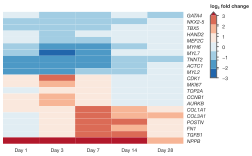

    *Fixed limits (comparable across panels) and 7 discrete steps, which
    are easier to read off in print.*

| Option | Meaning |
|---|---|
| `name` | SecretColors map (`"blues"`, `"RdBu"`, `"tol_sunset"`, `"tol_bu_rd"`, `"tol_yl_or_br"`, …; `sp.colormaps()` lists them), a palette colour (`"teal"`), a matplotlib map (`"viridis"`, `"magma"`), or a list of colours, low to high. Default: the theme's sequential map, or its diverging map with `center` or after `.scale()`. |
| `center` | Middle of a diverging map, e.g. `0` for differences or `1` for ratios. Limits become symmetric around it. Can't be combined with `log`. |
| `vmin`, `vmax` | Limits. Values outside get the end colour and an arrow on the colorbar. Fix them to compare panels. |
| `robust` | Set missing limits from the 2nd–98th percentiles, so a few outliers don't wash out the rest. |
| `reverse` | Flip the map (or append `_r` to the name). |
| `log` | Logarithmic colour scale (positive values only). |
| `levels` | Number of discrete colour steps (at least 2), or their boundaries. |

```python
sp.colormaps("diverging")      # name, kind, source, and notes on maps to avoid
```

!!! warning "Avoid rainbow and red–green maps"
    `jet`, `rainbow`, `turbo`, `Spectral` and red–green maps such as `RdYlGn`
    work but raise a `ColormapWarning`. Their uneven lightness invents
    boundaries in the data, and red–green can't be told apart by about 1 in 12
    men. Nature's figure guide and Crameri et al. (2020) ask authors not to
    use them. Good choices: `"viridis"`, `"magma"`, `"tol_yl_or_br"`,
    `"Blues"` (sequential); `"tol_bu_rd"`, `"tol_sunset"`, `"RdBu"`
    (diverging).

## Colorbar

Every heatmap gets a colorbar to the right of the row labels. Give it a
title with units; move it below wide heatmaps to save width.

```python
sp.heatmap(lfc).cmap("tol_sunset", center=0, robust=True).colorbar(
    "log₂ fold change", position="bottom", ticks=[-2, 0, 2], fmt=".0f"
).size(height="75mm")
```

| Option | Meaning |
|---|---|
| `label` | Title: what the colour means, with units. Default: the `value` column name, or "Z-score" for scaled data. |
| `position` | `"right"` (default), `"bottom"`, or `False` / `"none"` to hide it. |
| `ticks` | Tick values. |
| `fmt` | Tick format, e.g. `".1f"` or `"{:.0%}"`. |
| `pad` | Space in pt between the row (or column) labels and the colorbar; default about 4 pt. |

## Values in the cells

When readers need exact numbers, such as in a small summary matrix or a
confusion matrix, print them in the cells. The text is black or white,
whichever reads better on the cell, at the preset's tick-label size (never
below a journal's minimum). Your own text per cell, such as significance
stars, goes in `labels=`: a DataFrame with the same rows and columns, or a 2-D
list in data order; `""` leaves a cell blank.

```python
fibrosis = lfc.loc[pathways["Fibrosis"] + ["NPPB"]]
padj = 10 ** -(1.4 * fibrosis.abs() * rng.uniform(0.5, 1.5, fibrosis.shape))  # adjusted P
stars = padj.map(lambda p: "***" if p < 0.001 else "**" if p < 0.01 else "*" if p < 0.05 else "")
```

=== ".values(\".1f\")"

    ```python
    (
        sp.heatmap(fibrosis)
        .cmap("tol_yl_or_br", vmin=0, vmax=4)
        .values(".1f")
        .colorbar("log₂ fold change")
        .ticklabels(italic=True)
        .size(height="45mm")
    )
    ```
    <!-- figure: heatmap-values-numbers -->

    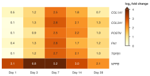

    *Each cell's value, one decimal. Values above `vmax` (NPPB) take the end
    colour.*

=== ".values(labels=stars)"

    ```python
    (
        sp.heatmap(fibrosis)
        .cmap("tol_yl_or_br", vmin=0, vmax=4)
        .values(labels=stars)
        .colorbar("log₂ fold change")
        .ticklabels(italic=True)
        .size(height="45mm")
    )
    ```
    <!-- figure: heatmap-values-stars -->

    

    *Your own labels: significance stars from adjusted P values (one, two
    or three stars for P < 0.05, 0.01, 0.001). Define them in the legend.*

If the labels don't fit the cells they are all hidden with a
`LabelsHiddenWarning`, since hiding only some would mislead. Use a larger
figure or a shorter format (`".2g"`).

## Scaling rows or columns

Genes differ in their baseline expression by orders of magnitude, so raw
values mostly show which genes are highly expressed. To compare *patterns*
across samples, z-score each row: `.scale("row")` subtracts each gene's mean,
divides by its standard deviation, switches to the diverging map centred at
0 and titles the colorbar "Z-score".

=== "Raw values"

    ```python
    (
        sp.heatmap(expr)
        .cmap("viridis")
        .colorbar("log₂ TPM")
        .ticklabels(italic=True)
    )
    ```
    <!-- figure: heatmap-scale-none -->

    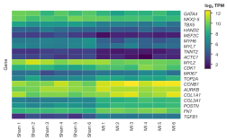

    *Raw log₂ expression: each gene's baseline level dominates, and the
    sham-versus-MI change is hard to see.*

=== "scale(\"row\")"

    ```python
    sp.heatmap(expr).scale("row").ticklabels(italic=True)
    ```
    <!-- figure: heatmap-scale-row -->

    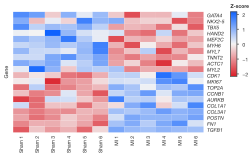

    *Row z-scores: every gene's up- or down-regulation in MI is visible.
    This is the default theme's diverging map, which runs red (low) to blue
    (high); `.cmap("tol_bu_rd")` gives the blue-low, red-high convention
    common in expression figures.*

=== "method=\"minmax\""

    ```python
    (
        sp.heatmap(expr)
        .scale("row", method="minmax")
        .cmap("magma")
        .colorbar("Scaled expression")
        .ticklabels(italic=True)
    )
    ```
    <!-- figure: heatmap-scale-minmax -->

    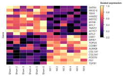

    *Min–max scaling puts each row on 0–1, a sequential quantity, so a
    sequential map fits.*

`.scale("col")` scales columns instead, e.g. to compare samples with
different sequencing depth. Constant rows have no pattern and are left blank.

!!! tip "State the scaling"
    Say "row z-scores" (or "min–max scaled per gene") in the colorbar title or
    legend. Without it, readers can't tell whether a dark cell is a high
    level or merely high for that gene.

## Clustering

`.cluster()` orders rows and columns by hierarchical clustering and draws the
dendrograms, so similar profiles sit together. Results match
`scipy.cluster.hierarchy.linkage`, but scipy is not required. The tabs start
from the genes in shuffled order, with a pathway track so you can see the
clustering recover the modules.

```python
shuffled = expr.sample(frac=1, random_state=4)
pathway_track = {"Pathway": "pathway"}
pathway_colors = dict(zip(pathways, ["#4477AA", "#EE6677", "#228833", "#CCBB44"]))
```

=== "No clustering"

    ```python
    (
        sp.heatmap(shuffled)
        .scale("row")
        .cmap("tol_bu_rd", center=0)
        .tracks(rows=pathway_track)
        .colors(pathway_colors)
        .ticklabels(italic=True)
        .size(height="75mm")
    )
    ```
    <!-- figure: heatmap-cluster-off.png -->

    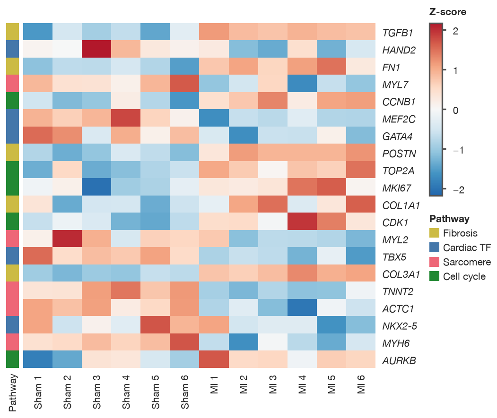

    *Data order: the structure is hidden.*

=== ".cluster()"

    ```python
    (
        sp.heatmap(shuffled)
        .scale("row")
        .cluster()
        .cmap("tol_bu_rd", center=0)
        .tracks(rows=pathway_track)
        .colors(pathway_colors)
        .ticklabels(italic=True)
        .size(height="75mm")
    )
    ```
    <!-- figure: heatmap-cluster-on.png -->

    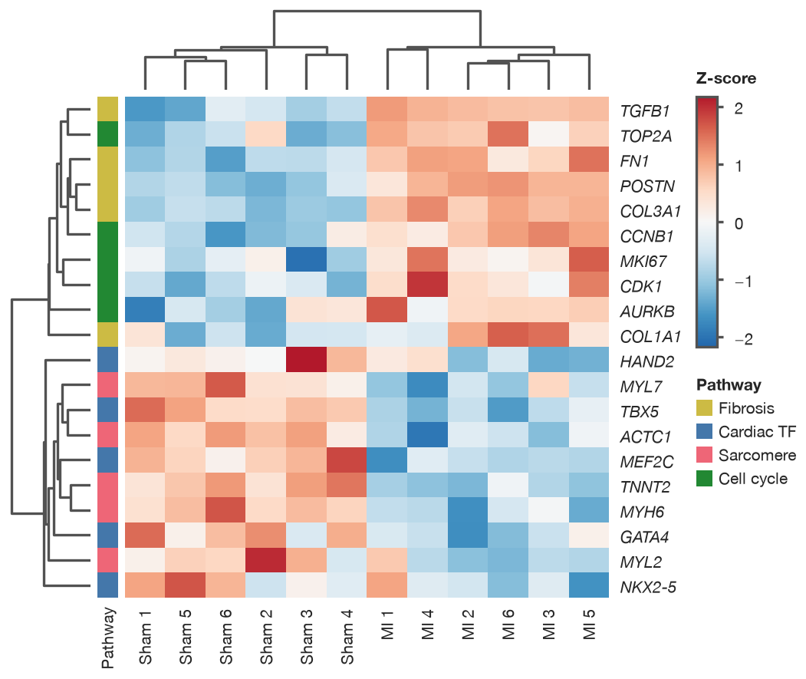

    *Rows and columns clustered: up- and down-regulated genes separate, and
    the samples split into sham and MI.*

=== "split_rows=2, cols=False"

    ```python
    (
        sp.heatmap(shuffled)
        .scale("row")
        .cluster(cols=False, split_rows=2, metric="correlation")
        .cmap("tol_bu_rd", center=0)
        .tracks(rows=pathway_track)
        .colors(pathway_colors)
        .ticklabels(italic=True)
        .size(height="75mm")
    )
    ```
    <!-- figure: heatmap-cluster-split.png -->

    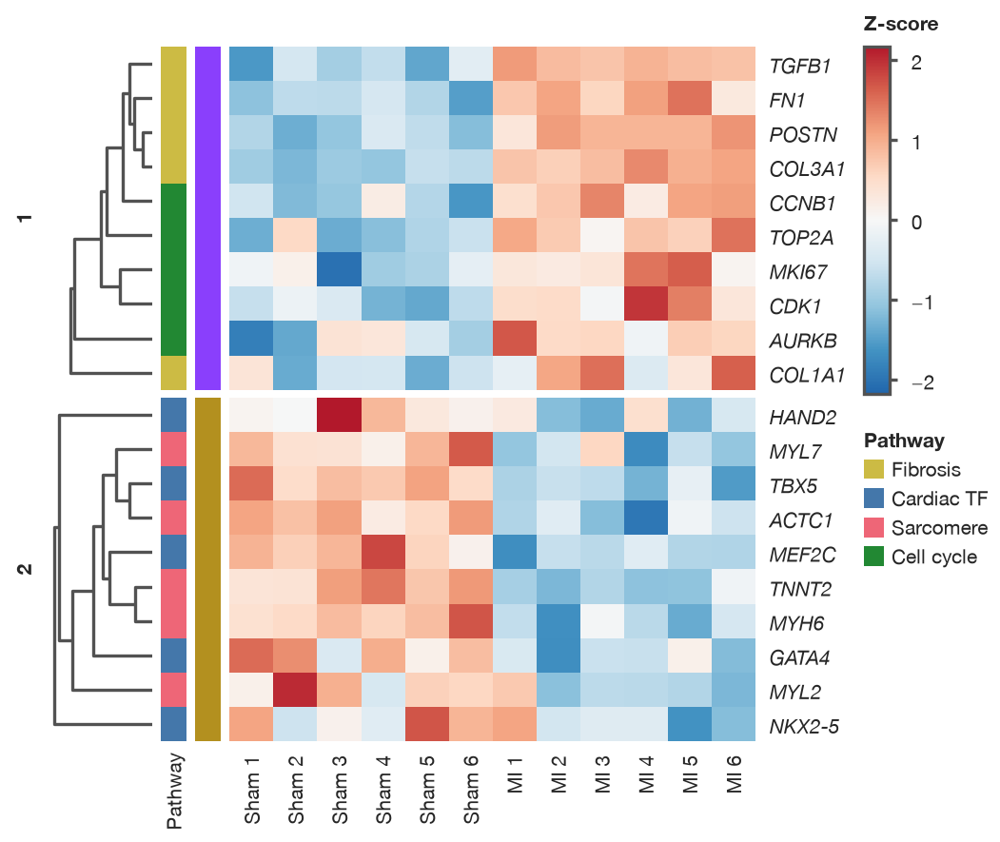

    *Columns kept in order, rows clustered by correlation distance and cut
    into two clusters, which get gaps and labels.*

| Option | Meaning |
|---|---|
| `rows`, `cols` | Which axes to cluster. Keep `cols=False` for ordered columns such as time points or doses. |
| `method` | Linkage: `"average"` (default), `"complete"` (pheatmap's default), `"single"` or `"ward"` (Euclidean only). |
| `metric` | `"euclidean"` (default), `"correlation"` (1 − Pearson r) or `"cosine"`. |
| `dendrogram` | Draw the trees. |
| `split_rows`, `split_cols` | Cut a tree into this many clusters, separated by gaps and labelled 1, 2, …; that axis must be clustered. |

With `.groups()`, each group is clustered on its own and keeps its place (as
in the overview). Clustering runs on the values as drawn, so after `.scale()`,
and needs complete data: drop or fill missing values first.

!!! note "Report how you clustered"
    A dendrogram order is one of many valid orders. State the distance and
    linkage in the figure legend, e.g. "rows clustered by average linkage on
    1 − Pearson r".

## Groups

`.groups()` keeps each group's rows (or columns) together and separates the
groups with a gap; a colour bar and its name mark each group. This is the
split heatmap common in journals, like ComplexHeatmap's `row_split` or
pheatmap's `gaps_row`. Use it when the grouping is known in advance; use
`split_rows` when it should come from the data.

```python
(
    sp.heatmap(expr)
    .scale("row")
    .groups(rows="pathway", cols=condition, gap=3)
    .cmap("tol_sunset", center=0)
    .colorbar("Row z-score")
    .ticklabels(italic=True)
    .colors({"Cardiac TF": "#0072B2", "Sarcomere": "#56B4E9", "Cell cycle": "#E69F00",
             "Fibrosis": "#D55E00", "Sham": "#BBBBBB", "MI": "#555555"})
    .size(height="80mm")
)
```
<!-- figure: heatmap-groups -->

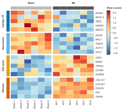

*Rows split by pathway, columns by condition, with Okabe–Ito group colours
and a `tol_sunset` diverging map.*

A group can be given as a column name from your table (`"pathway"`; in a long
table this works for columns too), a mapping `{row: group}`, a Series indexed
by row, or a list in data order. Groups appear in order of first appearance;
use a categorical column to fix the order.

| Option | Meaning |
|---|---|
| `rows`, `cols` | Group of each row / column. |
| `gap` | Space between groups in pt (default 2; `0` for none). |
| `labels` | Write the group names. |
| `bar` | Draw the colour bar. Colours come from the palette, or `.colors({group: colour})`. |

## Annotation tracks

Tracks are extra colour bars that describe rows or columns, such as
condition, batch, sex or tissue, explained in a legend under the colorbar.
Unlike groups they don't reorder anything, so they are the way to show that
clustering did (or didn't) follow a covariate. The overview has two column
tracks; the clustering tabs have a row track.

```python
sp.heatmap(expr).scale("row").tracks(
    cols={"Condition": condition, "Batch": batch},
    rows={"Pathway": "pathway"},
).size(height="70mm")
```

Tracks accept the same forms as groups, and as many tracks as you need.
Colours come from the palette in order of appearance, or from
`.colors({category: colour})`; `.legend(False)` hides the legend.

## Correlation matrices and masks

A correlation matrix is symmetric, so half of it is redundant. `.mask("upper")`
leaves the upper triangle blank; with `.values()` and a diverging map fixed at
−1 to 1 the result is a compact, honest summary.

```python
clinical = ["Age", "BMI", "SBP", "LDL", "HbA1c", "CRP", "eGFR"]
r = np.array([
    [1.00, 0.15, 0.45, 0.20, 0.25, 0.15, -0.55],
    [0.15, 1.00, 0.30, 0.15, 0.40, 0.35, -0.10],
    [0.45, 0.30, 1.00, 0.10, 0.20, 0.15, -0.30],
    [0.20, 0.15, 0.10, 1.00, 0.10, 0.10, -0.05],
    [0.25, 0.40, 0.20, 0.10, 1.00, 0.25, -0.20],
    [0.15, 0.35, 0.15, 0.10, 0.25, 1.00, -0.15],
    [-0.55, -0.10, -0.30, -0.05, -0.20, -0.15, 1.00],
])
patients = pd.DataFrame(rng.multivariate_normal(np.zeros(7), r, 300), columns=clinical)
corr = patients.corr()
(
    sp.heatmap(corr.iloc[1:, :-1], square=True)     # drop the empty first row and last column
    .mask("upper")
    .cmap("RdBu", center=0, vmin=-1, vmax=1, reverse=True)
    .values(".2f")
    .colorbar("Pearson r", ticks=[-1, -0.5, 0, 0.5, 1])
)
```
<!-- figure: heatmap-correlation -->

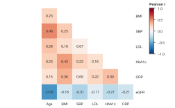

*Pearson correlations between seven clinical variables in 300 patients.
Lower triangle only; colour limits fixed at ±1.*

`"upper"` or `"lower"` hides that triangle (square matrices only);
`diagonal=True` hides the diagonal too. On the full matrix,
`.mask("upper", diagonal=True)` leaves an empty first row and last column;
plotting `corr.iloc[1:, :-1]` with `.mask("upper")`, as above, shows the same
cells without them. A boolean matrix (`True` = hide), as
an array in data order or a DataFrame, masks any cells you choose. Masked
cells stay blank, while missing values (with `missing="gap"`) are drawn grey,
so readers can tell "not shown" from "not measured".

Thin lines between cells, from the theme field `cell_edge_width`, help
readers see where one cell ends:

```python
sp.heatmap(fibrosis).theme(cell_edge_width=1).values(".1f")
```

## Row and column labels

Row labels sit right of the cells and column labels below; column labels turn
vertical when they are too wide. When there are too many rows to label
legibly, labels are hidden with a `LabelsHiddenWarning`. Label only the rows
that matter instead, the usual choice for genome-wide heatmaps:

```python
big = pd.DataFrame(rng.normal(0, 1, (200, 12)), columns=samples,
                   index=[f"Gene{i:03d}" for i in range(200)])
big.iloc[:50, 6:] += 2.5                       # induced after MI
big.iloc[50:90, 6:] -= 2.0                     # repressed after MI
markers = {"Gene004": "NPPA", "Gene022": "NPPB", "Gene041": "MYH7",
           "Gene057": "ATP2A2", "Gene078": "KCNJ2"}
big = big.rename(index=markers)
(
    sp.heatmap(big)
    .scale("row")
    .cmap("tol_bu_rd", center=0)
    .tracks(cols={"Condition": condition})
    .colors({"Sham": "#BBBBBB", "MI": "#AA3377"})
    .ticklabels(rows=list(markers.values()), italic=True)
    .colorbar("Row z-score")
)
```
<!-- figure: heatmap-marker-labels.png -->

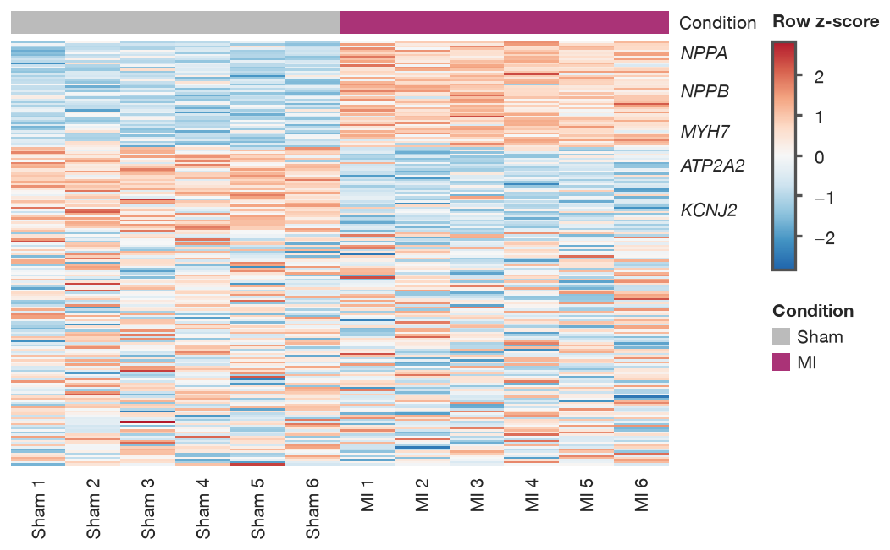

*200 genes, induced, repressed and unchanged after MI; only five marker
genes are labelled.*

```python
sp.heatmap(expr).ticklabels(cols={"Sham 1": "S1", "MI 1": "M1"})   # rename some labels
```

```python
sp.heatmap(big).ticklabels(rows=False)            # no row labels, no warning
```

```python
sp.heatmap(expr).ticklabels(rotation=45)          # fixed column-label angle
```

`.highlight("GATA4", "TBX5")` makes those labels bold and mutes the rest.

## Reference lines

`.refline()` draws lines across the heatmap (see
[bar plots](bar.md#reference-lines) for all options). A heatmap has no value
axis, so say which way: `axis="y"` for horizontal lines between or through
rows, `axis="x"` for vertical lines.

- A row or column **name** draws the line through the middle of its cells.
- A **number** `n` draws the line on the edge after the first `n` rows or
  columns (0 is the top or left edge). With `.groups()` the edge falls in the
  middle of the gap.

```python
(
    sp.heatmap(expr)
    .scale("row")
    .refline(6, axis="x", color="black", linestyle="-", linewidth=1)   # Sham | MI
    .refline("POSTN", axis="y", label=True)
)
```

The lines are drawn above the cells; names follow their row when clustering
reorders the rows.

## Size, presets and saving

Sizes, presets, themes and saving work as for every plot (see
[presets](../presets.md) and [journal-ready figures](../publication.md)):

```python
(
    sp.heatmap(expr)
    .scale("row")
    .groups(rows="pathway")
    .cluster(cols=False)
    .preset("nature", width="double")
)
```

Heatmaps with more than 5,000 cells are rasterized inside PDF and SVG files,
so the file stays small, while text and lines stay vector.
`plot.source_data()` returns the matrix as drawn (scaled, ordered, masked)
for a journal's source-data file:

```python
sp.heatmap(expr).scale("row").cluster().source_data().iloc[:3, :4]
```

## Recipes

A confusion matrix for a classifier: counts in the cells, a sequential map,
and axis titles saying which side is the truth.

```python
classes = ["Normal", "Adenoma", "Carcinoma"]
confusion = pd.DataFrame([[182, 9, 1], [14, 121, 11], [2, 8, 152]],
                         index=classes, columns=classes)
(
    sp.heatmap(confusion, square=True)
    .cmap("Blues")
    .values(".0f")
    .colorbar("Slides")
    .labels(x="Predicted class", y="Pathologist's diagnosis")
)
```
<!-- figure: heatmap-confusion -->

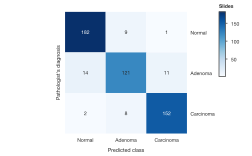

*Classifier predictions against the pathologist's diagnosis for 500
histology slides.*

Differential expression with the row tree cut into clusters and sample
groups on top:

```python
(
    sp.heatmap(expr)
    .scale("row")
    .cluster(cols=False, split_rows=2)
    .groups(cols=condition)
    .ticklabels(italic=True)
)
```

## Journal checklist

!!! note "Journal checklist"
    - **Colour scale.** Sequential for magnitudes; diverging only when the
      midpoint means something (0, or 1 for ratios), and centred on it.
      Avoid rainbow and red–green maps; SecretPlots warns about them.
    - **Colorbar.** Always include one, with a title and units ("Row z-score",
      "log₂ fold change", "Pearson r"). Arrow ends show values clipped by
      `vmin`/`vmax`/`robust`. Use the same limits for panels that are compared.
    - **Scaling.** Z-score rows before comparing genes, and say so.
    - **Order.** State how rows and columns are ordered: clustering metric and
      linkage, or the grouping.
    - **Text.** Cell values and labels use the preset's text sizes, so they stay
      within the journal's limits. Italicize gene names.
    - **Source data.** `plot.source_data()` gives the plotted numbers.

## Discovering options

```python
sp.HeatmapPlot.arguments()            # what sp.heatmap(...) accepts
```

```python
sp.HeatmapPlot.options()              # every chainable step
```

```python
sp.HeatmapPlot.options("cluster")     # one step's options, allowed values and defaults
```

See the [option discovery guide](../options.md) for searching these tables.

## Warnings and errors

| Message | What it means |
|---|---|
| `ColormapWarning: Colormap 'jet' is a rainbow map` | Pick a sequential or diverging map from `sp.colormaps()`. |
| `LabelsHiddenWarning: 300 row labels hidden` | Too many rows to label; use `.ticklabels(rows=[...])` or `rows=False`. |
| `LabelsHiddenWarning: ... cell values hidden` | Values don't fit the cells; enlarge the figure or shorten the format. |
| `Missing or non-finite heatmap cells` | Use `missing="gap"` or `"drop"`, or fill the matrix. |
| `Clustering needs complete data` | Drop or fill missing values before `.cluster()`. |
| `method='ward' needs metric='euclidean'` | Ward linkage is defined for Euclidean distance only. |
| `split_rows needs that axis to be clustered` | Don't combine `split_rows` with `rows=False`. |
| `groups: column 'x' has several values for row ...` | A group column must be constant within each row (or column). |
| `columns of a wide table can't be grouped by a column name` | Pass a mapping `{column: group}` for column groups. |
| `Use either .groups(rows=...) or .cluster(split_rows=...)` | Choose one way to split the rows. |
| `A triangle mask needs a square matrix` | Use a boolean mask for non-square data. |
| `log=True and center= cannot be combined` | A log colour scale can't be diverging. |
| `cmap(log=True) needs positive values` | Use a linear scale or drop values ≤ 0. |
| `Heatmap axes are categories; use .cmap(log=True)` | `.log()` isn't available on heatmaps. |
