# Histograms

`sp.histogram()` (alias `sp.hist()`) shows how one numeric variable is
distributed: where values cluster, how skewed they are and how two cohorts
overlap. Bars can show counts, proportions, percentages or densities; groups
can be overlaid, stacked or dodged; and density curves, fitted
distributions, reference lines, a rug and sample sizes can be added.

Every example on this page runs top to bottom like notebook cells, starting
from this setup. All data are synthetic.

```python
import numpy as np
import pandas as pd
import SecretPlots as sp

sp.use(preset="nature")                     # 89 mm single column, 7 pt text
rng = np.random.default_rng(11)

# Serum IL-6 in 420 healthy donors and 260 patients with sepsis (log-normal)
il6 = np.r_[rng.lognormal(np.log(2.5), 0.55, 420), rng.lognormal(np.log(22), 0.85, 260)]
cohort = pd.DataFrame({
    "il6": il6,
    "log_il6": np.log10(il6),
    "group": ["Healthy"] * 420 + ["Sepsis"] * 260,
})
IL6 = "Serum IL-6 (log₁₀ pg mL⁻¹)"

# Stroop task reaction times (ms): right-skewed, 150 trials per condition
stroop = pd.DataFrame({
    "rt": np.concatenate([230 + rng.gamma(3, s, 150) for s in (60, 85, 125)]),
    "condition": np.repeat(["Congruent", "Neutral", "Incongruent"], 150),
})

# UMIs per cell in a single-cell RNA-seq run, with a tail of empty droplets
umis = np.r_[rng.lognormal(np.log(6000), 0.6, 3000), rng.lognormal(np.log(220), 0.5, 600)]
```

The figure below is the classic two-cohort comparison: densities so that
cohorts of different size compare by shape, smooth density curves, each
cohort's median, and n in the legend.

```python
(
    sp.histogram(cohort, x="log_il6", hue="group", stat="density", binwidth=0.1)
    .kde()
    .refline("median")
    .show_n()
    .colors(["#0072B2", "#D55E00"])
    .labels(x=IL6)
    .legend(title="")
)
```
<!-- figure: histogram-overview -->

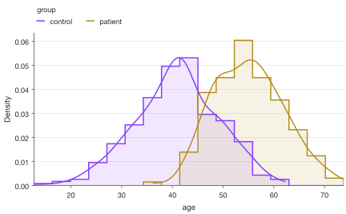

*Serum IL-6 in healthy donors and patients with sepsis. Bins of 0.1 log₁₀
units, density curves (Gaussian kernel) and dashed lines at each cohort's
median.*

Like every SecretPlots plot, nothing is drawn until the plot is displayed,
saved, or you access `.fig` / `.ax`.

## Contents

- [Signature](#signature)
- [Input data](#input-data)
- [What the bars show: `stat`](#what-the-bars-show-stat)
- [Bins](#bins)
- [Discrete values and log axes](#discrete-values-and-log-axes)
- [Groups: layer, stack or dodge](#groups-layer-stack-or-dodge)
- [Density curves and fits](#density-curves-and-fits)
- [Cumulative histograms](#cumulative-histograms)
- [Reference lines, rug and sample size](#reference-lines-rug-and-sample-size)
- [Colors, legend, orientation and source data](#colors-legend-orientation-and-source-data)
- [Journal checklist](#journal-checklist)
- [Discovering options](#discovering-options)
- [Warnings and errors](#warnings-and-errors)

## Signature

```text
sp.histogram(data=None, x=None, hue=None, *,
             bins="auto", binwidth=None, binrange=None, discrete=False,
             stat="count", common_norm=False, cumulative=False,
             multiple="layer", element=None, orient="v", hue_order=None,
             missing="raise") -> HistogramPlot
```

| Argument | Default | Meaning |
|---|---|---|
| `data` | `None` | Values (list, array, Series), a DataFrame with `x=`/`hue=` column names, a wide DataFrame or 2-D array (one group per column), or a dict `{group: values}`. |
| `x` | `None` | Column with the values, or the values themselves when `data` is left out. |
| `hue` | `None` | Column with the groups (or one group per value when `data` is left out). |
| `bins` | `"auto"` | Number of bins, explicit edges, or a rule: `"auto"`, `"fd"`, `"sturges"`, `"scott"`, `"rice"`, `"sqrt"`, `"doane"`. See [Bins](#bins). |
| `binwidth` | `None` | Bin width in data units; overrides `bins`. On a log axis a ratio > 1 (e.g. `2` for doubling bins). |
| `binrange` | `None` | `(low, high)` range covered by the bins. |
| `discrete` | `False` | One bin per integer, centred on it (counts, scores). |
| `stat` | `"count"` | Bar height: `"count"`, `"probability"` (alias `"proportion"`, `"fraction"`), `"percent"`, `"density"` or `"frequency"`. |
| `common_norm` | `False` | Normalize all groups together, so group sizes show. Ignored for `stat="count"`. |
| `cumulative` | `False` | Running total from left to right. |
| `multiple` | `"layer"` | Groups `"layer"` (overlaid), `"stack"` or `"dodge"` (side by side). |
| `element` | `None` | `"bars"` or `"step"` (outlines). Default: outlines for overlaid groups, bars otherwise. |
| `orient` | `"v"` | `"v"` (bars up) or `"h"` (bars to the right). |
| `hue_order` | `None` | Explicit group order. |
| `missing` | `"raise"` | `"raise"` rejects missing and infinite values; `"drop"` ignores them. See [data handling](../usage.md). |

### Chainable methods

Histogram-specific steps, on top of the shared ones (`.labels()`,
`.colors()`, `.legend()`, `.size()`, `.save()`, …; see [usage](../usage.md)):

| Method | Options (default) | What it does |
|---|---|---|
| `.kde()` | `show=True`, `bw_adjust=1.0`, `cut=0.0`, `color=None` | Smooth density curve (Gaussian kernel), scaled to the bars' `stat`. `color` is one colour or `{group: colour}`. |
| `.fit()` | `dist="normal"` | Normal distribution with the sample mean and SD, dashed. `None` removes it. |
| `.refline()` | `*values`, `axis=None`, `label=False`, `color=None`, `linestyle="--"`, `linewidth=None`, `label_position="end"`, `label_rotation=0`, `label_side=None` | Reference lines; also takes `"mean"` and `"median"` (one line per group). |
| `.rug()` | `show=True` | A tick for every value along the value axis. |
| `.show_n()` | `show=True` | n per group in the legend (or in a note without groups). |
| `.bin_edges` | property | The bin edges actually used. |
| `.source_data()` | | One row per bin and group: edges, count, the plotted stat and n. |

## Input data

```python
sp.histogram(cohort["log_il6"])                         # a Series, list or array
```

```python
sp.histogram(cohort, x="log_il6", hue="group")          # DataFrame + column names
```

```python
sp.histogram({"Healthy": cohort.log_il6[:420],          # dict: one group per key,
              "Sepsis": cohort.log_il6[420:]})          # groups of any size
```

All groups share the same bins. Missing and infinite values raise an error
by default; pass `missing="drop"` to ignore them.

## What the bars show: `stat`

`stat` sets what the bar heights mean, and the y-axis title follows it
("Count", "Proportion", "Percent", "Density"). Use counts when readers need
n; percentages or densities when groups differ in size. These four figures
use the library's default colours.

=== "stat=\"count\""

    ```python
    (
        sp.histogram(cohort, x="log_il6", hue="group", stat="count")
        .labels(x=IL6)
        .legend(title="")
    )
    ```
    <!-- figure: histogram-stat-count -->

    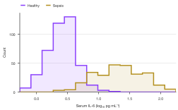

    *Counts: the healthy cohort (n = 420) looks more prominent simply
    because it is larger.*

=== "stat=\"percent\""

    ```python
    (
        sp.histogram(cohort, x="log_il6", hue="group", stat="percent")
        .labels(x=IL6)
        .legend(title="")
    )
    ```
    <!-- figure: histogram-stat-percent -->

    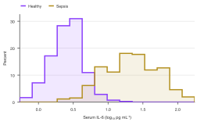

    *Percent: each cohort sums to 100 %, so shapes compare directly.*

=== "stat=\"density\""

    ```python
    (
        sp.histogram(cohort, x="log_il6", hue="group", stat="density")
        .labels(x=IL6)
        .legend(title="")
    )
    ```
    <!-- figure: histogram-stat-density -->

    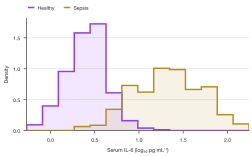

    *Density: each cohort has area 1. Needed for overlaying a density curve
    or fitted distribution, and for unequal bins.*

=== "common_norm=True"

    ```python
    (
        sp.histogram(cohort, x="log_il6", hue="group", stat="percent", common_norm=True)
        .labels(x=IL6)
        .legend(title="")
    )
    ```
    <!-- figure: histogram-stat-common-norm -->

    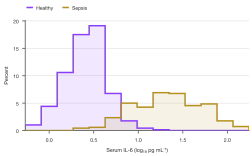

    *`common_norm=True`: one normalization for all groups. Bars sum to
    100 % across both cohorts, so the sepsis cohort's smaller share shows.*

| `stat` | Bar height | Use it for |
|---|---|---|
| `"count"` (default) | Values in the bin | Raw numbers; readers see n directly. |
| `"probability"` (`"proportion"`) | Fraction of values; heights sum to 1 | Groups of different size. |
| `"percent"` | Percent of values; heights sum to 100 | The same, for a general audience. |
| `"density"` | Fraction ÷ bin width; area is 1 | Overlaying curves; unequal bins. |
| `"frequency"` | Count ÷ bin width (axis "Count per unit") | Counts per unit with unequal bins. |

## Bins

A histogram's shape depends on the bin width, so try a few and state the one
you use in the figure legend. The default `bins="auto"` takes whichever of
the Sturges and Freedman–Diaconis rules gives narrower bins (as numpy does).

=== "binwidth=5 (too narrow)"

    ```python
    (
        sp.histogram(stroop, x="rt", binwidth=5)
        .colors("#0072B2")
        .labels(x="Reaction time (ms)")
    )
    ```
    <!-- figure: histogram-bins-narrow -->

    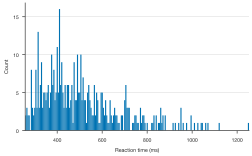

    *5 ms bins: mostly noise.*

=== "binwidth=25"

    ```python
    (
        sp.histogram(stroop, x="rt", binwidth=25)
        .colors("#0072B2")
        .labels(x="Reaction time (ms)")
    )
    ```
    <!-- figure: histogram-bins-medium -->

    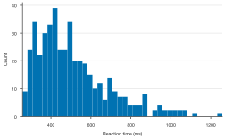

    *25 ms bins: the right skew typical of reaction times is clear.*

=== "binwidth=150 (too wide)"

    ```python
    (
        sp.histogram(stroop, x="rt", binwidth=150)
        .colors("#0072B2")
        .labels(x="Reaction time (ms)")
    )
    ```
    <!-- figure: histogram-bins-wide -->

    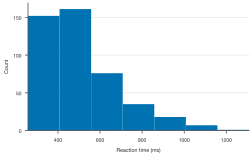

    *150 ms bins: the skew is lost.*

Other ways to set bins:

```python
sp.histogram(stroop, x="rt", bins=30, binrange=(200, 1400))   # number of bins over a range
```

```python
sp.histogram(stroop, x="rt", bins="fd")                       # a rule: fd, sturges, scott, rice, sqrt, doane
```

```python
sp.histogram(stroop, x="rt", bins=[200, 400, 500, 600, 800, 1400], stat="density")  # edges
```

`plot.bin_edges` returns the edges actually used, for the figure legend:

```python
plot = sp.histogram(stroop, x="rt", bins="fd")
width = plot.bin_edges[1] - plot.bin_edges[0]
plot.labels(x=f"Reaction time (ms; {width:.0f} ms bins)")
```

??? info "Which rule should I use?"
    `"fd"` (Freedman–Diaconis) bases the width on the interquartile range and
    copes well with skew and outliers. `"sturges"` assumes roughly normal data
    and gives too few bins for large n. `"auto"` picks the narrower of the two.
    With unequal edges use `stat="density"` or `"frequency"`, so a wide bin
    doesn't look taller only because it is wide.

## Discrete values and log axes

Scores, counts and Likert items take whole numbers: `discrete=True` gives one
bin per integer, centred on it, so no bin straddles two values.

```python
sofa = pd.DataFrame({"sofa": rng.binomial(24, 0.27, 260)})
(
    sp.histogram(sofa, x="sofa", discrete=True, stat="percent")
    .refline("median", label=True)
    .colors("#009E73")
    .labels(x="SOFA score at admission", y="Patients (%)")
)
```
<!-- figure: histogram-discrete -->

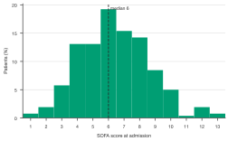

*SOFA scores of 260 patients with sepsis; one bar per integer score and a
labelled median.*

Data spanning orders of magnitude, such as concentrations or counts per cell,
belong on a log axis. With `.log("x")` the bins are evenly spaced in log
space, so they look equally wide; `binwidth=2` would make each bin double the
previous one.

```python
(
    sp.histogram(umis, stat="percent")
    .log("x")
    .refline(500, label="QC cutoff", color="#D55E00")
    .colors("#4477AA")
    .labels(x="UMIs per cell", y="Barcodes (%)")
)
```
<!-- figure: histogram-log-axis -->

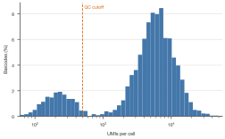

*UMIs per barcode on a log axis. Empty droplets form the small mode on the
left; the line marks a 500-UMI quality-control cutoff.*

!!! tip "Log axis or log values?"
    `.log("x")` keeps the original units on the tick labels, which readers find
    easiest. Plotting `log10` values instead (as in the overview) lets you add
    `.kde()`, which isn't supported on a log axis. Either way, prefer `stat`
    `"count"`, `"percent"` or `"probability"`: on a log axis, `"density"` divides by the
    bin width in data units, so wide bins on the right look too low.

## Groups: layer, stack or dodge

With `hue`, groups share the same bins. By default they are overlaid as
outlines with a light fill: where they cross, outlines stay readable, while
overlapping filled bars blend into what looks like a third group.

=== "layer (default)"

    ```python
    (
        sp.histogram(cohort, x="log_il6", hue="group", binwidth=0.1)
        .colors(["#4477AA", "#EE6677"])
        .labels(x=IL6)
        .legend(title="")
    )
    ```
    <!-- figure: histogram-groups-layer -->

    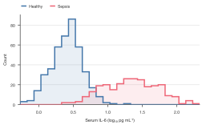

    *`multiple="layer"` with outlines (`element="step"`): the default for
    groups.*

=== "element=\"bars\""

    ```python
    (
        sp.histogram(cohort, x="log_il6", hue="group", binwidth=0.1, element="bars")
        .colors(["#4477AA", "#EE6677"])
        .labels(x=IL6)
        .legend(title="")
    )
    ```
    <!-- figure: histogram-groups-bars -->

    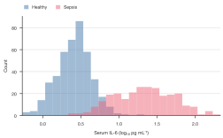

    *Translucent overlaid bars: the overlap mixes into a third colour.*

=== "multiple=\"stack\""

    ```python
    (
        sp.histogram(cohort, x="log_il6", hue="group", binwidth=0.1, multiple="stack")
        .colors(["#4477AA", "#EE6677"])
        .labels(x=IL6)
        .legend(title="")
    )
    ```
    <!-- figure: histogram-groups-stack -->

    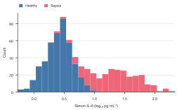

    *Stacked: the outline is the whole population, but the upper group sits on
    a moving baseline and is hard to read.*

=== "multiple=\"dodge\""

    ```python
    (
        sp.histogram(cohort, x="log_il6", hue="group", binwidth=0.2, multiple="dodge")
        .colors(["#4477AA", "#EE6677"])
        .labels(x=IL6)
        .legend(title="")
    )
    ```
    <!-- figure: histogram-groups-dodge -->

    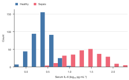

    *Dodged: bars side by side within each bin. Works with few, wide bins.*

Use stacking only when the total matters as much as the parts, and dodging
for a handful of wide bins. `multiple="dodge"` needs bars, and `.kde()` can't
be stacked.

## Density curves and fits

`.kde()` overlays a smooth density estimate per group, scaled to the bars'
`stat` so it lines up with counts as well as densities. `.fit("normal")`
overlays a normal distribution with the sample mean and SD as a dashed line,
a quick visual check of a normality assumption.

```python
incongruent = stroop[stroop.condition == "Incongruent"]
(
    sp.histogram(incongruent, x="rt", stat="density", binwidth=50)
    .kde()
    .fit("normal")
    .colors("#CCBB44")
    .labels(x="Reaction time (ms)")
)
```
<!-- figure: histogram-kde-fit -->

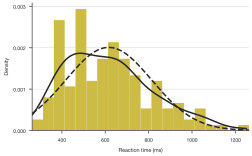

*Incongruent-trial reaction times. The density curve (solid) follows the
right skew; the fitted normal (dashed) misses both the peak and the tail.*

```python
sp.histogram(incongruent, x="rt").kde(bw_adjust=0.5)       # follow the data more closely
```

```python
sp.histogram(cohort, x="log_il6", hue="group").kde(color={"Sepsis": "black"})  # one group's curve
```

Without `hue` the curves use the text colour; with `hue`, each group's
colour. The curve stops at the smallest and largest value (`cut=0`), so it
never suggests impossible values such as negative times; `cut=3` draws the
tails.

## Cumulative histograms

A cumulative histogram shows, for every value, the share of observations at
or below it, a binned empirical cumulative distribution. Shifts between
groups become horizontal offsets, and medians are where curves cross 50 %.

```python
(
    sp.histogram(stroop, x="rt", hue="condition", stat="percent",
                 cumulative=True, binwidth=10)
    .refline(50, axis="y", linestyle=":")
    .colors(["#009E73", "#E69F00", "#CC79A7"])
    .labels(x="Reaction time (ms)")
    .legend(title="")
)
```
<!-- figure: histogram-cumulative -->

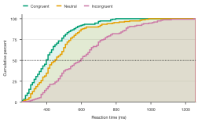

*Cumulative distributions of reaction time; the dotted line at 50 % reads
off each condition's median.*

Each group rises to 100 % (or 1, or its count). With `stat="density"` the axis
is "Cumulative proportion". `.kde()` adds the smooth cumulative curve.

## Reference lines, rug and sample size

`.refline()` marks values: numbers such as a clinical cutoff, or `"mean"` and
`"median"`, which draw one line per group in the group's colour (their labels
stack so close lines stay readable). `label=True` prints the value, text
prints that text.

With fewer than about 30 values a histogram's shape mostly reflects the bin
choice, and SecretPlots warns (`SmallSampleWarning`). Add `.rug()` so readers
see every value:

```python
pilot = pd.DataFrame({"lactate": rng.normal(3.1, 0.8, 18).round(1)})
(
    sp.histogram(pilot, x="lactate", binwidth=0.5)
    .rug()
    .show_n()
    .refline(2, label="Sepsis-3", color="#D55E00")
    .colors("#56B4E9")
    .labels(x="Serum lactate (mmol L⁻¹)", y="Patients")
)
```
<!-- figure: histogram-rug-refline -->

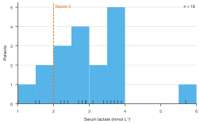

*Lactate in an 18-patient pilot. The rug shows each value; the line marks
the 2 mmol L⁻¹ threshold.*

Without `axis=` the lines cross the binned axis; `axis="y"` draws horizontal
lines on the count axis instead. Each call adds lines with its own `color`,
`linestyle` and `linewidth`; see [bar plots](bar.md#reference-lines).
`.show_n()` puts "Healthy (n = 420)" in the legend, or a note without groups.

## Colors, legend, orientation and source data

These work as for every plot (see [usage](../usage.md)):

```python
(
    sp.histogram(cohort, x="log_il6", hue="group", stat="probability")
    .colors({"Healthy": "#56B4E9", "Sepsis": "#D55E00"})   # by group
    .legend("inside", loc="upper right", title="")
    .labels(x=IL6)
)
```

```python
sp.histogram(stroop, x="rt", hue="condition").highlight("Incongruent")   # mute the rest
```

```python
sp.histogram(stroop, x="rt", orient="h").labels(y="Reaction time (ms)")   # bars to the right
```

`plot.source_data()` returns one row per bin and group, with the bin edges,
counts, the plotted `stat` and n: ready for a journal's source-data file.

```python
sp.histogram(cohort, x="log_il6", hue="group", binwidth=0.1).source_data().head()
```

## Journal checklist

!!! note "Journal checklist"
    - **n.** Report the number of values per group; `.show_n()` puts it on
      the plot. With small n, show individual values (`.rug()`, or a dot or
      strip plot instead).
    - **Bin width.** State it in the legend (`plot.bin_edges`) and check that
      your conclusion doesn't depend on it.
    - **Normalization.** Say what the y axis is. Counts, proportions and
      densities differ by factors of n and bin width; a density is not a
      probability.
    - **Groups.** Prefer overlaid outlines or separate panels over stacked
      bars, and colour-blind-safe colours (Okabe–Ito, Paul Tol).
    - **Skewed data.** Consider a log axis, and say so in the legend.

See [journal-ready figures](../publication.md) and [presets](../presets.md)
for sizes, fonts and export.

## Discovering options

```python
sp.HistogramPlot.options()            # every chainable step
```

```python
sp.HistogramPlot.options("kde")       # one step's options, allowed values and defaults
```

See the [option discovery guide](../options.md) for searching these tables.

## Warnings and errors

| Message | What it means |
|---|---|
| `SmallSampleWarning: Fewer than 30 values` | Add `.rug()` (or use a dot plot) so readers see the individual values. |
| `Unknown stat='frequncy'. Did you mean 'frequency'?` | `stat` is one of count, probability, percent, density, frequency. |
| `Unknown bins='freedman'` | Use a number, edges, or a rule name such as `"fd"`. |
| `A log axis needs positive values` | Drop values ≤ 0 before `.log("x")`. |
| `Density curves on a log axis are not supported` | Plot `np.log10` values on a linear axis to use `.kde()`. |
| `On a log axis binwidth is a ratio and must exceed 1` | Use e.g. `binwidth=2` for doubling bins. |
| `Density curves are not stacked` | Use `multiple="layer"` with `.kde()`. |
| `multiple='dodge' needs element='bars'` | Side-by-side outlines aren't supported. |
| `A cumulative histogram of counts per unit has no clear meaning` | Use another `stat` with `cumulative=True`. |
