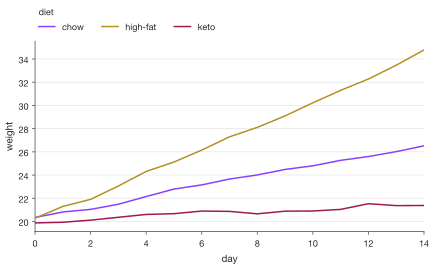
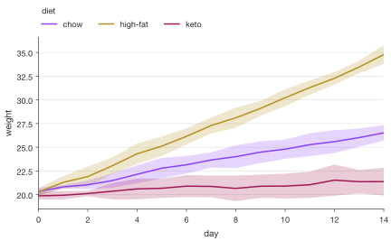
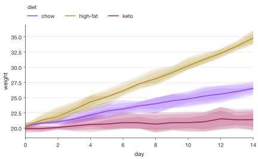
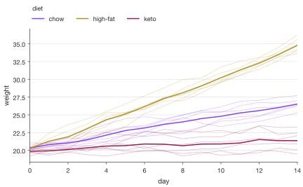
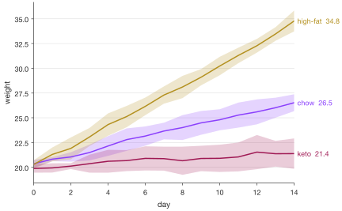
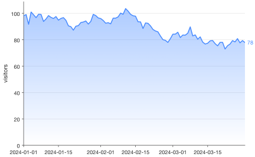

# Line plots

`sp.line()` (alias `sp.plot()`) draws one line per group along x. When several
rows share an x (replicates), they are summarized with an estimator (the mean
by default) and `error=` adds an error band or error bars from them.

```python
import numpy as np
import pandas as pd
import SecretPlots as sp

rng = np.random.default_rng(1)
rows = []
for diet, slope in [("chow", 0.5), ("high-fat", 1.1), ("keto", 0.2)]:
    for mouse in range(6):
        weight = 20 + slope * np.arange(15) + rng.normal(0, 0.5, 15).cumsum()
        rows += [
            {"day": d, "weight": w, "diet": diet, "mouse": f"{diet}-{mouse}"}
            for d, w in enumerate(weight)
        ]
df = pd.DataFrame(rows)

sp.line(df, x="day", y="weight", hue="diet", error="ci")
```
<!-- figure: line-overview -->


*Line example rendered by SecretPlots. All data on this page are synthetic.*

Every example on this page uses the `df` above: body weight of 18 mice (6 per
diet) measured daily for 15 days. Like every SecretPlots plot, nothing is drawn
until the plot is displayed, saved, shown, or you access `.fig` / `.ax`.

!!! tip "Explore the options from Python"
    Run `sp.LinePlot.options()` to list chainable steps, then
    `sp.LinePlot.options("legend")` for a step's parameters and defaults.
    Use `sp.theme_options()` for style fields. See the [option discovery guide](../options.md)
    for searching these tables and inspecting constructor arguments.

## Contents

- [Signature](#signature)
- [Input data](#input-data)
- [Groups, dashes and markers](#groups-dashes-and-markers)
- [Error bands and error bars](#error-bands-and-error-bars)
- [Error level: how wide the interval is](#error-level-how-wide-the-interval-is)
- [Fan charts: nested intervals](#fan-charts-nested-intervals)
- [Your own error values](#your-own-error-values)
- [Individual units (spaghetti plots)](#individual-units-spaghetti-plots)
- [Direct labels at the line ends](#direct-labels-at-the-line-ends)
- [Shading under a line](#shading-under-a-line)
- [Reference lines](#reference-lines)
- [Reporting: caption and source data](#reporting-caption-and-source-data)
- [Style fields](#style-fields)
- [Warnings and errors](#warnings-and-errors)

## Signature

```text
sp.line(data=None, x=None, y=None, hue=None, *,
        style=None, units=None, error=None, estimator="mean",
        yerr=None, xerr=None, sort=True,
        order=None, hue_order=None, style_order=None, missing="raise") -> LinePlot
```

| Argument | Meaning |
|---|---|
| `missing` | `"raise"` (default), `"drop"` or `"gap"`; see [data handling](../usage.md). |
| `data` | Long DataFrame or dict of columns; a wide DataFrame (one line per numeric column); a Series; a list/array of y values. Can be left out; see below. |
| `x`, `y` | Column names, or sequences when `data` is left out. x can be numbers, dates or categories. |
| `hue` | Column with groups, drawn in different colors. |
| `style` | Column with groups, drawn with different dash patterns (and marker shapes with `.markers()`). Up to 8 values. |
| `units` | Column naming repeated measures (a subject, a cell, a well): each is drawn as a faint thin line. |
| `error` | `"sd"`, `"sem"`, `"ci"` (confidence interval of the estimate) or `"pi"` (percentile interval of the values). |
| `estimator` | `"mean"`, `"median"`, `"sum"`, a function, or `None` to draw rows as they are. |
| `yerr`, `xerr` | Your own errors: a column of half-widths, or a tuple of two columns `(minus, plus)`. |
| `sort` | Connect points in x order (`False` keeps the data order, e.g. for trajectories). |
| `order` | Order of category x values. |
| `hue_order`, `style_order` | Explicit group / style order. |

Chainable steps specific to line plots: `.errorbars()`, `.markers()`,
`.fill()`, `.endlabels()`, `.refline()`, `.grouplabels()`, `.ticklabels()`.
Reporting: `.caption()`, `.source_data()`. Everything else (labels, legend,
colors, highlight, limits, log axes, presets, themes, saving) works the same as
for [bar plots](bar.md). Run `sp.LinePlot.options()` for the full list.

## Input data

```python
sp.line(df, x="day", y="weight")                     # long DataFrame (mean per day)
```

```python
sp.line(x=[0, 1, 2, 3], y=[1.0, 2.4, 2.9, 4.2])      # plain sequences
```

```python
sp.line([3, 5, 4, 6, 8])                             # y values; x = 0, 1, 2, ...
```

```python
wide = df.pivot_table(index="day", columns="diet", values="weight")
sp.line(wide)                                        # one line per column
```

```python
ts = pd.Series(
    100 + rng.normal(0, 3, 90).cumsum(),
    index=pd.date_range("2024-01-01", periods=90),
    name="visitors",
)
sp.line(ts)                                          # Series: index -> x (dates)
```

Dates get a date axis. Text x values are treated as categories, evenly spaced
in data order (set it with `order=`):

```python
timepoints = pd.DataFrame(
    {"stage": ["E8.5", "E9.5", "E10.5", "E12.5"], "cells": [120, 340, 910, 2400]}
)
sp.line(timepoints, x="stage", y="cells").markers()
```

Missing or infinite data raises an error by default (`missing="raise"`). Use
`missing="drop"` to remove affected rows and connect the remaining points, or
`missing="gap"` to break the line/band at missing values. Gap mode needs valid x
coordinates and group/unit labels. A missing replicate makes its aggregated
point a gap; it is not silently excluded from the summary.

## Groups, dashes and markers

```python
sp.line(df, x="day", y="weight", hue="diet")
```
<!-- figure: line-groups-dashes-and-markers -->



*Groups, dashes and markers: output of the example above.*

`style=` varies the dash pattern; with `.markers()` it also varies the marker
shape. It can be the same column as `hue`, which helps in black-and-white
print:

```python
sp.line(df, x="day", y="weight", hue="diet", style="diet").markers()
```

`.markers()` puts a marker on every point. Filled markers get a thin
background-colored ring so they stand out from the line; `filled=False` draws
hollow markers:

```python
sp.line(df, x="day", y="weight", hue="diet").markers("o", size=4, filled=False)
```

Rename groups with `.grouplabels()` and the legend title with
`.legend(title=...)`:

```python
(
    sp.line(df, x="day", y="weight", hue="diet")
    .grouplabels({"high-fat": "High fat"})
    .legend(title="Diet")
)
```

## Error bands and error bars

`error=` says what the error shows; `.errorbars()` says how it looks.

| `error=` | Shows | Default `level` |
|---|---|---|
| `"sd"` | estimate ± standard deviation of the values | 1 (a multiple) |
| `"sem"` | estimate ± standard error of the mean | 1 (a multiple) |
| `"ci"` | confidence interval of the estimate: t interval for the mean (and sum), bootstrap (2000 resamples, fixed seed) for the median | 0.95 |
| `"pi"` | percentile interval of the values themselves (where the data lie) | 0.95 |

```python
sp.line(df, x="day", y="weight", hue="diet", error="sd")
```
<!-- figure: line-error-bands-and-error-bars -->



*Error bands and error bars: output of the example above.*

`.errorbars("bars")` draws error bars at each x instead of a band. When groups
share x values their bars overlap; `dodge=` moves them apart (a fraction of the
smallest step between x values):

```python
(
    sp.line(df, x="day", y="weight", hue="diet", error="sem")
    .errorbars("bars", dodge=0.3)
    .markers()
)
```

| `.errorbars()` option | Effect |
|---|---|
| `display` | `"band"` (default) or `"bars"`. |
| `level` | How wide the interval is; see [below](#error-level-how-wide-the-interval-is). Several values draw nested intervals. |
| `edges` | Bands only: thin lines along the band edges. |
| `capsize` | Bars only: cap length in pt (default: the theme's `errorbar_capsize`); 0 for none. |
| `dodge` | Shift groups apart along x (0 to 1). |

```python
sp.line(df, x="day", y="weight", hue="diet", error="sd").errorbars(edges=True)
```

## Error level: how wide the interval is

`level` in `.errorbars()` sets the width of each error band or bar. What the
number means depends on `error=`:

| `error=` | `level` means | Default | Example |
|---|---|---|---|
| `"ci"` | Coverage of the confidence interval, 0 to 1 | 0.95 | `level=0.9`: 90 % confidence interval of the mean |
| `"pi"` | Share of the values the interval covers, 0 to 1 | 0.95 | `level=0.5`: the middle 50 % of the values (25th to 75th percentile) |
| `"sd"` | Multiple of the standard deviation | 1 | `level=2`: mean ± 2 SD |
| `"sem"` | Multiple of the standard error of the mean | 1 | `level=1.96`: mean ± 1.96 SEM |

```python
sp.line(df, x="day", y="weight", hue="diet", error="ci").errorbars(level=0.9)
```

```python
sp.line(df, x="day", y="weight", hue="diet", error="sd").errorbars(level=2)
```

- For `"ci"` and `"pi"`, `level` is a fraction: `0.95`, not `95`. Values
  outside 0 to 1 raise an error that says so.
- For `"sd"` and `"sem"`, `level` is any positive multiple.
- `level` only applies to `error=`. Errors you pass with `yerr=` already have
  their size, so `level` raises an error there.
- Report the level in the figure legend: `.caption()` includes it (see
  [Reporting](#reporting-caption-and-source-data)).

## Fan charts: nested intervals

A list of levels, e.g. `level=(0.5, 0.8, 0.95)`, draws one interval per level,
nested inside each other, the way forecasts show uncertainty. The order you
give them in doesn't matter.

- **Bands** overlap, so the inner (narrower, more likely) range comes out
  darkest and the outer range palest: "likely" against "possible".
- **Bars** draw inner intervals thicker, a "point-interval" plot as in ggdist.
  Only the widest interval gets caps.

```python
(
    sp.line(df, x="day", y="weight", hue="diet", error="pi")
    .errorbars(level=(0.5, 0.8, 0.95))
)
```
<!-- figure: line-fan-charts-nested-intervals -->



*`error="pi"` with `.errorbars(level=(0.5, 0.8, 0.95))` shows nested percentile intervals; overlapping bands appear darker.*

```python
(
    sp.line(df[df["day"] % 2 == 0], x="day", y="weight", hue="diet", error="ci")
    .errorbars("bars", level=(0.66, 0.95), dodge=0.4)
    .markers()
)
```

With several levels, `.source_data()` has one low/high column pair per level
(e.g. `ci0.66_low`, `ci0.95_high`; with one level just `ci_low`, `ci_high`),
and `.caption()` lists every level, e.g. "bands the 50%, 80%, 95% percentile
intervals":

```python
fan = sp.line(df, x="day", y="weight", hue="diet", error="pi").errorbars(
    level=(0.5, 0.8, 0.95)
)
print(fan.caption())
fan.source_data().columns.tolist()
```

## Your own error values

When the errors are already computed (model output, instrument uncertainty),
pass them with `yerr=` instead of `error=`: a column of half-widths, or a tuple
of two columns `(minus, plus)`. Each x can then appear only once per line.

```python
summary = (
    df.groupby(["diet", "day"])["weight"].agg(["mean", "std"]).reset_index()
)
sp.line(summary, x="day", y="mean", hue="diet", yerr="std").labels(y="weight")
```

```python
dose = pd.DataFrame(
    {"dose": [0.1, 0.3, 1, 3, 10], "response": [5, 18, 52, 81, 94],
     "low": [3, 5, 8, 6, 4], "high": [4, 6, 7, 5, 3], "dose_err": [0.02, 0.05, 0.1, 0.4, 1]}
)
(
    sp.line(dose, x="dose", y="response", yerr=("low", "high"), xerr="dose_err")
    .errorbars("bars")
    .markers()
    .log("x")
)
```

## Individual units (spaghetti plots)

`units=` draws every unit (here each mouse) as a faint thin line behind its
group's mean, showing the summary and the spread of individual trajectories
together:

```python
sp.line(df, x="day", y="weight", hue="diet", units="mouse")
```
<!-- figure: line-individual-units-spaghetti-plots -->



*`units="mouse"` shows individual trajectories behind the group summary.*

With `estimator=None`, only the individual lines are drawn:

```python
sp.line(df, x="day", y="weight", hue="diet", units="mouse", estimator=None)
```

## Direct labels at the line ends

`.endlabels()` writes each group's name at the end of its line, in its color,
and drops the legend: the reader doesn't have to look back and forth. Labels
that would overlap are moved apart. `values=` adds the last value:

```python
(
    sp.line(df, x="day", y="weight", hue="diet", error="ci")
    .endlabels(values=".1f")
)
```
<!-- figure: line-direct-labels-at-the-line-ends -->



*Direct labels at the line ends: output of the example above.*

Without groups, `values=` alone labels the last value:

```python
sp.line(ts).endlabels(values=".0f")
```

`label=` changes the text: `{group}` stands for the group name, so
`label="Diet {group}"` adds a prefix. Without groups, plain text names the line:

```python
sp.line(ts).endlabels(label="Revenue", values=".0f")
```

`pad=` sets the gap before the labels, in points (default 4). When the value
axis sits on the right (as in the news preset), the labels start after its tick
labels.

## Shading under a line

`.fill()` shades the area between the line and a baseline (`to=`, default 0).
`gradient=True` fades the shading toward the baseline:

```python
sp.line(ts).fill(gradient=True).endlabels(values=".0f")
```
<!-- figure: line-shading-under-a-line -->



*`.fill(gradient=True)` fades the fill toward zero; `.endlabels(values=".0f")` identifies the series at its endpoint.*

```python
sp.line(ts).fill(to=100, alpha=0.3)
```

For stacked areas, bands between two columns or areas split by sign, see
[area plots](area.md).

## Reference lines

`.refline()` adds dashed lines across the plot: horizontal by default,
vertical with `axis="x"`. Values on a date axis can be dates or date strings;
on a category x axis, category names. Each call adds lines and can set its own
`label` (text or `True`), `color`, `linestyle` and `linewidth`; see
[bar plots](bar.md#reference-lines) for all options.

```python
(
    sp.line(df, x="day", y="weight", hue="diet")
    .refline(25)
    .refline(7, axis="x", label=True)
)
```

```python
(
    sp.line(ts)
    .refline("2024-02-14", axis="x", label="campaign", color="#da1e28")
    .refline(100, linestyle=":")
)
```

## Reporting: caption and source data

`.caption()` returns figure-legend text saying what the lines and error bars
show, and `.source_data()` the plotted numbers (one row per point, with the
interval bounds), for a journal's source-data file:

```python
plot = sp.line(df, x="day", y="weight", hue="diet", error="ci")
print(plot.caption())
plot.source_data().head()
```

## Style fields

| Field | Effect |
|---|---|
| `line_width` | Line width in pt. Unit lines are half as wide. |
| `fill_alpha` | Opacity of error bands and `.fill()` shading (0.22 by default). |
| `errorbar_capsize` | Error bar cap length in pt. |
| `marker`, `marker_size`, `marker_edge_width` | Marker shape, diameter and ring width for `.markers()`. |
| `grid` | `"value"` (the default, horizontal lines) / `"y"`, `"x"`, `"both"`, `"none"`. |

```python
sp.line(df, x="day", y="weight", hue="diet", error="ci").theme(line_width=2, fill_alpha=0.15)
```

Set them for line plots only in a preset's `[plots.line]` section.

## Warnings and errors

- `error=` needs several rows at some x: with one value per point there is
  nothing to summarize (`DataShapeError`).
- `estimator="sd"` (or `"sem"`, ...) raises with a hint to use `error=`.
- Unknown error kinds suggest the closest one (`error="std"` → `"sd"`).
- `error=` and `yerr=` can't be combined; `yerr=` needs one row per x per line,
  and errors can't be negative.
- `level` for `"ci"`/`"pi"` is a coverage between 0 and 1 (`0.95`, not `95`);
  for `"sd"`/`"sem"` a positive multiple. It can't be used with `yerr=`.
- `.endlabels()` without groups needs `values=` or `label=`; `label=` with
  `{group}` needs groups.
