# Line plots

`sp.line()` (alias `sp.plot()`) draws one line per group along x. It is the
natural plot for anything measured over time or over a continuous dose:
growth curves, pharmacokinetics, time courses, model projections. When several
rows share an x (replicate animals, wells, runs), they are summarized with an
estimator (the mean by default) and `error=` turns their spread into a band or
error bars.

The examples on this page run top to bottom like notebook cells. This first
block builds three synthetic datasets (all data on this page are synthetic) and
selects the Nature preset, so every figure is sized for an 89 mm column:

```python
import numpy as np
import pandas as pd
import SecretPlots as sp

sp.use(preset="nature")
rng = np.random.default_rng(11)

# Xenograft study: tumour volume of 8 mice per arm, measured every 3 days.
days = np.arange(0, 22, 3)
rows = []
for treatment, rate in [("Vehicle", 0.15), ("Drug A", 0.10), ("Drug A + B", 0.045)]:
    for mouse in range(1, 9):
        k = rate * rng.lognormal(0, 0.15)
        volume = 80 * np.exp(k * days) * rng.lognormal(0, 0.08, days.size)
        rows += [
            {"day": d, "volume": v, "treatment": treatment, "mouse": f"{treatment} #{mouse}"}
            for d, v in zip(days, volume)
        ]
growth = pd.DataFrame(rows)

# Pharmacokinetics: plasma concentration after one oral dose, 6 subjects per dose.
hours = np.array([0.25, 0.5, 1, 2, 4, 8, 12, 24])
rows = []
for dose in [1, 3, 10]:
    for subject in range(1, 7):
        ka, ke = 2.0 * rng.lognormal(0, 0.2), 0.15 * rng.lognormal(0, 0.2)
        conc = 40 * dose * ka / (ka - ke) * (np.exp(-ke * hours) - np.exp(-ka * hours))
        conc *= rng.lognormal(0, 0.12, hours.size)
        rows += [
            {"hours": h, "conc": c, "dose": f"{dose} mg kg⁻¹", "subject": f"{dose}-{subject}"}
            for h, c in zip(hours, conc)
        ]
pk = pd.DataFrame(rows)

# Model ensemble: 300 simulated trajectories of hospital bed occupancy.
weeks = np.arange(27)
steps = rng.normal(0.035, 0.06, (300, weeks.size))
steps[:, 0] = 0
beds = 120 * np.exp(steps.cumsum(axis=1))
forecast = pd.DataFrame(
    {"week": np.tile(weeks, 300), "beds": beds.ravel(), "run": np.repeat(range(300), weeks.size)}
)
```

The figure most papers need: group means with SEM error bars, individual
markers at each measurement, and each arm named at the end of its line instead
of in a legend.

```python
(
    sp.line(growth, x="day", y="volume", hue="treatment", error="sem")
    .errorbars("bars", capsize=1.5)
    .markers(size=3.5)
    .endlabels()
    .colors(["#000000", "#E69F00", "#0072B2"])
    .labels(x="Days after implantation", y="Tumour volume (mm³)")
)
```
<!-- figure: line-hero -->

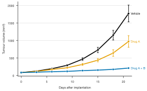

*Mean ± SEM tumour volume (n = 8 mice per arm). Direct labels replace the
legend; Okabe–Ito colors stay distinct for colour-blind readers.*

Nothing is drawn until the plot is displayed, saved, shown, or you access
`.fig` / `.ax`, so steps can be chained in any order.

## Contents

- [Signature](#signature)
- [Input data](#input-data)
- [What the error shows: SD, SEM, CI or PI](#what-the-error-shows-sd-sem-ci-or-pi)
- [How the error looks: bands or bars](#how-the-error-looks-bands-or-bars)
- [Error level and fan charts](#error-level-and-fan-charts)
- [Your own error values and log axes](#your-own-error-values-and-log-axes)
- [Individual trajectories](#individual-trajectories)
- [Groups in black and white: dashes and markers](#groups-in-black-and-white-dashes-and-markers)
- [Direct labels and highlighting](#direct-labels-and-highlighting)
- [Shading under a line](#shading-under-a-line)
- [Reporting: caption and source data](#reporting-caption-and-source-data)
- [Style fields](#style-fields)
- [Discovering options](#discovering-options)
- [Warnings and errors](#warnings-and-errors)

## Signature

```text
sp.line(data=None, x=None, y=None, hue=None, *,
        style=None, units=None, error=None, estimator="mean",
        yerr=None, xerr=None, sort=True,
        order=None, hue_order=None, style_order=None,
        missing="raise") -> LinePlot
```

`sp.plot` is the same function.

| Argument | Meaning |
|---|---|
| `data` | Long DataFrame or dict of columns; a wide DataFrame (index or `x` column → x, one line per numeric column); a Series (index → x); a list/array of y values. Can be left out when `x` and `y` are sequences. |
| `x`, `y` | Column names, or sequences when `data` is left out. x can be numbers, dates or categories (categories are evenly spaced in data order). |
| `hue` | Column with groups, drawn in different colors. |
| `style` | Column with groups, drawn with different dash patterns (and marker shapes with `.markers()`). Can be the same column as `hue`. |
| `units` | Column naming repeated measures (a mouse, a cell, a well): each is drawn as a faint thin line behind the summary. With `estimator=None`, only these lines are drawn. |
| `error` | `"sd"`, `"sem"`, `"ci"` (confidence interval of the estimate) or `"pi"` (percentile interval of the values). Needs replicates at each x. |
| `estimator` | `"mean"` (default), `"median"`, `"sum"`, a function, or `None` to draw rows as they are. `error="ci"` needs `"mean"`, `"median"` or `"sum"`. |
| `yerr`, `xerr` | Your own errors: a column (or sequence) of half-widths, or a tuple of two columns `(minus, plus)`. Can't be combined with `error=`. `xerr` needs numeric x. |
| `sort` | `True` (default) connects points in x order; `False` keeps the data order (e.g. for trajectories in a phase plane). |
| `order` | Order of category x values. |
| `hue_order`, `style_order` | Explicit group / style order. |
| `missing` | `"raise"` (default), `"drop"` or `"gap"`; see [Input data](#input-data) and [data handling](../usage.md). |

### Chainable methods

| Method | What it does |
|---|---|
| `.errorbars(display="band", *, level=None, edges=False, capsize=None, dodge=0.0)` | How the error looks: band or bars, interval level (several levels for a fan chart), band edges, cap length, dodging. |
| `.markers(marker=True, *, size=None, filled=True)` | A marker at every point; with `style=` each style value gets its own shape. `False` removes them. |
| `.encode_groups(*, markers=True)` | Use the hue groups as the style too: dashes (and markers) in addition to color. |
| `.fill(show=True, *, to=0.0, gradient=False, alpha=None)` | Shade between each line and a baseline. |
| `.endlabels(show=True, *, values=None, label=None, pad=4.0)` | Name each line at its right end instead of a legend. |
| `.grouplabels(labels)` | Rename hue groups (list in group order or `{old: new}`). |
| `.ticklabels(*, rotation=None)` | Rotate x tick labels. |
| `.refline(*values, axis=None, label=False, color=None, linestyle="--", linewidth=None, label_position="end", label_rotation=0, label_side=None)` | Dashed reference lines; each call adds lines. |
| `.caption()` / `.source_data()` | Figure-legend text and the plotted numbers (see [Reporting](#reporting-caption-and-source-data)). |

Shared with every plot: `.labels()`, `.legend()`, `.colors()`, `.highlight()`,
`.xlim()`, `.ylim()`, `.log()`, `.format_axis()`, `.chrome()`, `.size()`,
`.preset()`, `.theme()`, `.copy()`, `.save()`. See [usage](../usage.md) and
[presets](../presets.md).

## Input data

Long data (one row per measurement) is the most flexible form: the estimator
summarizes rows that share an x.

```python
sp.line(growth, x="day", y="volume", hue="treatment")      # long DataFrame
```

```python
sp.line(x=[0, 1, 2, 4, 8], y=[0.0, 1.9, 3.1, 4.0, 4.4])     # plain sequences
```

```python
mean_volume = growth.pivot_table(index="day", columns="treatment", values="volume")
sp.line(mean_volume)                                        # wide: one line per column
```

```python
admissions = pd.Series(
    80 + rng.normal(0, 4, 120).cumsum(),
    index=pd.date_range("2024-01-01", periods=120),
    name="admissions",
)
sp.line(admissions)                                         # Series: index → x (dates)
```

Text x values become evenly spaced categories in data order (change it with
`order=`):

```python
stages = pd.DataFrame({"stage": ["E8.5", "E9.5", "E10.5", "E12.5"], "cells": [120, 340, 910, 2400]})
sp.line(stages, x="stage", y="cells").markers()
```

Missing or infinite values raise an error by default (`missing="raise"`).
`missing="drop"` removes affected rows and connects the remaining points;
`missing="gap"` breaks the line (and band) at missing values. In gap mode a
missing replicate makes its summary point a gap rather than silently shrinking
n.

## What the error shows: SD, SEM, CI or PI

Use `error=` when you have replicates and want to show their uncertainty. The
four kinds answer different questions, so pick the one that matches your claim
and say which in the legend. Click through the tabs to compare them on the
same data (these figures keep the library's default palette):

=== "error=\"ci\""

    ```python
    (
        sp.line(growth, x="day", y="volume", hue="treatment", error="ci")
        .legend(title="")
        .labels(x="Days after implantation", y="Tumour volume (mm³)")
    )
    ```
    <!-- figure: line-error-ci -->

    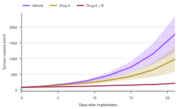

    *95% confidence interval of the mean: where the true group mean probably
    lies. Use it to compare groups.*

=== "error=\"sd\""

    ```python
    (
        sp.line(growth, x="day", y="volume", hue="treatment", error="sd")
        .legend(title="")
        .labels(x="Days after implantation", y="Tumour volume (mm³)")
    )
    ```
    <!-- figure: line-error-sd -->

    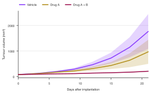

    *Mean ± SD: how much individual mice vary. It does not shrink with more
    animals.*

=== "error=\"sem\""

    ```python
    (
        sp.line(growth, x="day", y="volume", hue="treatment", error="sem")
        .legend(title="")
        .labels(x="Days after implantation", y="Tumour volume (mm³)")
    )
    ```
    <!-- figure: line-error-sem -->

    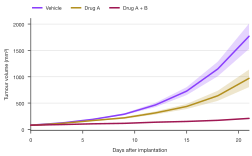

    *Mean ± SEM: the precision of the mean. Narrowest of the four; roughly a
    68% confidence interval.*

=== "error=\"pi\""

    ```python
    (
        sp.line(growth, x="day", y="volume", hue="treatment", error="pi")
        .legend(title="")
        .labels(x="Days after implantation", y="Tumour volume (mm³)")
    )
    ```
    <!-- figure: line-error-pi -->

    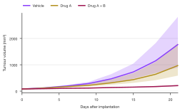

    *95% percentile interval: the range that holds the middle 95% of the
    measured values themselves.*

| `error=` | Shows | Default `level` |
|---|---|---|
| `"sd"` | estimate ± standard deviation of the values | 1 (a multiple) |
| `"sem"` | estimate ± standard error of the mean | 1 (a multiple) |
| `"ci"` | confidence interval of the estimate: t interval for the mean (and sum), bootstrap (2000 resamples, fixed seed) for the median | 0.95 |
| `"pi"` | percentile interval of the values themselves (where the data lie) | 0.95 |

!!! note "Journal checklist"
    Most journals require the legend to state what the line and the band or
    bars show, and the n behind each point. `.caption()` writes the first part
    for you (see [Reporting](#reporting-caption-and-source-data)). Prefer SD or
    a CI over SEM when the aim is to show variability or support a comparison;
    with small n (under ~10 per group) also show the individual animals, as in
    [Individual trajectories](#individual-trajectories). More advice is on the
    [publication page](../publication.md).

## How the error looks: bands or bars

`error=` decides what the interval means; `.errorbars()` decides how it is
drawn. Bands suit dense, evenly spaced time courses; bars suit sparse
measurements where each point is a real visit. Groups that share x values can
be dodged so their bars don't overlap.

=== "Band (default)"

    ```python
    (
        sp.line(growth, x="day", y="volume", hue="treatment", error="sd")
        .colors(["#4477AA", "#EE6677", "#228833"])
        .legend(title="")
        .labels(x="Days after implantation", y="Tumour volume (mm³)")
    )
    ```
    <!-- figure: line-display-band -->

    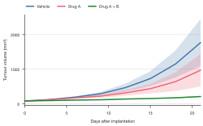

    *`.errorbars("band")` is the default: a translucent band per group.*

=== "Band with edges"

    ```python
    (
        sp.line(growth, x="day", y="volume", hue="treatment", error="sd")
        .errorbars(edges=True)
        .colors(["#4477AA", "#EE6677", "#228833"])
        .legend(title="")
        .labels(x="Days after implantation", y="Tumour volume (mm³)")
    )
    ```
    <!-- figure: line-display-edges -->

    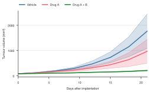

    *`edges=True` outlines each band, which keeps overlapping bands readable in
    print.*

=== "Bars, dodged"

    ```python
    (
        sp.line(growth, x="day", y="volume", hue="treatment", error="sd")
        .errorbars("bars", dodge=0.25, capsize=1.5)
        .markers(size=3.5)
        .colors(["#4477AA", "#EE6677", "#228833"])
        .legend(title="")
        .labels(x="Days after implantation", y="Tumour volume (mm³)")
    )
    ```
    <!-- figure: line-display-bars -->

    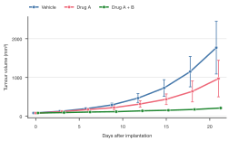

    *`.errorbars("bars", dodge=0.25)` shifts the arms apart by a quarter of
    the 3-day step, so no bar hides another.*

| `.errorbars()` option | Effect |
|---|---|
| `display` | `"band"` (default) or `"bars"`. |
| `level` | How wide the interval is; see [below](#error-level-and-fan-charts). Several values draw nested intervals. |
| `edges` | Bands only: thin lines along the band edges. |
| `capsize` | Bars only: cap length in pt (default: the theme's `errorbar_capsize`); 0 for none. |
| `dodge` | Shift groups apart along x, as a fraction (0 to 1) of the smallest step between x values. Numeric or category x only, not dates. |

## Error level and fan charts

`level` in `.errorbars()` sets the width of the interval. What the number means
depends on `error=`:

| `error=` | `level` means | Default | Example |
|---|---|---|---|
| `"ci"` | Coverage of the confidence interval, 0 to 1 | 0.95 | `level=0.9`: 90% CI of the mean |
| `"pi"` | Share of the values covered, 0 to 1 | 0.95 | `level=0.5`: the 25th to 75th percentile |
| `"sd"` | Multiple of the standard deviation | 1 | `level=2`: mean ± 2 SD |
| `"sem"` | Multiple of the standard error | 1 | `level=1.96`: mean ± 1.96 SEM |

```python
sp.line(growth, x="day", y="volume", hue="treatment", error="ci").errorbars(level=0.9)
```

A list of levels draws nested intervals. With bands this is a fan chart, the
standard way to show a model projection: the darkest core is the likely range,
the pale outer band the plausible one. Here 300 simulated trajectories are
summarized by their median and the 50%, 80% and 95% percentile intervals:

```python
(
    sp.line(forecast, x="week", y="beds", estimator="median", error="pi")
    .errorbars(level=(0.5, 0.8, 0.95))
    .colors(["#0072B2"])
    .labels(x="Weeks from today", y="Occupied beds")
)
```
<!-- figure: line-fan -->

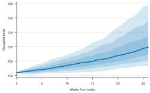

*Median projection with 50%, 80% and 95% percentile intervals of 300 model
runs. Overlapping bands make the inner intervals darker.*

With bars, inner intervals are drawn thicker and only the widest one gets caps
(a "point-interval" plot):

```python
(
    sp.line(growth, x="day", y="volume", hue="treatment", error="ci")
    .errorbars("bars", level=(0.66, 0.95), dodge=0.3)
    .markers()
)
```

`level` is a fraction for `"ci"` and `"pi"` (`0.95`, not `95`) and a positive
multiple for `"sd"` and `"sem"`. It only applies to `error=`: errors passed
with `yerr=` already have their size.

## Your own error values and log axes

When the errors are already computed (a model fit, an instrument uncertainty,
a summary table from a collaborator), pass them with `yerr=` instead of
`error=`: a column of half-widths, or a tuple `(minus, plus)` for asymmetric
errors. Each x may then appear only once per line.

Concentrations are log-normally distributed, so pharmacokinetic profiles are
usually plotted on a log axis with the geometric mean and the geometric SD,
which is asymmetric on a linear scale:

```python
logc = np.log(pk["conc"])
pk_summary = (
    logc.groupby([pk["dose"], pk["hours"]], sort=False).agg(["mean", "std"]).reset_index()
)
pk_summary["gmean"] = np.exp(pk_summary["mean"])
pk_summary["minus"] = pk_summary["gmean"] * (1 - np.exp(-pk_summary["std"]))
pk_summary["plus"] = pk_summary["gmean"] * (np.exp(pk_summary["std"]) - 1)

(
    sp.line(pk_summary, x="hours", y="gmean", hue="dose", yerr=("minus", "plus"))
    .errorbars("bars", capsize=1.5)
    .markers("o", size=3.5)
    .log("y")
    .endlabels()
    .colors(["#88CCEE", "#44AA99", "#332288"])
    .labels(x="Time after dose (h)", y="Plasma concentration (ng mL⁻¹)")
)
```
<!-- figure: line-pk-log -->

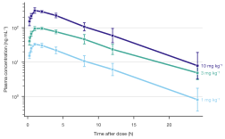

*Geometric mean ± geometric SD (n = 6 per dose) on a log axis. The parallel
terminal slopes show dose-independent elimination.*

`xerr=` adds horizontal error bars in the same way (numeric x only).

## Individual trajectories

With small groups, the summary hides too much: reviewers want to see every
animal. `units=` names the column that identifies each subject; each one is
drawn as a thin, faint line behind its group's summary. With
`estimator=None`, only the individual lines are drawn.

=== "units= with the mean"

    ```python
    (
        sp.line(growth, x="day", y="volume", hue="treatment", units="mouse")
        .endlabels()
        .colors(["#CC6677", "#DDCC77", "#117733"])
        .labels(x="Days after implantation", y="Tumour volume (mm³)")
    )
    ```
    <!-- figure: line-units-mean -->

    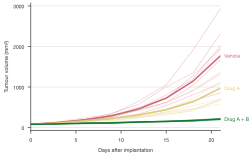

    *Every mouse as a faint line, the arm mean on top.*

=== "estimator=None"

    ```python
    (
        sp.line(growth, x="day", y="volume", hue="treatment", units="mouse", estimator=None)
        .log("y")
        .colors(["#CC6677", "#DDCC77", "#117733"])
        .legend(title="")
        .labels(x="Days after implantation", y="Tumour volume (mm³)")
    )
    ```
    <!-- figure: line-units-only -->

    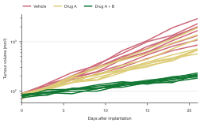

    *Individual curves only. On a log axis exponential growth is a straight
    line, and differences in growth rate become differences in slope.*

!!! tip "Small n? Show the animals"
    For n below about 10 per group, plot individual trajectories (`units=`)
    alongside or instead of a mean ± error, and give n in the legend.

## Groups in black and white: dashes and markers

Color alone fails in greyscale print and for some readers. `style=` varies the
dash pattern (and, with `.markers()`, the marker shape) by a column; it can be
the same column as `hue`. `.encode_groups()` is the shortcut for exactly that:
hue groups get color, dashes and markers.

```python
(
    sp.line(growth, x="day", y="volume", hue="treatment", error="sem")
    .errorbars("bars", capsize=1.5)
    .encode_groups()
    .colors(["#000000", "#000000", "#000000"])
    .legend(title="", position="inside")
    .labels(x="Days after implantation", y="Tumour volume (mm³)")
)
```
<!-- figure: line-encode-groups -->

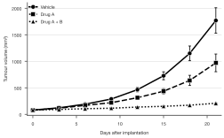

*`.encode_groups()` with an all-black palette: the arms remain distinguishable
by dash pattern and marker shape alone.*

`.markers()` takes a matplotlib marker (`"o"`, `"s"`, `"D"`, ...), a `size` in
pt and `filled=False` for hollow markers. Filled markers get a thin
background-colored ring so they separate from the line.

```python
sp.line(growth, x="day", y="volume", hue="treatment", style="treatment").markers("s", size=4, filled=False)
```

Rename groups with `.grouplabels()` and set the legend title with
`.legend(title=...)`:

```python
(
    sp.line(growth, x="day", y="volume", hue="treatment")
    .grouplabels({"Drug A + B": "Combination"})
    .legend(title="Arm")
)
```

## Direct labels and highlighting

`.endlabels()` writes each group's name at the end of its line, in its color,
and drops the legend; labels that would overlap are moved apart. `values=`
adds the last value. `.highlight()` keeps the groups you name in color and
greys out the rest, which focuses the reader on one comparison:

```python
(
    sp.line(growth, x="day", y="volume", hue="treatment", error="sem")
    .highlight("Drug A + B")
    .colors({"Drug A + B": "#D55E00"})
    .endlabels(values=".0f")
    .labels(x="Days after implantation", y="Tumour volume (mm³)")
)
```
<!-- figure: line-highlight -->

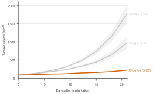

*`.highlight("Drug A + B")` mutes the other arms; `.endlabels(values=".0f")`
adds the final mean volume to each name.*

`label=` changes the text: `{group}` stands for the group name, so
`label="Arm: {group}"` adds a prefix. Without groups, plain text names the
single line, and `values=` alone prints just the last value. `pad=` sets the
gap before the labels in points (default 4).

```python
sp.line(admissions).endlabels(label="Admissions", values=".0f")
```

## Shading under a line

`.fill()` shades between each line and a baseline (`to=`, default 0). Use it to
emphasise a magnitude that is read against zero, such as a fluorescence
transient, an occupancy or a cumulative count. `.refline()` marks events:

```python
seconds = np.arange(0, 60, 0.1)
dff = sum(
    a * np.clip(seconds - t0, 0, None) / 1.5 * np.exp(1 - np.clip(seconds - t0, 0, None) / 1.5)
    for t0, a in [(10, 0.9), (30, 1.4), (45, 0.6)]
)
calcium = pd.DataFrame({"time": seconds, "dff": dff + rng.normal(0, 0.02, seconds.size)})
```

=== ".fill()"

    ```python
    (
        sp.line(calcium, x="time", y="dff")
        .fill()
        .refline(10, 30, 45, axis="x", linestyle=":")
        .colors(["#009E73"])
        .labels(x="Time (s)", y="ΔF/F₀")
    )
    ```
    <!-- figure: line-fill -->

    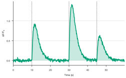

    *An even fill at the theme's `fill_alpha`; dotted lines mark the three
    stimuli.*

=== ".fill(gradient=True)"

    ```python
    (
        sp.line(calcium, x="time", y="dff")
        .fill(gradient=True)
        .refline(10, 30, 45, axis="x", linestyle=":")
        .colors(["#009E73"])
        .labels(x="Time (s)", y="ΔF/F₀")
    )
    ```
    <!-- figure: line-fill-gradient -->

    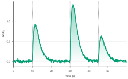

    *`gradient=True` fades from twice `fill_alpha` at the line to transparent
    at the baseline.*

`alpha=` sets the opacity, and `.fill(False)` removes the shading. For stacked
areas, bands between two columns, or areas colored by sign, see
[area plots](area.md).

`.refline()` adds horizontal lines by default and vertical ones with
`axis="x"`; values can be numbers, dates (also as text, e.g. `"2024-03-01"`) or
category names. Each call can set its own `label` (`True` writes the value),
`color`, `linestyle` and `linewidth`, and `.refline()` without values removes
them all.

## Reporting: caption and source data

`.caption()` returns figure-legend text that says what the lines and error
bars show, including every interval level. `.source_data()` returns the plotted
numbers, one row per point with n and the interval bounds, ready for a
journal's source-data file:

```python
plot = sp.line(growth, x="day", y="volume", hue="treatment", error="ci")
print(plot.caption())
plot.source_data().head()
```

With several levels, `.source_data()` has one low/high column pair per level
(e.g. `pi0.5_low`, `pi0.95_high`; with one level just `pi_low`, `pi_high`):

```python
fan = sp.line(forecast, x="week", y="beds", estimator="median", error="pi").errorbars(
    level=(0.5, 0.8, 0.95)
)
print(fan.caption())
fan.source_data().columns.tolist()
```

## Style fields

| Field | Effect |
|---|---|
| `line_width` | Line width in pt. Unit lines are half as wide. |
| `fill_alpha` | Opacity of error bands and `.fill()` shading (0.22 by default). |
| `errorbar_capsize` | Error bar cap length in pt. |
| `marker`, `marker_size`, `marker_edge_width` | Marker shape, diameter and ring width for `.markers()`. |
| `muted` | Color of de-emphasized groups with `.highlight()`. |
| `grid` | `"value"` (default), `"x"`, `"y"`, `"both"` or `"none"`. |

```python
sp.line(growth, x="day", y="volume", hue="treatment", error="ci").theme(line_width=1, fill_alpha=0.15)
```

Set them for line plots only in a preset's `[plots.line]` section (see
[presets](../presets.md)).

## Discovering options

```python
sp.LinePlot.arguments()             # what sp.line(...) accepts
```

```python
sp.LinePlot.options()               # every chainable step
```

```python
sp.LinePlot.options("errorbars")    # one step's parameters, allowed values, defaults
```

```python
sp.theme_options()                  # style fields
```

The [option discovery guide](../options.md) shows how to search these tables.

## Warnings and errors

- `error=` needs several rows at some x; with one value per point there is
  nothing to summarize (`DataShapeError`).
- `estimator="sd"` (or `"sem"`, ...) raises with a hint to use `error=`.
- Unknown error kinds suggest the closest one (`error="std"` → `"sd"`).
- `error="ci"` needs `estimator` `"mean"`, `"median"` or `"sum"`; for your own
  function use `"pi"` or `"sd"`. `error=` with `estimator=None` raises.
- `error=` and `yerr=` can't be combined; `yerr=` needs one row per x per line,
  and errors can't be negative.
- `.errorbars()` without `error=`, `yerr=` or `xerr=` raises: first choose
  what the bars show.
- `level` for `"ci"`/`"pi"` is a coverage between 0 and 1 (`0.95`, not `95`);
  for `"sd"`/`"sem"` a positive multiple. It can't be used with `yerr=`.
- `dodge=` works with numeric or category x, not dates.
- `.encode_groups()` needs `hue=` groups.
- `.endlabels()` without groups needs `values=` or `label=`; `label=` with
  `{group}` needs groups.
