# Scatter plots

`sp.scatter()` draws one marker per row: two numeric columns against each
other, optionally colored by group, shaped by a second grouping, sized by a
third column, and with a fit line. Use it for relationships between two
measurements, volcano plots, method comparisons and quality-control plots.

The examples on this page run top to bottom like notebook cells and share one
namespace. All data are synthetic: a differential expression result for 3,000
genes (KO vs WT) and a clinical cohort of 160 adults with BMI, liver fat
measured by MRI, sex, age and glycaemic status.

```python
import math

import numpy as np
import pandas as pd
import SecretPlots as sp

sp.use(preset="nature")            # 89 mm single column, 5–7 pt text
rng = np.random.default_rng(42)

# Differential expression, KO vs WT: 10% of genes truly change
true_lfc = rng.normal(0, 0.25, 3000) + np.where(
    rng.uniform(0, 1, 3000) < 0.1, rng.normal(0, 1.8, 3000), 0.0
)
se = 0.2 + rng.gamma(2.0, 0.12, 3000)
lfc = true_lfc + rng.normal(0, se)
p = np.vectorize(math.erfc)(np.abs(lfc / se) / math.sqrt(2))   # two-sided z-test
deg = pd.DataFrame({"log2fc": lfc, "neglog10p": -np.log10(p)})
significant = deg["neglog10p"] > 2
deg["call"] = np.select(
    [significant & (deg["log2fc"] > 1), significant & (deg["log2fc"] < -1)],
    ["Up", "Down"],
    "NS",
)

# Clinical cohort
n = 160
bmi = rng.normal(28, 4.5, n).clip(18, 42)
sex = rng.choice(["Female", "Male"], n)
cohort = pd.DataFrame(
    {
        "bmi": bmi,
        "liver_fat": (1.5 + 0.035 * (bmi - 18) ** 2 + 1.5 * (sex == "Male"))
        * rng.lognormal(0, 0.25, n),
        "sex": sex,
        "age": rng.uniform(25, 75, n).round(),
        "status": np.where(
            rng.uniform(0, 1, n) < (bmi - 18) / 30,
            "Type 2 diabetes",
            rng.choice(["Normoglycaemic", "Prediabetes"], n, p=[0.65, 0.35]),
        ),
    }
)
SEX = {"Female": "#EE6677", "Male": "#4477AA"}   # Paul Tol bright
STATUS = ["Normoglycaemic", "Prediabetes", "Type 2 diabetes"]
```

```python
(
    sp.scatter(deg, x="log2fc", y="neglog10p", hue="call", hue_order=["NS", "Down", "Up"])
    .colors({"Up": "#D55E00", "Down": "#0072B2", "NS": "#C8C8C8"})
    .refline(-1, 1, axis="x", linestyle=":", color="#888888")
    .refline(2, linestyle=":", color="#888888")
    .labels(x="log₂ fold change (KO / WT)", y="−log₁₀ P")
    .legend(title="")
    .theme(marker_size=3, grid="none")
)
```
<!-- figure: scatter-overview.png -->

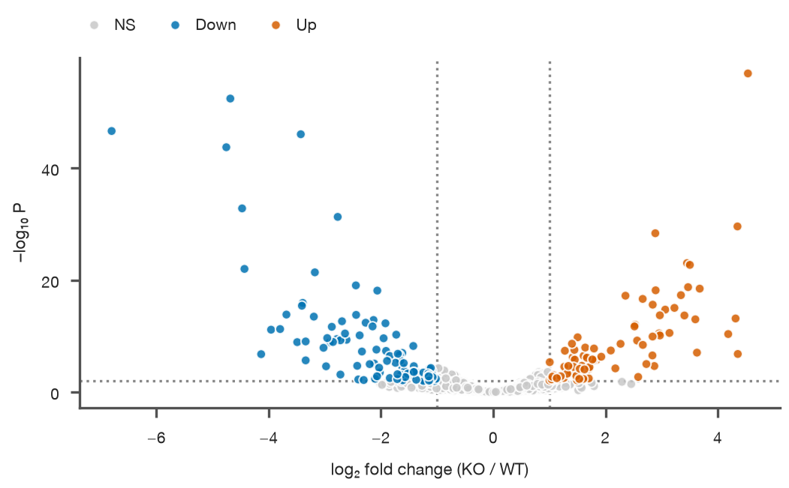

*Volcano plot of 3,000 genes. Dotted lines mark |log₂ FC| = 1 and P = 0.01;
significant genes are colored, the rest are grey. `hue_order` puts the grey
points first, so the colored ones are drawn on top.*

Like every SecretPlots plot, nothing is drawn until the plot is displayed,
saved, shown, or you access `.fig` / `.ax`.

!!! tip "Explore the options from Python"
    `sp.ScatterPlot.options()` lists every chainable step, and
    `sp.ScatterPlot.options("fit")` shows one step's parameters and defaults.
    See [Discovering options](#discovering-options).

## Contents

- [Signature](#signature)
- [Input data](#input-data)
- [Encoding a third variable](#encoding-a-third-variable)
- [Fit lines](#fit-lines)
- [Highlighting](#highlighting)
- [Dense data: marker size and transparency](#dense-data-marker-size-and-transparency)
- [Colors](#colors)
- [Axes, reference lines and legend](#axes-reference-lines-and-legend)
- [Recipe: Bland–Altman plot](#recipe-blandaltman-plot)
- [Size, presets and saving](#size-presets-and-saving)
- [Discovering options](#discovering-options)
- [Warnings and errors](#warnings-and-errors)

## Signature

```text
sp.scatter(data=None, x=None, y=None, hue=None, *,
           size=None, style=None, hue_order=None, style_order=None,
           missing="raise") -> ScatterPlot
```

| Argument | Default | Meaning |
|---|---|---|
| `data` | `None` | DataFrame or dict of columns, or an array with two columns (x, y). Can be left out; see [Input data](#input-data). |
| `x`, `y` | `None` | Column names of the two numeric variables, or sequences of numbers when `data` is left out. |
| `hue` | `None` | Column with groups, drawn in different colors with a legend. |
| `size` | `None` | Numeric column that scales marker area, with a size legend. |
| `style` | `None` | Column with groups, drawn in different marker shapes (up to 8) with a legend. Can be the same column as `hue`. |
| `hue_order` | `None` | Explicit group order (a list). Groups are also drawn in this order, so later groups sit on top. |
| `style_order` | `None` | Explicit order of the `style` values, and so of their shapes (a list). |
| `missing` | `"raise"` | `"raise"` rejects missing or non-finite x, y, size, hue or style values; `"drop"` ignores those rows. See [data handling](../usage.md). |

### Chainable methods

Specific to scatter plots:

| Method | What it does |
|---|---|
| `.fit(kind="linear", *, ci=0.95, per_group=True, frac=2/3, stats=False)` | Add a fit line; see [Fit lines](#fit-lines). |
| `.grouplabels(labels)` | Rename the `hue` groups (list in group order or `{old: new}`). |
| `.encode_groups()` | Give each `hue` group its own marker shape as well as its color, replacing `style=`. |

Shared by every plot type:

| Method | What it does |
|---|---|
| `.labels(x=, y=, title=)` | Axis titles and plot title. |
| `.legend(position="auto", *, title, ncols, fontsize, loc, anchor)` | Place and format the legend; see [bar plots](bar.md#legend). |
| `.colors(colors=None, *, alpha=None)` | One color, a palette, or a `{group: color}` mapping. |
| `.highlight(*names)` | Emphasize `hue` groups; mute the rest. |
| `.xlim(low, high)`, `.ylim(low, high)` | Axis limits. |
| `.log(axis="y")` | Log scale on `"x"`, `"y"` or `"xy"`. |
| `.format_axis(axis="y", kind="number", *, decimals, prefix, suffix, scale, date_format)` | Tick label format. |
| `.refline(*values, axis, label, color, linestyle, linewidth, label_position, label_rotation, label_side)` | Reference lines; see [bar plots](bar.md#reference-lines). |
| `.chrome(title, subtitle, source, note)` | Headline and source text around the figure. |
| `.preset(name, width, height)`, `.size(width, height, scale_text)` | Journal preset and figure size. |
| `.theme(theme, **overrides)` | Switch theme or override style fields. |
| `.save(path, dpi, **kwargs)`, `.show()`, `.render(ax)`, `.copy()` | Output and copying. |
| `.options(verb)`, `.explain(field)`, `.style_report()` | Introspection. |

## Input data

A DataFrame with column names is the usual form. Axis titles default to the
column names, so replace them with the quantity and its unit:

```python
sp.scatter(cohort, x="bmi", y="liver_fat").labels(
    x="BMI (kg m⁻²)", y="Liver fat, MRI-PDFF (%)"
)
```
<!-- figure: scatter-basic -->

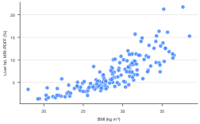

*The simplest call, in the default `nature` theme: liver fat rises steeply with
BMI.*

Other accepted shapes:

```python
sp.scatter(x=[0.5, 1.0, 2.0, 4.0], y=[0.12, 0.26, 0.49, 0.81])   # plain sequences
```

```python
sp.scatter({"dose": [0, 1, 2, 4], "response": [0.1, 0.4, 0.7, 0.9]},
           x="dose", y="response")                              # dict of columns
```

```python
sp.scatter(np.array([[1, 2], [2, 4], [3, 5]]))                  # two-column array: x, y
```

```python
sp.scatter(cohort[["bmi", "liver_fat"]])                        # exactly two numeric columns
```

Missing or infinite values raise an error by default; `missing="drop"` ignores
the affected rows. Plain sequences have no names, so add axis titles with
`.labels()`.

## Encoding a third variable

A scatter plot has room for one or two more variables beyond x and y. Color
(`hue`) is the strongest channel and suits the grouping your story is about.
Shape (`style`) adds a second grouping that still reads in grayscale. Marker
area (`size`) shows a continuous variable, but only roughly; readers compare
areas poorly.

=== "hue="

    ```python
    (
        sp.scatter(cohort, x="bmi", y="liver_fat", hue="sex")
        .colors(SEX)
        .labels(x="BMI (kg m⁻²)", y="Liver fat, MRI-PDFF (%)")
        .legend(title="")
    )
    ```
    <!-- figure: scatter-hue -->

    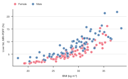

    *`hue="sex"`: one color per group, with a legend.*

=== "hue= + style="

    ```python
    (
        sp.scatter(
            cohort, x="bmi", y="liver_fat", hue="sex", style="status", style_order=STATUS
        )
        .colors(SEX)
        .labels(x="BMI (kg m⁻²)", y="Liver fat, MRI-PDFF (%)")
        .legend("right", title="")
    )
    ```
    <!-- figure: scatter-style -->

    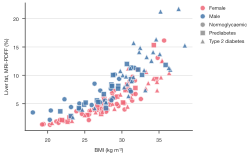

    *`style="status"` adds marker shapes. The legend lists the colors, then
    the shapes in grey.*

=== "size="

    ```python
    (
        sp.scatter(cohort, x="bmi", y="liver_fat", size="age")
        .colors("#009E73")
        .labels(x="BMI (kg m⁻²)", y="Liver fat, MRI-PDFF (%)")
        .legend("right", title="Age (years)")
    )
    ```
    <!-- figure: scatter-size -->

    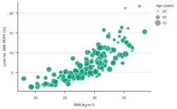

    *`size="age"`: marker area grows with age; the legend shows three
    reference sizes.*

=== ".encode_groups()"

    ```python
    (
        sp.scatter(cohort, x="bmi", y="liver_fat", hue="status", hue_order=STATUS)
        .encode_groups()
        .colors(["#0072B2", "#E69F00", "#CC79A7"])
        .labels(x="BMI (kg m⁻²)", y="Liver fat, MRI-PDFF (%)")
        .legend(title="")
    )
    ```
    <!-- figure: scatter-encode-groups -->

    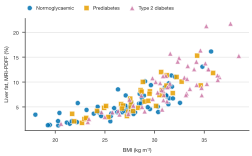

    *`.encode_groups()`: color and shape both identify the group, so the
    figure survives grayscale printing and color vision deficiency.*

Details:

- Groups appear in order of first appearance (or the category order of a
  pandas `Categorical`). Set it with `hue_order=` / `style_order=`.
- The first `style` value uses the theme's `marker` (default circle); the rest
  follow square, triangle, diamond, down-triangle, plus, cross, star. That
  allows up to 8 values.
- `.encode_groups()` is the same as passing the `hue` column as `style=`
  too: the legend shows one combined entry per group.
- `style` changes only the marker shape. Fit lines, colors and `.highlight()`
  follow `hue`.
- Marker **area** grows linearly from 0.4× to 3× the theme's `marker_size`
  area, from the smallest to the largest value of the `size` column.
- The legend title joins the column names, e.g. `sex / status`; replace it
  with `.legend(title=...)`. Rename groups with `.grouplabels()`; later
  `.colors({...})` and `.highlight()` calls use the new names.

## Fit lines

`.fit()` adds a trend with its uncertainty. Use a linear fit to report a slope
or R², and LOWESS to show the shape of a curved relationship without assuming
a model. Here the relationship is curved, which the tabs make obvious.

=== ".fit()"

    ```python
    (
        sp.scatter(cohort, x="bmi", y="liver_fat", hue="sex")
        .colors(SEX)
        .fit()
        .labels(x="BMI (kg m⁻²)", y="Liver fat, MRI-PDFF (%)")
        .legend(title="")
    )
    ```
    <!-- figure: scatter-fit-linear -->

    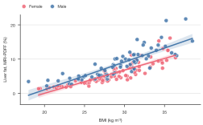

    *Least-squares line with a 95% confidence band, one per group.*

=== "stats=True"

    ```python
    (
        sp.scatter(cohort, x="bmi", y="liver_fat", hue="sex")
        .colors(SEX)
        .fit(stats=True)
        .labels(x="BMI (kg m⁻²)", y="Liver fat, MRI-PDFF (%)")
        .legend(title="")
    )
    ```
    <!-- figure: scatter-fit-stats -->

    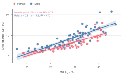

    *`stats=True` prints `y = ax + b, R² = ...` per group in the top-left
    corner.*

=== "\"lowess\""

    ```python
    (
        sp.scatter(cohort, x="bmi", y="liver_fat", hue="sex")
        .colors(SEX)
        .fit("lowess")
        .labels(x="BMI (kg m⁻²)", y="Liver fat, MRI-PDFF (%)")
        .legend(title="")
    )
    ```
    <!-- figure: scatter-fit-lowess -->

    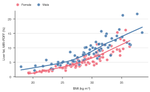

    *LOWESS follows the curve that the straight line misses. No band.*

=== "per_group=False"

    ```python
    (
        sp.scatter(cohort, x="bmi", y="liver_fat", hue="sex")
        .colors(SEX)
        .fit("lowess", per_group=False)
        .labels(x="BMI (kg m⁻²)", y="Liver fat, MRI-PDFF (%)")
        .legend(title="")
    )
    ```
    <!-- figure: scatter-fit-pooled -->

    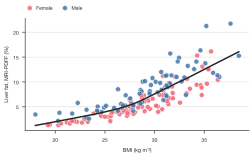

    *One pooled fit through all points, drawn in the text color.*

| Option | Default | Meaning |
|---|---|---|
| `kind` | `"linear"` | `"linear"` (least squares), `"lowess"` (local smoother), or `None` to remove the fit. |
| `ci` | `0.95` | Confidence level of the band around a linear fit; `None` for no band. Ignored for LOWESS. |
| `per_group` | `True` | One fit per `hue` group, in the group's color. `False`: one fit through all points. |
| `frac` | `2/3` | LOWESS only: fraction of points used for each local fit, 0 to 1. Smaller follows the data more closely. |
| `stats` | `False` | Linear only: print `y = ax + b, R² = ...` (per group) in the top-left corner. |

```python
sp.scatter(cohort, x="bmi", y="liver_fat").fit("linear", ci=0.99)       # 99% band
```

```python
sp.scatter(cohort, x="bmi", y="liver_fat").fit("lowess", frac=0.3)      # wigglier
```

??? info "Statistics details"
    - The band is a confidence interval for the fitted **mean** (not a
      prediction interval for new points), using Student's t with n − 2
      degrees of freedom.
    - LOWESS uses tricube-weighted local linear fits without robustness
      iterations, so strong outliers still pull the curve.
    - A linear fit needs at least 2 distinct x values, its band at least 3
      points; LOWESS needs at least 3 points.
    - `stats=True` reports R² of the least-squares fit, not a P value. Report
      the test you used (Pearson, Spearman, regression) in the caption.

!!! note "Journal checklist"
    - State n, the fit method and what the band shows (e.g. "line, least
      squares fit; shading, 95% CI of the mean").
    - Use the same axis ranges on panels that readers compare (`.xlim()`,
      `.ylim()`).
    - A correlation is not a slope: if you report Pearson's r, say so; R² from
      `stats=True` is its square for a simple linear fit.

## Highlighting

`.highlight()` keeps the named `hue` groups in color and mutes the rest to
grey. Use it when one group carries the message and the others are context.

=== "Without highlight"

    ```python
    sp.scatter(cohort, x="bmi", y="liver_fat", hue="status", hue_order=STATUS).labels(
        x="BMI (kg m⁻²)", y="Liver fat, MRI-PDFF (%)"
    ).legend(title="")
    ```
    <!-- figure: scatter-highlight-off -->

    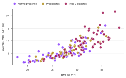

    *Three groups in the default `nature` palette.*

=== ".highlight(\"Type 2 diabetes\")"

    ```python
    (
        sp.scatter(cohort, x="bmi", y="liver_fat", hue="status", hue_order=STATUS)
        .highlight("Type 2 diabetes")
        .labels(x="BMI (kg m⁻²)", y="Liver fat, MRI-PDFF (%)")
        .legend(title="")
    )
    ```
    <!-- figure: scatter-highlight-on -->

    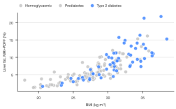

    *People with type 2 diabetes cluster at high BMI and liver fat.*

Highlighting needs `hue=` groups; names follow any `.grouplabels()` renames.
The muted color comes from the theme field `muted`.

## Dense data: marker size and transparency

With thousands of points, default markers merge into a blob and hide where the
data are densest. Smaller, translucent markers show density again. Here:
quality control of 5,000 single cells, with typical filtering thresholds.

```python
umi = rng.lognormal(8.2, 0.7, 5000)
genes_detected = 0.9 * umi**0.82 * rng.lognormal(0, 0.12, 5000)
low_quality = rng.uniform(0, 1, 5000) < 0.08
genes_detected[low_quality] *= rng.uniform(0.15, 0.45, low_quality.sum())
qc = pd.DataFrame({"umi": umi, "genes": genes_detected})
```

=== "Default markers"

    ```python
    (
        sp.scatter(qc, x="umi", y="genes")
        .colors("#332288")
        .log("xy")
        .refline(1000, axis="x", linestyle=":", color="#888888")
        .refline(500, linestyle=":", color="#888888")
        .labels(x="UMIs per cell", y="Genes detected per cell")
    )
    ```
    <!-- figure: scatter-dense-default.png -->

    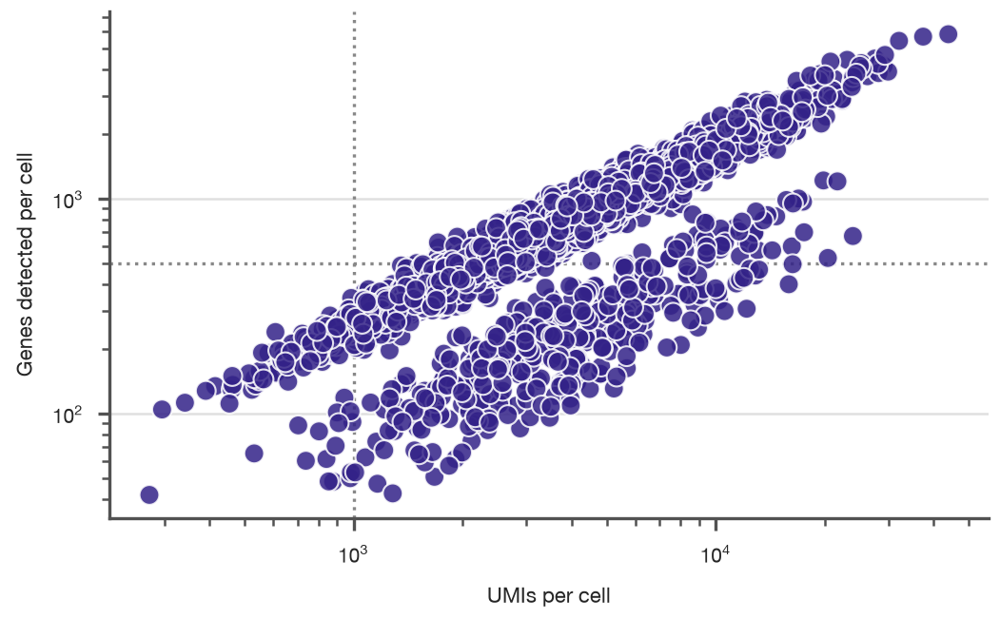

    *Default markers (5 pt, 85% opaque): the core is a solid band.*

=== "marker_size=1.5, marker_alpha=0.25"

    ```python
    (
        sp.scatter(qc, x="umi", y="genes")
        .colors("#332288")
        .log("xy")
        .refline(1000, axis="x", linestyle=":", color="#888888")
        .refline(500, linestyle=":", color="#888888")
        .labels(x="UMIs per cell", y="Genes detected per cell")
        .theme(marker_size=1.5, marker_alpha=0.25, marker_edge_width=0)
    )
    ```
    <!-- figure: scatter-dense-small.png -->

    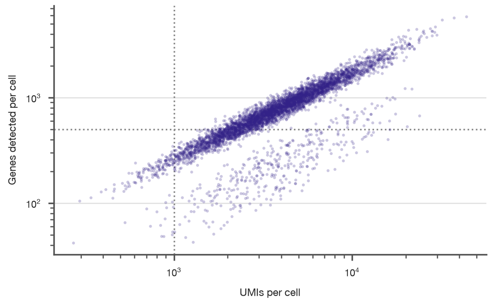

    *Small, translucent markers reveal the dense core and the low-quality
    cells below the main trend.*

Marker look comes from four theme fields:

| Field | Default | Effect |
|---|---|---|
| `marker` | `"o"` | Marker shape, any [matplotlib marker](https://matplotlib.org/stable/api/markers_api.html): `"o"` circle, `"s"` square, `"^"` triangle, `"D"` diamond, `"x"`, `"+"`, ... Line-only shapes (`"x"`, `"+"`) are stroked in the point color at the theme's `line_width`. |
| `marker_size` | 5 | Marker diameter in pt (the base size when `size=` is used). |
| `marker_alpha` | 0.85 | Opacity, 0 to 1. Lower it when points overlap. |
| `marker_edge_width` | 0.5 | Outline width in pt; the outline uses the axes background color so overlapping points stay distinct. |

Set them per plot with `.theme(...)`, for every plot with `sp.use(...)`, or
for scatter plots only in a preset's `[plots.scatter]` section.

## Colors

```python
sp.scatter(cohort, x="bmi", y="liver_fat").colors("#009E73")              # one color
```

```python
sp.scatter(cohort, x="bmi", y="liver_fat", hue="sex").colors(SEX)         # mapping
```

```python
sp.scatter(cohort, x="bmi", y="liver_fat", hue="status", hue_order=STATUS).colors(
    ["#0072B2", "#E69F00", "#CC79A7"]                                     # palette
)
```

`alpha=` makes the colors see-through. Markers are already slightly
transparent (`marker_alpha`), so `alpha=0.5` halves that:

```python
sp.scatter(cohort, x="bmi", y="liver_fat").colors(alpha=0.5)
```

!!! tip "Colorblind-safe palettes"
    Avoid red against green for groups. The Okabe–Ito
    (`#E69F00 #56B4E9 #009E73 #0072B2 #D55E00 #CC79A7`) and Paul Tol palettes
    used on this page stay distinct for all common color vision deficiencies.
    Use a light grey such as `#C8C8C8` for background points, as in the
    volcano plot.

## Axes, reference lines and legend

Unlike bar plots, `.labels(x=...)` here always means your `x` column's axis,
since a scatter plot has no orientation.

```python
(
    sp.scatter(cohort, x="bmi", y="liver_fat", hue="sex")
    .colors(SEX)
    .refline(5.5, label="Steatosis", color="#D55E00")
    .refline(30, axis="x", linestyle=":")
    .xlim(18, 42)
    .labels(x="BMI (kg m⁻²)", y="Liver fat, MRI-PDFF (%)")
    .legend("inside", loc="upper left", anchor=(0.02, 0.98), title="")
)
```

- `.refline()` draws horizontal lines by default (`axis="y"`) and vertical
  ones with `axis="x"`; on scatter plots they sit behind the points. See
  [bar plots](bar.md#reference-lines) for every option.
- `.log("x")`, `.log("y")` or `.log("xy")` for log scales, as in the QC plot
  above.
- `grid="value"` (the default) draws horizontal gridlines and
  `grid="category"` vertical ones; `"both"`, `"x"`, `"y"` and `"none"` also
  work: `.theme(grid="none")`.
- Legend options (`position`, `title`, `ncols`, `fontsize`, `loc`, `anchor`)
  are described on the [bar plot page](bar.md#legend).

## Recipe: Bland–Altman plot

To compare two measurement methods, plot their difference against their mean,
with lines for the mean bias and the 95% limits of agreement. Here: HbA1c from
a point-of-care device against the central laboratory in 80 patients.

```python
lab = rng.normal(6.4, 1.1, 80)
poc = lab + 0.12 + rng.normal(0, 0.22, 80)
agreement = pd.DataFrame({"mean": (lab + poc) / 2, "diff": poc - lab})
bias = agreement["diff"].mean()
loa = 1.96 * agreement["diff"].std()

(
    sp.scatter(agreement, x="mean", y="diff")
    .colors("#0072B2")
    .refline(bias, label=f"Bias {bias:+.2f}", linestyle="-")
    .refline(bias + loa, label=f"+1.96 SD {bias + loa:+.2f}", color="#D55E00")
    .refline(bias - loa, label=f"−1.96 SD {bias - loa:+.2f}", color="#D55E00")
    .refline(0, color="#BBBBBB", linestyle=":")
    .labels(x="Mean of both methods, HbA1c (%)", y="Point of care − laboratory (%)")
    .theme(grid="none")
)
```
<!-- figure: scatter-bland-altman -->

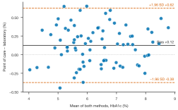

*Bland–Altman plot: the point-of-care device reads slightly high on average
(solid line), and 95% of differences fall within the dashed limits of
agreement.*

## Size, presets and saving

These work exactly as for [bar plots](bar.md#size-presets-and-themes):

```python
plot = (
    sp.scatter(cohort, x="bmi", y="liver_fat", hue="sex")
    .colors(SEX)
    .fit("lowess")
    .labels(x="BMI (kg m⁻²)", y="Liver fat, MRI-PDFF (%)")
    .preset("nature", width="double")
)
plot.save("fig3a.pdf")
```

See [Presets](../presets.md) and [Journal-ready figures](../publication.md)
for sizing, fonts and file formats.

## Discovering options

```python
sp.ScatterPlot.options()            # all steps you can chain, with a summary
```

```python
sp.ScatterPlot.options("legend")    # one step's options, allowed values and defaults
```

```python
sp.theme_options()                  # every style field, e.g. marker_size
```

`plot.explain("marker_size")` tells you where a style value came from, and
`plot.style_report()` lists every resolved value. See the
[option discovery guide](../options.md) and the [gallery](../gallery.md).

## Warnings and errors

| Message | What it means |
|---|---|
| `Column 'BMI' not found. Available: ...` | Check the column name (case-sensitive). |
| `Values in 'sex' must be numeric` | `x`, `y` and `size` must be numbers; groups go in `hue=` or `style=`. |
| `x='bmi' / y='liver_fat' look like column names, but no data was given` | Pass the DataFrame first: `sp.scatter(df, x=..., y=...)`. |
| `Pass x= and y= column names` | The DataFrame doesn't have exactly two numeric columns to use automatically. |
| `A confidence band for ... needs at least 3 points` | Use `.fit(ci=None)` or add data. |
| `Unknown fit 'loess'. Did you mean 'lowess'?` | Use `"linear"` or `"lowess"`. |
| `stats=True needs a linear fit` | Equations are only printed for `kind="linear"`. |
| `style= has 9 values, but there are only 8 marker shapes` | Use `hue=` for that column, or group the values first. |
| `encode_groups() needs hue= groups` | Add `hue=` before calling `.encode_groups()`. |
| `Unknown marker 'q'` | Set `marker` to a matplotlib marker such as `"o"`, `"s"` or `"^"`. |
| `highlight() picks hue= groups` | Highlighting works on groups; add `hue=`. |
| `Cannot highlight [...]: not a group` | Check the group name and any `.grouplabels()` renames. |
| `PaletteExtendedWarning` | More groups than palette colors; extra shades were generated. |
