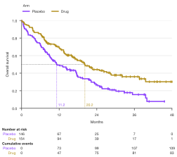
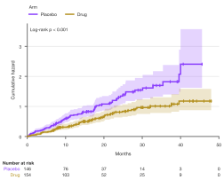
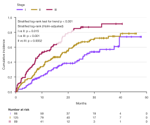
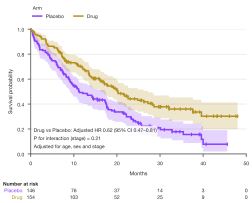

# Survival curves

`sp.survival()` draws Kaplan–Meier curves from one row per subject: a
follow-up time and whether the event happened or the subject was censored. It
also draws cumulative incidence (1 − KM) and the Nelson–Aalen cumulative
hazard. Optional extras are a confidence band, censoring ticks, a
number-at-risk table aligned with the time axis, and log-rank p-values and
hazard ratios written on the plot.

Everything except fuller models is computed by SecretPlots, with numpy only:

- the estimates and their intervals
- median survival
- the log-rank family of tests
- unadjusted hazard ratios

For adjusted hazard ratios or interaction p-values, fit your model in
lifelines, statsmodels or R and pass the numbers in. They are written in the
same style.

The examples on this page share one setup, like cells in a notebook. The data
are synthetic: a two-arm trial with three regions, followed for up to four
years.

```python
import numpy as np
import pandas as pd
import SecretPlots as sp

sp.use(preset="nature")                      # 89 mm single column, 7 pt text

rng = np.random.default_rng(1)
n = 300
arm = rng.choice(["Placebo", "Drug"], n)
region = rng.choice(["Europe", "Americas", "Asia"], n)
stage = rng.choice(["I", "II", "III"], n, p=[0.3, 0.4, 0.3])
scale = np.where(arm == "Drug", 30, 18) * np.select(
    [stage == "I", stage == "II"], [1.6, 1.0], 0.6)
event_time = rng.exponential(scale)
censor_time = rng.uniform(6, 48, n)
trial = pd.DataFrame({
    "months": np.minimum(event_time, censor_time).round(1),
    "died": event_time <= censor_time,
    "arm": arm,
    "region": region,
    "stage": stage,
})
```

```python
(
    sp.survival(trial, time="months", event="died", hue="arm",
                hue_order=["Placebo", "Drug"])
    .risk_table()
    .pvalue()
    .hazard_ratio()
    .labels(y="Overall survival")
)
```
<!-- figure: survival-hero -->


*Overall survival by arm with 95% confidence bands and a tick for each
censored patient. The table counts the patients still at risk at each tick.
The log-rank p-value and the Cox hazard ratio (drug against placebo, the first
group) are computed from the data.*

Nothing is drawn until the plot is displayed, saved or shown, or until you
access `.fig` / `.ax`.

!!! tip "Explore the options from Python"
    `sp.SurvivalPlot.options()` lists every chainable step and
    `sp.SurvivalPlot.options("pvalue")` shows one step's parameters, allowed
    values and defaults. See the [option discovery guide](../options.md).

## Signature

```text
sp.survival(data, time="time", event="event", *, hue=None, strata=None,
            kind="survival", hue_order=None, missing="raise") -> SurvivalPlot
```

| Argument | Default | Meaning |
|---|---|---|
| `data` | | A DataFrame (or dict of columns) with one row per subject. |
| `time` | `"time"` | Column of follow-up times: numbers ≥ 0, in any unit. Its name becomes the axis title. |
| `event` | `"event"` | Column marking an event (`1`/`True`) or censoring (`0`/`False`). |
| `hue` | `None` | Groups (e.g. treatment arms): one curve each, with a legend. |
| `strata` | `None` | A column to stratify tests and hazard ratios by (e.g. region or a randomisation factor). It is not drawn. |
| `kind` | `"survival"` | `"survival"` (Kaplan–Meier), `"failure"` (1 − KM, the cumulative incidence when there are no competing risks) or `"cumhaz"` (Nelson–Aalen cumulative hazard). |
| `hue_order` | `None` | Explicit order of the groups. The first one is the reference for hazard ratios. |
| `missing` | `"raise"` | `"raise"` rejects missing times, events or groups; `"drop"` leaves those subjects out. See [data handling](../usage.md). |

### Chainable methods

Every plot also has the shared steps (`.labels()`, `.legend()`, `.chrome()`,
`.preset()`, `.size()`, `.theme()`, `.colors()`, `.highlight()`, `.xlim()`,
`.format_axis()`, `.refline()`, `.save()`...). Survival plots add:

| Step | What it does |
|---|---|
| `.ci(show=True, *, level=0.95, method="log-log", alpha)` | Confidence bands; `False` hides them. `level` also sets median and hazard-ratio intervals. |
| `.censors(show=True, *, marker="|", size)` | Ticks where subjects were censored. |
| `.risk_table(*rows, times, show=True)` | Table below the axis: `"at_risk"` (default), `"events"`, `"censored"`. `times` sets the columns and the x ticks. |
| `.median(show=True, *, label=False)` | Dotted guides at each group's median survival. |
| `.pvalue(value, *, test, rho, gamma, trend, pairwise, correction, label)` | A computed test between the groups, or your own p-value; see [Tests](#tests). |
| `.hazard_ratio(values, *, ref, label="HR", decimals=2)` | Computed hazard ratios, or your own; see [Hazard ratios](#hazard-ratios). |
| `.annotate(*lines, loc)` | Your own lines in the statistics box, and where the box sits. |
| `.statistics()` | Per group: n, events, censored and median survival with its interval. |
| `.test_results()` | The statistic, degrees of freedom and p-value behind each computed p-value and hazard ratio. |
| `.source_data()` | The plotted estimates and counts at every distinct time. |

## Input data

Use one row per subject: the time to the event or to the last follow-up, and
whether the event was observed. Subjects without the event are censored at
their last follow-up time. Booleans work for the event column. Other codings
(e.g. `"dead"`/`"alive"`) need converting first, such as
`trial["status"] == "dead"`. Times are numbers. To use dates, compute the
durations first, e.g. `(last_visit - start).dt.days / 30.44` for months.

The estimates follow the conventions of R's `survival` package, the reference
most journals expect:

- Subjects censored at a time still count as at risk at that time.
- Kaplan–Meier intervals use Greenwood's variance on the log–log scale (as
  lifelines, SAS and Stata do). Use `method="log"` for R's default.
- The cumulative hazard uses Aalen's variance with a log-transformed
  interval.
- The median is the first time the curve reaches 0.5. If the curve sits
  exactly at 0.5 for a while, the median is the midpoint of that interval.

```python
sp.survival(trial, time="months", event="died", hue="arm").statistics()
```

## Risk tables

`.risk_table()` adds the number at risk under each x tick. Each group's label
is in its curve's color. Add `"events"` or `"censored"` for cumulative counts,
and pass `times=` to choose the columns. The x ticks follow, which suits
months in steps of 6 or 12. Without an explicit height, the figure grows by
the table's height, so the curves keep their room.

```python
(
    sp.survival(trial, time="months", event="died", hue="arm",
                hue_order=["Placebo", "Drug"])
    .risk_table("at_risk", "events", times=[0, 12, 24, 36, 48])
    .ci(False)
    .median(label=True)
    .labels(y="Overall survival")
)
```
<!-- figure: survival-table -->



*Columns every 12 months. The dotted guides drop from 0.5 to each arm's
median survival.*

## Cumulative incidence and hazard

`kind="failure"` turns the curves upside down (1 − KM), which reads better
when events are rare. `kind="cumhaz"` draws the Nelson–Aalen cumulative
hazard. On a log scale (`.log("y")`), parallel cumulative hazards suggest
proportional hazards.

```python
(
    sp.survival(trial, time="months", event="died", hue="arm",
                hue_order=["Placebo", "Drug"], kind="cumhaz")
    .risk_table()
    .pvalue()
)
```
<!-- figure: survival-cumhaz -->



*The cumulative hazard rises faster on placebo. The statistics box moves to the
upper left, where these curves leave room.*

## Tests

`.pvalue()` runs a log-rank test between the `hue` groups. Each call adds a
line to the statistics box, and `.pvalue(False)` removes them. Weighted
versions emphasise different parts of follow-up:

| `test=` | Weight at each event time | Sensitive to |
|---|---|---|
| `"logrank"` (default) | 1 | Proportional hazards |
| `"wilcoxon"` | number at risk (Gehan–Breslow) | Early differences |
| `"tarone-ware"` | √(number at risk) | Between the two |
| `"peto"` | Peto–Peto's survival estimate | Early differences, robust to censoring |
| `"fleming-harrington"` | S(t)^`rho` (1 − S(t))^`gamma` | Late differences with `gamma` > 0 (delayed effects), early ones with `rho` > 0 |

Other options:

- With `strata=` the tests are stratified: computed within each stratum, then
  combined.
- `trend=True` tests for a trend across ordered groups, with scores 1, 2,
  3…; a list gives your own scores.
- `pairwise=True` gives one p-value per pair of groups, adjusted with
  `correction="holm"` or `"bonferroni"`.

```python
(
    sp.survival(trial, time="months", event="died", hue="stage",
                hue_order=["I", "II", "III"], strata="arm", kind="failure")
    .ci(False)
    .pvalue(trend=True)
    .pvalue(pairwise=True, correction="holm")
    .risk_table()
    .legend(title="Stage")
)
```
<!-- figure: survival-tests -->



*Stage III has the most events. Both tests are stratified by arm, and the
pairwise p-values are Holm-adjusted.*

`.test_results()` returns the statistics behind the printed values, for the
methods section:

```python
(
    sp.survival(trial, time="months", event="died", hue="stage",
                hue_order=["I", "II", "III"], strata="arm")
    .pvalue(trend=True)
    .pvalue(pairwise=True, correction="holm")
    .test_results()
)
```

## Hazard ratios

`.hazard_ratio()` fits a Cox model with the group as its only covariate
(Efron's handling of ties, stratified by `strata=`). It writes each group
against the reference, which is the first group or `ref=`. This model matches
R's `coxph(Surv(time, event) ~ arm)` and lifelines' `CoxPHFitter`.

Hazard ratios adjusted for covariates, and p-values for interactions, need a
fuller model. Give their numbers instead:

- `(hr, lower, upper)` for two groups
- `{group: (hr, lower, upper)}` for more

`.annotate()` adds any other line to the box.

```python
(
    sp.survival(trial, time="months", event="died", hue="arm",
                hue_order=["Placebo", "Drug"])
    .risk_table()
    .hazard_ratio((0.62, 0.47, 0.81), label="Adjusted HR")
    .pvalue(0.21, label="P for interaction (stage)")
    .annotate("Adjusted for age, sex and stage")
)
```
<!-- figure: survival-supplied -->



*Numbers from your own model, written like computed ones: drug against
placebo with its 95% CI, and the P for interaction.*

## Size and layout

The statistics box sits in the lower left for survival curves and in the upper
left otherwise. `.annotate(loc="upper right")` moves it. The risk table keeps a
fixed physical row spacing under the x-axis title, so it stays aligned when the
figure is resized or drawn into your own axes with `.render(ax=...)`.

`.highlight("Drug")` mutes the other groups in the curves and the table.
`.colors({"Placebo": "#8d8d8d"})` recolors chosen groups. `.source_data()`
returns every plotted estimate with its interval and counts, ready for a
journal's source-data file.
