# Violin plots and rainclouds

`sp.violin()` draws the distribution of each category as a mirrored density
curve with a small box plot inside. Use it when the *shape* matters: skew, a
long tail, two peaks. `sp.raincloud()` combines a half violin (the cloud), a
small box and every value as a dot (the rain) (Allen et al., *Wellcome Open
Res* 4:63, 2019), so readers see the shape, the summary and the raw data at
once.

The examples on this page share one setup, like cells in a notebook. All data
are synthetic: Stroop task reaction times (right-skewed, n = 60 per
condition), behavioural z-scores of mice by genotype and sex (n = 40 per
group), and gait speed in three age groups of unequal size.

```python
import numpy as np
import pandas as pd
import SecretPlots as sp

sp.use(preset="nature")                      # 89 mm single column, 7 pt text
rng = np.random.default_rng(21)

conditions = ["Congruent", "Neutral", "Incongruent"]
stroop = pd.DataFrame(
    {
        "condition": np.repeat(conditions, 60),
        "rt": np.concatenate(
            [rng.lognormal(np.log(m), s, 60) for m, s in ((480, 0.16), (520, 0.18), (610, 0.22))]
        ),
    }
)

genotypes = ["WT", "Het", "KO"]
behaviour = pd.DataFrame(
    {"genotype": np.tile(np.repeat(genotypes, 40), 2), "sex": np.repeat(["Female", "Male"], 120)}
)
behaviour["score"] = (
    rng.normal(0, 1, 240)
    + behaviour["genotype"].map({"WT": 0, "Het": 0.6, "KO": 1.6})
    + (behaviour["sex"] == "Male") * behaviour["genotype"].map({"WT": 0, "Het": 0.3, "KO": 0.9})
)

ages = ["20–39", "40–59", "60–79"]
gait = pd.DataFrame(
    {
        "age": np.repeat(ages, [120, 60, 24]),
        "speed": np.concatenate(
            [rng.normal(1.32, 0.14, 120), rng.normal(1.24, 0.16, 60), rng.normal(1.02, 0.2, 24)]
        ),
    }
)

stroop_colors = {"Congruent": "#44AA99", "Neutral": "#DDCC77", "Incongruent": "#CC6677"}
sex_colors = {"Female": "#EE6677", "Male": "#4477AA"}
```

```python
(
    sp.violin(behaviour, x="genotype", y="score", hue="sex", split=True, inner="quartiles")
    .colors(sex_colors)
    .legend(title="")
    .show_n(sep=" / ")
    .labels(x="", y="Behavioural score (z)")
)
```
<!-- figure: violin-hero -->

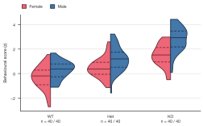

*Split violins compare two groups within each genotype at a glance: females
on the left half, males on the right. Solid lines mark medians, dashed lines
quartiles, and the sample sizes sit under each label. The sex difference grows
with gene dosage.*

Violins take the same data and the same steps as [box plots](box.md):
`.points()`, `.mean()`, `.show_n()`, `.compare()`, `.refline()`,
`.ticklabels()`, `.grouplabels()`, `.test_results()`, `.caption()` and
`.source_data()`. The box plot page covers those in depth; this page focuses
on what is specific to densities.

!!! tip "Explore the options from Python"
    `sp.ViolinPlot.arguments()` lists what `sp.violin(...)` accepts.
    `sp.ViolinPlot.options()` and `sp.RaincloudPlot.options()` list every
    chainable step; `sp.ViolinPlot.options("points")` shows one step's
    parameters, allowed values and defaults. See the
    [option discovery guide](../options.md).

## Signature

```text
sp.violin(data, x=None, y=None, hue=None, *,
          bw_adjust=1.0, cut=0.0, scale="area", inner="box", split=False,
          side="both", fill=True, edgecolor=None, linewidth=None, orient="v",
          order=None, hue_order=None, missing="raise") -> ViolinPlot

sp.raincloud(data, x=None, y=None, hue=None, *,
             bw_adjust=1.0, cut=0.0, scale="area", edgecolor=None,
             linewidth=None, orient="h",
             order=None, hue_order=None, missing="raise") -> RaincloudPlot
```

| Argument | Default | Meaning |
|---|---|---|
| `data`, `x`, `y`, `hue` | | Same inputs as [box plots](box.md#input-data): a long DataFrame with column names, a wide DataFrame, a dict, a Series, a list or an array. |
| `bw_adjust` | `1.0` | Multiplies the automatic bandwidth (Scott's rule, n^−1/5, on a robust spread: the smaller of the SD and IQR / 1.349). Smaller values follow the data more closely. Must be positive. |
| `cut` | `0.0` | How far past the smallest and largest value to draw, in bandwidths. With 0 each violin is trimmed at the data (ggplot2's `trim = TRUE`), so it never suggests impossible values. |
| `scale` | `"area"` | `"area"` (equal areas), `"count"` (area proportional to n) or `"width"` (equal maximum widths). |
| `inner` | `"box"` | `"box"`, `"quartiles"`, `"median"` or `None`. Violin only; rainclouds always draw a box. |
| `split` | `False` | With exactly two `hue` groups, draw one half per group. Violin only. |
| `side` | `"both"` | `"left"` or `"right"` for half violins; for horizontal violins `"right"` is the upper side. Cannot be combined with `split=True`. Violin only. |
| `fill` | `True` | Filled violins, or (`False`) outlines in the group colour. Violin only. |
| `edgecolor` | `None` | Colour of the outline and the median / quartile lines (default: a dark shade of the fill). `"none"` removes only the outline. |
| `linewidth` | `None` | Outline width in pt (default: from the theme); `0` removes it. |
| `orient` | `"v"` / `"h"` | `"v"` (values up) or `"h"` (values to the right). Rainclouds are horizontal by default. Also a step: `.orient("v")`. |
| `order`, `hue_order` | `None` | Explicit category and group order. |
| `missing` | `"raise"` | `"raise"` rejects missing or infinite values; `"drop"` ignores those observations. See [data handling](../usage.md). |

### Chainable methods

| Step | What it does |
|---|---|
| `.points(show=True, *, kind="auto", size, alpha, color, edgecolor, linewidth, seed=0)` | Draw every value as a dot. `kind`: `"auto"`, `"swarm"`, `"quasirandom"`, `"jitter"` or `"strip"`. Rainclouds start with `kind="jitter"`; `.points(False)` removes the rain. |
| `.mean(show=True)` | Mark each mean with a white diamond. |
| `.show_n(show=True, *, label="n = {n}", sep=", ")` | Print the sample size under each category label. |
| `.compare(*pairs, ref, test="mann-whitney", correction, p, format="p", hide_ns=False)` | Significance brackets; tests and corrections as for [box plots](box.md#significance-brackets). |
| `.refline(*values, axis, label, color, linestyle="--", linewidth, label_position="end", label_rotation=0, label_side=None)` | Reference lines across the plot. |
| `.ticklabels(labels, *, rotation, italic=False)` | Rename categories and style their labels. |
| `.grouplabels(labels)` | Rename `hue` groups in the legend. |
| `.orient("v" \| "h")` | Direction of the value axis. |

Plus the general steps of every plot (`.colors()`, `.highlight()`,
`.labels()`, `.legend()`, `.log()`, `.size()`, `.save()`, …) and
`.test_results()`, `.caption()` and `.source_data()`, which return a table or
text instead of a plot.

## Inside the violin

The density shows the shape; the inner marks give readers the numbers.
`inner=` chooses what to draw inside:

=== "inner=\"box\" (default)"

    ```python
    sp.violin(stroop, x="condition", y="rt").colors(stroop_colors).labels(
        x="", y="Reaction time (ms)"
    )
    ```
    <!-- figure: violin-inner-box -->

    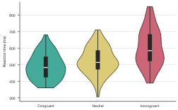

    *A mini box plot: dark box from the first to the third quartile, thin
    line to the most extreme values within 1.5 × IQR, white median line.*

=== "inner=\"quartiles\""

    ```python
    sp.violin(stroop, x="condition", y="rt", inner="quartiles").colors(
        stroop_colors
    ).labels(x="", y="Reaction time (ms)")
    ```
    <!-- figure: violin-inner-quartiles -->

    

    *Solid median and dashed quartile lines: lighter than a box, and they
    stay readable on narrow or split violins.*

=== "inner=\"median\""

    ```python
    sp.violin(stroop, x="condition", y="rt", inner="median").colors(
        stroop_colors
    ).labels(x="", y="Reaction time (ms)")
    ```
    <!-- figure: violin-inner-median -->

    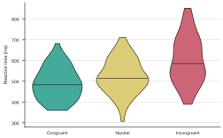

    *Only the median, for the cleanest look.*

=== "inner=None + points"

    ```python
    (
        sp.violin(stroop, x="condition", y="rt", inner=None)
        .points(kind="quasirandom")
        .colors(stroop_colors)
        .labels(x="", y="Reaction time (ms)")
    )
    ```
    <!-- figure: violin-inner-points -->

    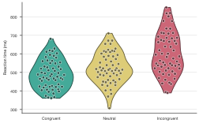

    *No summary, every value instead. Quasirandom dots follow the density,
    so they fill the violin.*

## Smoothing and trimming

A violin is a kernel density estimate, and the bandwidth decides how much it
smooths. The default (Scott's rule on a robust spread) suits most data; adjust
it with `bw_adjust=` when the curve hides or invents structure. These figures
keep the default theme colours.

=== "bw_adjust=0.4"

    ```python
    sp.violin(stroop, x="condition", y="rt", bw_adjust=0.4).labels(
        x="", y="Reaction time (ms)"
    )
    ```
    <!-- figure: violin-bw-narrow -->

    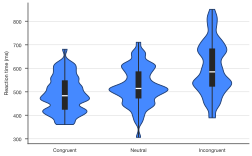

    *A narrow bandwidth follows individual values. Bumps this size in 60
    values are mostly noise.*

=== "bw_adjust=2"

    ```python
    sp.violin(stroop, x="condition", y="rt", bw_adjust=2).labels(
        x="", y="Reaction time (ms)"
    )
    ```
    <!-- figure: violin-bw-wide -->

    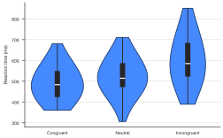

    *A wide bandwidth smooths away detail, here most of the right skew.
    Compare with the default in the tabs above.*

By default each violin stops at the smallest and largest value (`cut=0`,
ggplot2's `trim = TRUE`), so it never suggests impossible values such as
negative reaction times. `cut=2` extends the tails two bandwidths past the
data, as in seaborn's default:

```python
sp.violin(stroop, x="condition", y="rt", cut=2)
```

## Scaling between violins

When groups differ in size, decide what the violin widths should say.
`scale=` sets how violins compare with each other; all violins in a plot share
one scale.

=== "scale=\"area\" (default)"

    ```python
    (
        sp.violin(gait, x="age", y="speed")
        .colors("#88CCEE")
        .show_n()
        .labels(x="Age (years)", y="Gait speed (m s⁻¹)")
    )
    ```
    <!-- figure: violin-scale-area -->

    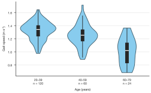

    *Equal areas: a narrow violin is one whose values are spread out, as for
    the oldest group.*

=== "scale=\"count\""

    ```python
    (
        sp.violin(gait, x="age", y="speed", scale="count")
        .colors("#88CCEE")
        .show_n()
        .labels(x="Age (years)", y="Gait speed (m s⁻¹)")
    )
    ```
    <!-- figure: violin-scale-count -->

    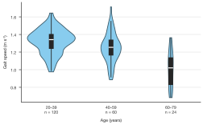

    *Area proportional to n: the 24 oldest participants get a slim violin,
    honest about how little data it rests on.*

=== "scale=\"width\""

    ```python
    (
        sp.violin(gait, x="age", y="speed", scale="width")
        .colors("#88CCEE")
        .show_n()
        .labels(x="Age (years)", y="Gait speed (m s⁻¹)")
    )
    ```
    <!-- figure: violin-scale-width -->

    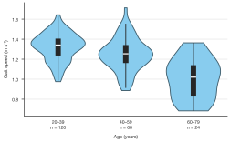

    *Equal maximum widths: easiest to read shapes, but widths no longer
    compare between groups.*

## Groups: side by side or split

With `hue=`, groups are drawn side by side within each category. With exactly
two groups, `split=True` draws one half per group, which halves the width and
puts the two shapes back to back.

=== "hue (side by side)"

    ```python
    (
        sp.violin(behaviour, x="genotype", y="score", hue="sex")
        .colors(sex_colors)
        .legend(title="")
        .labels(x="", y="Behavioural score (z)")
    )
    ```
    <!-- figure: violin-groups-dodge -->

    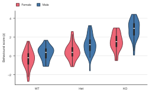

    *Side by side works for any number of groups.*

=== "split=True"

    ```python
    (
        sp.violin(behaviour, x="genotype", y="score", hue="sex", split=True)
        .colors(sex_colors)
        .legend(title="")
        .labels(x="", y="Behavioural score (z)")
    )
    ```
    <!-- figure: violin-groups-split -->

    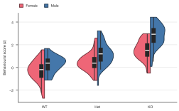

    *Back to back, two shapes are easier to compare. With the default inner
    box each half gets its own box; `inner="quartiles"` (top of the page) is
    often cleaner.*

For a single half violin per category, use `side="left"` or `side="right"`:

```python
sp.violin(stroop, x="condition", y="rt", side="right").colors(stroop_colors)
```

!!! warning "Brackets on split violins"
    `.compare(("Female", "Male"))` on a split violin draws each bracket with
    zero width, because both halves share one position. Report the test in
    the legend instead (use `.test_results()` for the numbers), or compare on
    side-by-side violins.

## Rainclouds

Rainclouds are the most complete view of a distribution: the cloud shows the
shape, the box the summary, the rain every value. They are horizontal by
default, with the cloud above each category and the rain below it.

```python
(
    sp.raincloud(stroop, x="condition", y="rt")
    .compare(ref="Congruent", correction="holm")
    .colors(stroop_colors)
    .labels(x="Reaction time (ms)", y="")
)
```
<!-- figure: violin-raincloud -->

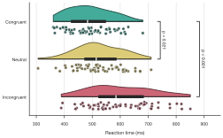

*Reaction times slow from congruent to incongruent trials; the right skew
typical of reaction times is visible in every cloud. Brackets give Holm-adjusted
Mann–Whitney p-values against the congruent condition. Note that `x=` names
the axis as drawn, so on a horizontal plot it is the value axis.*

The rain is an ordinary `.points()` layer, jittered by default. Change it with
`.points(kind=...)`, remove it with `.points(False)`, and turn the plot
upright with `orient="v"`:

```python
(
    sp.raincloud(stroop, x="condition", y="rt", orient="v")
    .points(kind="swarm")
    .colors(stroop_colors)
    .labels(x="", y="Reaction time (ms)")
)
```
<!-- figure: violin-raincloud-vertical -->

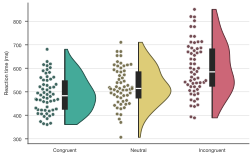

*Upright, with beeswarm rain: no dot hides another.*

## Points, outlines and brackets

Dots take the same options as on box plots. For a quiet background and
prominent data, drop the inner marks and the outline, fade the fill with
`.colors(..., alpha=)` and draw black dots with a white ring:

```python
(
    sp.violin(stroop, x="condition", y="rt", inner=None, edgecolor="none")
    .points(color="black", edgecolor="white", linewidth=0.4)
    .compare(ref="Congruent", correction="holm", format="stars")
    .colors(stroop_colors, alpha=0.5)
    .labels(x="", y="Reaction time (ms)")
)
```
<!-- figure: violin-points-brackets -->

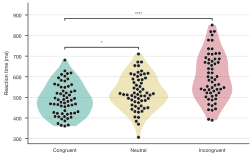

*Faded violins, every value in black, and Holm-adjusted significance stars
against the congruent condition.*

`fill=False` draws outlines in the group colour instead of filled shapes,
and `.points(size=..., alpha=...)` tunes the dots for large samples.

## Figure legend text

`.caption()` writes the sentences that define a violin for your figure legend:
the kernel, the bandwidth rule, trimming and scaling, the inner marks, n and
the test.

```python
(
    sp.violin(stroop, x="condition", y="rt")
    .points()
    .compare(ref="Congruent", correction="holm")
    .caption()
)
# "Violins show kernel density estimates (Gaussian kernel, bandwidth by Scott's
# rule), trimmed to the range of the data and drawn with equal areas. Inside,
# the white line marks the median, the box the first and third quartiles and
# the thin line the most extreme values within 1.5x the interquartile range.
# Dots show individual values. n = 60 per distribution. P values: two-sided
# Mann-Whitney U test, Holm-adjusted for multiple comparisons."
```

`.test_results()` returns the comparisons as a table and `.source_data()` the
summary numbers per violin (n, mean, SD, quartiles, whisker ends, outliers),
for a supplementary file:

```python
sp.violin(behaviour, x="genotype", y="score", hue="sex", split=True).source_data()
```

!!! note "Journal checklist"
    - **Say what the violin is**: a kernel density estimate, with the
      bandwidth, trimming and scaling. `.caption()` writes this.
    - **Show the data when n is small.** A density from fewer than about 10
      values mostly shows the kernel's shape; SecretPlots warns below 10.
      Below about 20 values, add `.points()` or use a raincloud or a
      [box plot](box.md) with points.
    - **Report n** (`.show_n()`) and **name the test** and correction
      (`.compare()`, `.caption()`).
    - **Keep the bandwidth honest.** Don't tune `bw_adjust` until a bump
      appears; state it if you change it.

    See the [journal-ready figures guide](../publication.md) for sizes, fonts
    and export, and the [gallery](../gallery.md) for more examples.

## Warnings and errors

| Message | What it means |
|---|---|
| `SmallSampleWarning: Fewer than 10 values` | A density from so few values mostly shows the kernel. Add `.points()`. |
| `split=True needs hue= with exactly 2 groups` | Split violins need a `hue` column with exactly two groups; filter the data to two groups first. |
| `split=True already draws half violins; leave side out` | Don't combine `split=True` with `side=`. |
| `bw_adjust must be positive` / `cut must be 0 or more` | Check those arguments. |
| `Unknown scale=...` / `Unknown inner=...` | Use one of the listed values; the message suggests the closest one. |
| `A log axis needs positive values` | Drop values ≤ 0 before `.log()`. |
