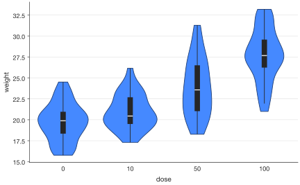
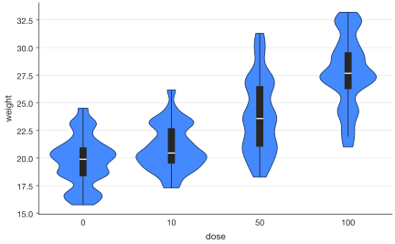
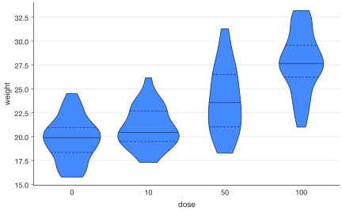
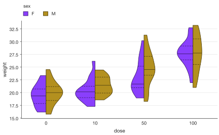
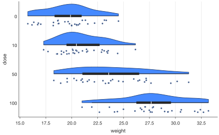

# Violin plots and rainclouds

`sp.violin()` draws the distribution of the values in each category as a
mirrored density curve, with a small box plot inside. `sp.raincloud()`
combines a half violin (the cloud), a small box and every value as a dot (the
rain) (Allen et al., *Wellcome Open Res* 4:63, 2019).

```python
import numpy as np
import pandas as pd
import SecretPlots as sp

rng = np.random.default_rng(4)
df = pd.DataFrame(
    {
        "dose": np.repeat(["0", "10", "50", "100"], 30),
        "weight": np.r_[rng.normal(20, 2, 30), rng.normal(21, 2.5, 30),
                        rng.normal(24, 3, 30), rng.lognormal(3.3, 0.15, 30)],
        "sex": np.tile(["F", "M"], 60),
    }
)

sp.violin(df, x="dose", y="weight")
```
<!-- figure: violin-overview -->



*Violin example rendered by SecretPlots. All data on this page are synthetic.*

Violins take the same data as [box plots](box.md), and the same steps:
`.points()`, `.mean()`, `.show_n()`, `.refline()`, `.compare()`,
`.ticklabels()`, `.grouplabels()`, `.test_results()`, `.caption()` and
`.source_data()`. They are documented on the box plot page.

!!! tip "Explore the options from Python"
    Run `sp.ViolinPlot.options()` to list chainable steps, then
    `sp.ViolinPlot.options("legend")` for a step's parameters and defaults.
    Use `sp.theme_options()` for style fields. See the [option discovery guide](../options.md)
    for searching these tables and inspecting constructor arguments.

## Contents

- [Signature](#signature)
- [Density and scaling](#density-and-scaling)
- [Inside the violin](#inside-the-violin)
- [Groups and split violins](#groups-and-split-violins)
- [Half violins and rainclouds](#half-violins-and-rainclouds)
- [Points and significance brackets](#points-and-significance-brackets)
- [Journal checklist](#journal-checklist)

## Signature

```text
sp.violin(data, x=None, y=None, hue=None, *,
          bw_adjust=1.0, cut=0.0, scale="area", inner="box", split=False,
          side="both", fill=True, edgecolor=None, linewidth=None, orient="v",
          order=None, hue_order=None, missing="raise") -> ViolinPlot

sp.raincloud(data, x=None, y=None, hue=None, *,
             bw_adjust=1.0, cut=0.0, scale="area", edgecolor=None,
             linewidth=None, orient="h",
             order=None, hue_order=None, missing="raise") -> RaincloudPlot
```

| Argument | Meaning |
|---|---|
| `bw_adjust` | Multiplies the automatic bandwidth (Scott's rule on a robust spread). Smaller values follow the data more closely. |
| `cut` | How far past the data to draw, in bandwidths. With the default 0, each violin is trimmed at the smallest and largest value (ggplot2's `trim = TRUE`), so it never shows impossible values. |
| `scale` | `"area"` (equal areas; default), `"count"` (area ∝ n) or `"width"` (equal widths). |
| `inner` | `"box"`, `"quartiles"`, `"median"` or `None`. |
| `split` | With exactly two `hue` groups, draw one half per group. |
| `side` | `"left"` or `"right"` for half violins. For horizontal violins, `"right"` is the upper side. |
| `fill` | Filled (default) or outlines in the group colour. |
| `edgecolor` | Colour of the outline and the median/quartile lines (default: a dark shade of the fill). `"none"` removes only the outline. |
| `linewidth` | Outline width in pt; `0` removes it. |
| `missing` | `"raise"` (default) rejects missing/non-finite plotted fields; `"drop"` ignores affected observations. Applies to both constructors; see [data handling](../usage.md). |

## Density and scaling

```python
sp.violin(df, x="dose", y="weight", bw_adjust=0.5)     # more detail
```
<!-- figure: violin-density-and-scaling -->



*`bw_adjust=0.5` uses a smaller smoothing bandwidth to expose finer distribution detail.*

```python
sp.violin(df, x="dose", y="weight", scale="count")     # bigger groups look bigger
```

```python
sp.violin(df, x="dose", y="weight", scale="width", cut=2)
```

All violins share one scale, so with `scale="area"` a narrow violin is one
whose values are spread out. On a `.log()` axis, densities are computed on
the log scale.

## Inside the violin

```python
sp.violin(df, x="dose", y="weight", inner="quartiles")  # dashed quartiles, solid median
```
<!-- figure: violin-inside-the-violin -->



*`inner="quartiles"` draws quartile and median lines inside each density.*

```python
sp.violin(df, x="dose", y="weight", inner=None).points(kind="quasirandom")
```

The default `inner="box"` draws a dark box from the first to the third
quartile. A thin line runs to the most extreme values within 1.5 × IQR, and a
white line marks the median.

## Groups and split violins

```python
sp.violin(df, x="dose", y="weight", hue="sex")
```

```python
sp.violin(df, x="dose", y="weight", hue="sex", split=True, inner="quartiles")
```
<!-- figure: violin-groups-and-split-violins -->



*`split=True` puts the two hue groups on opposite halves; `inner="quartiles"` retains the summaries.*

## Half violins and rainclouds

```python
sp.violin(df, x="dose", y="weight", side="right")
```

```python
sp.raincloud(df, x="dose", y="weight")
```
<!-- figure: violin-half-violins-and-rainclouds -->



*`sp.raincloud()` combines a half density, a box summary, and the observed values; its default orientation is horizontal.*

Rainclouds are horizontal by default, with the cloud above each category and
the rain below it. Change how the dots are placed with
`.points(kind="swarm")`, or remove them with `.points(False)`:

```python
sp.raincloud(df, x="dose", y="weight", orient="v").points(kind="swarm")
```

## Points and significance brackets

Dots take the same options as on box plots, including `edgecolor=` and
`linewidth=` for the ring around each dot:

```python
sp.violin(df, x="dose", y="weight", inner=None, edgecolor="none").points(
    color="black", edgecolor="white", linewidth=0.4
)
```
<!-- figure: violin-points-and-significance-brackets -->


*Points and significance brackets: output of the example above.*

```python
(
    sp.violin(df, x="dose", y="weight")
    .points(kind="quasirandom")
    .compare(ref="0", correction="holm")
    .labels(x="Dose (mg/kg)", y="Body weight (g)")
)
```

## Journal checklist

- **Say what the violin is.** State that it is a kernel density estimate,
  give the bandwidth, and say whether it is trimmed and how it is scaled.
  `.caption()` writes this from the plot's settings.
- **Show the data when n is small.** A density estimate from fewer than about
  10 values mostly shows the kernel's shape. SecretPlots warns below 10. Use
  `.points()`, or a [box plot](box.md) with points.
- **Report n** (`.show_n()`) and the test (`.compare()` / `.caption()`).
