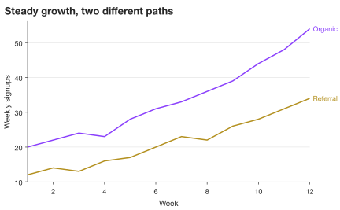
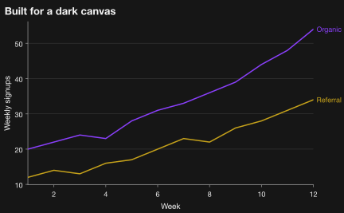
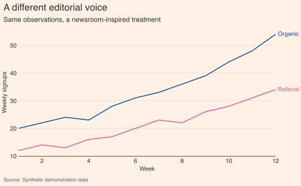

# Presets and themes

A **preset** defines an output destination: physical widths, resolution,
accepted formats, style, and any constraints. A **theme** defines visual fields
such as colors, typography, and gridlines. Start with a preset for the destination,
then use a theme or a few explicit overrides to shape the look.

## Discover the available choices

```python
import SecretPlots as sp

sp.presets.list()                       # all registered presets
sp.presets.list(kind="journal")         # just journal presets
sp.list_themes()                        # named visual themes
sp.theme_options("dark")                # fields and values in a theme
```

Inspect a preset before applying it:

```python
nature = sp.presets.get("nature")
nature.target.widths                    # named widths, stored in inches
```

## One dataset, three visual treatments

These previews use the same synthetic data. The code specifies every styling
change; the renderer does not add a hidden documentation theme.

```python
import numpy as np
import pandas as pd

week = np.arange(1, 13)
data = pd.DataFrame({
    "Week": week,
    "Organic": [20, 22, 24, 23, 28, 31, 33, 36, 39, 44, 48, 54],
    "Referral": [12, 14, 13, 16, 17, 20, 23, 22, 26, 28, 31, 34],
})
base = sp.line(data, x="Week").endlabels().labels(y="Weekly signups")
base.copy().preset("screen").chrome(title="Steady growth, two different paths")
```
<!-- figure: presets-screen -->



*`preset("screen")`: a general-purpose canvas; `.endlabels()` names the series
at their endpoints instead of using a legend.*

```python
base.copy().preset("screen").theme("dark").chrome(title="Built for a dark canvas")
```
<!-- figure: presets-dark -->



*`.theme("dark")` changes the canvas, typography colors, and palette together.*

```python
base.copy().preset("ft-like").chrome(
    title="A different editorial voice",
    subtitle="Same observations, a newsroom-inspired treatment",
    source="Synthetic demonstration data",
)
```
<!-- figure: presets-editorial -->



*`preset("ft-like")` supplies an editorial treatment. The `-like` presets are
inspired by public chart conventions and are not affiliated with publishers.*

## Apply globally, temporarily, or to one plot

```python
with sp.use(preset="nature"):
    paper = sp.line(data, x="Week").labels(y="Weekly signups")

# The plot keeps the settings captured when it was created.
paper.size(width="double", height="65mm")
```

Outside a `with` block, `sp.use(preset="screen", theme="dark")` sets defaults
for subsequently created plots. `sp.reset()` restores the built-in defaults.
On an existing plot, use `.preset(...)` and `.theme(...)` explicitly.

## Physical size and export

```python
paper.save("growth.pdf")
paper.copy().size(width="single", height="60mm").save("growth-single.pdf")
```

Width names come from the selected preset. You can also use explicit lengths,
for example `.size(width="89mm", height="60mm")`; a plain number means inches.
Raster dimensions depend on both physical size and export `dpi`. SVG and PDF
retain vector geometry. Web previews are scaled to fit the documentation page;
they are not a ruler for the exported physical size.

## Understand which setting wins

Style fields are resolved in this order, with the first specified value winning:

1. Explicit per-plot settings, such as `.theme(font_size=8)` or `.colors(...)`.
2. The preset's section for that plot type, such as `[plots.bar]`.
3. The preset's theme.
4. The selected theme, such as `sp.use(theme="dark")`.
5. The built-in `secret` theme, which supplies every field.

Preset limits are then applied to values from presets and themes. Explicit
per-plot overrides are kept with a `LimitExceededWarning` when they exceed a
limit. Set `sp.config.enforce_limits = True` to constrain those overrides too.

```python
paper.explain("font_size")
paper.style_report()
```

Use the report to understand font fallback, resolved values, and adjustments.
The previews use fonts available on the build machine; your installed fonts
can change typography. Review the destination's current author instructions
before submission; a bundled preset is a starting point, not an acceptance check.

## Built-in preset reference

The dimensions below describe the bundled presets. Follow the linked publisher
instructions when preparing a submission.

| Preset | Kind | Notes |
|---|---|---|
| `nature` | journal | 89 / 183 mm, ≤170 mm high, 5–7 pt sans-serif, 8 pt bold panel labels ([source](https://research-figure-guide.nature.com/figures/preparing-figures-our-specifications)) |
| `science` | journal | 90 / 183 mm, 6–9 pt Arial/Helvetica, lines ≥0.28 pt, 10 pt bold panel labels ([source](https://www.science.org/cms/asset/62583409-a188-466e-8cc0-6fb5f083bbff/author_prep_guide_2025.pdf)) |
| `cell` | journal | 85 / 114 / 174 mm, 6–8 pt Arial, lines ≥0.5 pt, capital panel labels ([source](https://www.cell.com/figureguidelines)) |
| `pnas` | journal | 87 / 114 / 178 mm, ≤225 mm high, text ≥6 pt, lines ≥0.25 pt ([source](https://www.pnas.org/pb-assets/authors/digitalart-1675347574760.pdf)) |
| `aha` | journal | AHA journals (Circulation, Hypertension, …): 80 / 127.5 / 177.5 mm, 6–10 pt Arial, 12.6 pt bold panel labels ([source](https://www.ahajournals.org/pb-assets/migration/Hype_InstructionsforFigureSubmission.pdf)) |
| `ieee` | journal | 3.5 / 7.16 in, ≤8.8 in high, ~9–10 pt Helvetica/Arial ([source](https://conferences.ieeeauthorcenter.ieee.org/write-your-paper/improve-your-graphics/)) |
| `acm` | journal | acmart `sigconf` column / text width (240 / 504 pt), 8–9 pt text ([source](https://github.com/borisveytsman/acmart/blob/master/acmart.dtx)) |
| `elsevier` | journal | 30 / 90 / 140 / 190 mm, ~7 pt text, ≥6 pt ([source](https://www.elsevier.com/about/policies-and-standards/author/artwork-and-media-instructions/artwork-sizing)) |
| `springer` | journal | 84 / 174 mm (`small` = 119 mm), ≤234 mm high, 8–12 pt Helvetica/Arial, lines ≥0.3 pt ([source](https://link.springer.com/journal/11145/submission-guidelines)) |
| `neurips` | journal | 5.5 in text width, 8–10 pt text ([source](https://media.neurips.cc/Conferences/NeurIPS2025/Styles.zip)) |
| `bbc` | news | BBC [bbplot](https://github.com/bbc/bbplot) style: 640×450 px, Helvetica 28/22/18 pt |
| `nyt-like`, `wapo-like`, `ft-like`, `economist-like` | news | Inspired by public chart conventions; not affiliated with the publishers |
| `screen`, `web`, `a4`, `letter`, `poster`, `slide-16x9` | generic | Everyday output sizes |


## Register your own preset

Save a preset as TOML, then call `sp.presets.register("my_lab.toml")` and
`sp.use(preset="my_lab")`. The repository's
[contributing guide](https://github.com/secretBiology/SecretPlots/blob/master/CONTRIBUTING.md)
describes the format and source requirements. To discover individual visual
fields, use `sp.theme_options()` and the [option discovery guide](options.md).
