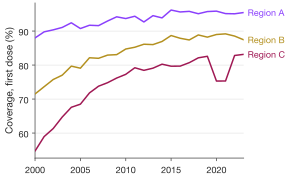
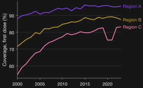
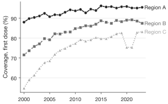
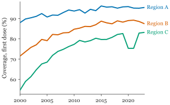
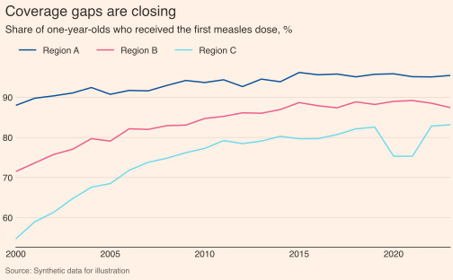
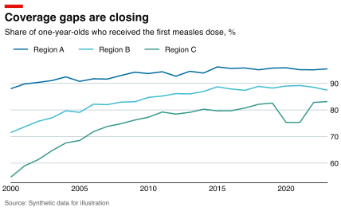
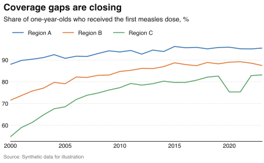
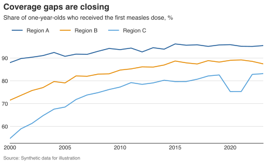
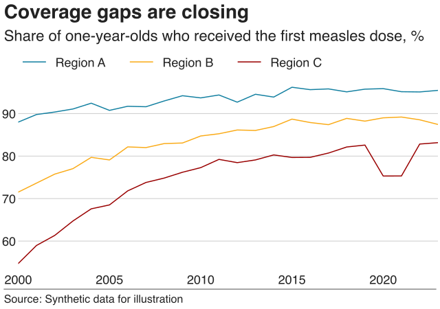

# Presets and themes

<p class="lead">Two independent choices shape every figure. A <b>preset</b>
says where the figure is going: physical size, font limits, dpi and file
formats. A <b>theme</b> says how it looks: palette, fonts, grid and spines.
Change either one without touching your data or plot code.</p>

| | Preset | Theme |
|---|---|---|
| Answers | *Where will this be printed or shown?* | *What should it look like?* |
| Controls | Width and height, min/max text size, dpi, formats, headline/source furniture | Colours, fonts, grid, spines, marker and line styles |
| Examples | `nature`, `ieee`, `slide-16x9`, `ft-like` | `secret` (default), `dark`, `print-bw`, your own |
| Select for the session | `sp.use(preset="nature")` | `sp.use(theme="dark")` |
| Select for one plot | `.preset("nature")` | `.theme("dark")` or `.theme(grid="none")` |

```python
import numpy as np
import pandas as pd
import SecretPlots as sp

sp.presets.list()                    # every preset
sp.presets.list(kind="journal")      # just the journals
sp.list_themes()                     # named themes
sp.theme_options()                   # every style field you can override
```

## Themes

All examples on this page share one dataset: measles vaccine coverage in
three regions (synthetic).

```python
rng = np.random.default_rng(12)
years = np.arange(2000, 2024)
coverage = pd.DataFrame(
    [
        {"year": y, "region": region,
         "coverage": min(98, start + gain * (1 - np.exp(-(y - 2000) / 8))
                         - (6 if region == "Region C" and 2020 <= y <= 2021 else 0)
                         + rng.normal(0, 0.8))}
        for region, start, gain in (("Region A", 88, 8), ("Region B", 72, 18), ("Region C", 55, 30))
        for y in years
    ]
)
base = (
    sp.line(coverage, x="year", y="coverage", hue="region")
    .endlabels()
    .labels(x="", y="Coverage, first dose (%)")
)
```

=== "secret (default)"

    ```python
    base.copy().preset("screen").size(width="narrow")
    ```
    <!-- figure: presets-theme-secret -->

    { .narrow }

    *The built-in `secret` theme: SecretColors' IBM palette (colour-blind safe),
    a light value grid, and only the left and bottom spines.*

=== "dark"

    ```python
    base.copy().preset("screen").size(width="narrow").theme("dark")
    ```
    <!-- figure: presets-theme-dark -->

    { .narrow }

    *`.theme("dark")`: for dark slides and dashboards. The palette is
    re-balanced for contrast against the background.*

=== "print-bw"

    ```python
    base.copy().preset("screen").size(width="narrow").theme("print-bw").encode_groups()
    ```
    <!-- figure: presets-theme-print-bw -->

    { .narrow }

    *`.theme("print-bw")` with `.encode_groups()`: greys plus dashes and markers,
    for greyscale printing.*

=== "Your own"

    ```python
    lab = sp.Theme(
        name="lab",
        font_family=("Georgia", "DejaVu Serif"),
        font_generic="serif",
        palette=("#0072B2", "#D55E00", "#009E73", "#CC79A7"),
        grid="none",
        spines=("left", "bottom"),
        line_width=1.8,
    )
    sp.register_theme(lab, overwrite=True)

    base.copy().preset("screen").size(width="narrow").theme("lab")
    ```
    <!-- figure: presets-theme-custom -->

    { .narrow }

    *A registered `sp.Theme`: set only the fields you care about. Everything else
    falls back to the built-in theme.*

A theme is partial by design. Any field left as `None` is filled in from the
next layer, so a three-line theme is a complete, working style.

## Newsroom presets

Besides journals, SecretPlots ships editorial presets for blog posts, press
releases and outreach. They add a headline, subtitle and source line through
`.chrome()`:

```python
story = (
    base.copy()
    .endlabels(show=False)                 # newsroom styles prefer a top legend
    .labels(y="")                          # the unit goes in the subtitle
    .chrome(
        title="Coverage gaps are closing",
        subtitle="Share of one-year-olds who received the first measles dose, %",
        source="Synthetic data for illustration",
    )
)
```

=== "ft-like"

    ```python
    story.copy().preset("ft-like")
    ```
    <!-- figure: presets-news-ft -->

    

=== "economist-like"

    ```python
    story.copy().preset("economist-like")
    ```
    <!-- figure: presets-news-economist -->

    

=== "nyt-like"

    ```python
    story.copy().preset("nyt-like")
    ```
    <!-- figure: presets-news-nyt -->

    

=== "wapo-like"

    ```python
    story.copy().preset("wapo-like")
    ```
    <!-- figure: presets-news-wapo -->

    

=== "bbc"

    ```python
    story.copy().preset("bbc")
    ```
    <!-- figure: presets-news-bbc -->

    

!!! note "About the `-like` presets"
    Presets ending in `-like` are inspired by publicly visible chart
    conventions. They are not affiliated with or endorsed by those publishers
    and use open fallback fonts. The `bbc` preset follows the BBC's public
    [bbplot](https://github.com/bbc/bbplot) style.

## Session, block or single plot

```python
sp.use(preset="nature")                       # rest of the session

with sp.use(preset="slide-16x9", theme="dark"):
    talk = sp.line(coverage, x="year", y="coverage", hue="region")   # just this block

paper = talk.copy().preset("nature").theme("secret")                 # one plot
sp.reset()                                                           # back to defaults
```

A plot captures the selection that is active when it is **created**, so `talk`
keeps the slide preset even when it is drawn after the `with` block ends.

## Which setting wins?

When the same field is set in several places, the most specific one wins:

1. **The plot itself**: `.theme(font_size=8)`, `.colors(...)`.
2. **The preset's section for that plot type**, e.g. `[plots.bar]` in its TOML file.
3. **The preset's theme**, e.g. the salmon background of `ft-like`.
4. **The selected theme**: `sp.use(theme="dark")`.
5. **The built-in `secret` theme**, which defines every field.

Preset limits, such as Nature's 5–7 pt, are then applied to values that came
from presets and themes. Values you set explicitly on a plot are kept, with a
`LimitExceededWarning`; set `sp.config.enforce_limits = True` to clamp them too.

```python
paper.explain("font_size")       # where did this value come from?
paper.style_report()             # every resolved field, its source and any adjustment
```

## Built-in presets

=== "Journals"

    | Preset | Widths | Text | Source |
    |---|---|---|---|
    | `nature` | 89 / 183 mm, ≤ 170 mm high | 5–7 pt, 8 pt bold panel labels | [guidelines](https://research-figure-guide.nature.com/figures/preparing-figures-our-specifications) |
    | `science` | 90 / 183 mm | 6–9 pt, lines ≥ 0.28 pt | [guidelines](https://www.science.org/cms/asset/62583409-a188-466e-8cc0-6fb5f083bbff/author_prep_guide_2025.pdf) |
    | `cell` | 85 / 114 / 174 mm | 6–8 pt Arial, lines ≥ 0.5 pt | [guidelines](https://www.cell.com/figureguidelines) |
    | `pnas` | 87 / 114 / 178 mm, ≤ 225 mm high | ≥ 6 pt, lines ≥ 0.25 pt | [guidelines](https://www.pnas.org/pb-assets/authors/digitalart-1675347574760.pdf) |
    | `aha` | 80 / 127.5 / 177.5 mm | 6–10 pt Arial | [guidelines](https://www.ahajournals.org/pb-assets/migration/Hype_InstructionsforFigureSubmission.pdf) |
    | `elsevier` | 30 / 90 / 140 / 190 mm | ≥ 6 pt | [guidelines](https://www.elsevier.com/about/policies-and-standards/author/artwork-and-media-instructions/artwork-sizing) |
    | `springer` | 84 / 119 / 174 mm, ≤ 234 mm high | 8–12 pt, lines ≥ 0.3 pt | [guidelines](https://link.springer.com/journal/11145/submission-guidelines) |
    | `ieee` | 3.5 / 7.16 in, ≤ 8.8 in high | ~9–10 pt | [guidelines](https://conferences.ieeeauthorcenter.ieee.org/write-your-paper/improve-your-graphics/) |
    | `acm` | 240 / 504 pt (acmart `sigconf`) | 8–9 pt | [acmart](https://github.com/borisveytsman/acmart/blob/master/acmart.dtx) |
    | `neurips` | 5.5 in text width | 8–10 pt | [style files](https://media.neurips.cc/Conferences/NeurIPS2025/Styles.zip) |

=== "Everyday"

    | Preset | Widths | Use it for |
    |---|---|---|
    | `screen` (default) | 6 in · narrow 4 in · wide 9 in | Notebooks and reports |
    | `web` | mobile 360 px · desktop 700 px | Blogs and websites |
    | `a4`, `letter` | full / half text width | Theses, reports, preprints |
    | `slide-16x9` | full / half slide | Talks (text ≥ 14 pt) |
    | `poster` | 250 mm column · 520 mm wide | Conference posters (text ≥ 24 pt) |

=== "Newsroom"

    | Preset | Widths | Notes |
    |---|---|---|
    | `bbc` | 640 × 450 px | BBC [bbplot](https://github.com/bbc/bbplot) style |
    | `ft-like` | mobile · article · wide | Salmon page, left-aligned headline |
    | `economist-like` | mobile · article · wide | Inspired by public conventions |
    | `nyt-like` | mobile · article · wide | Inspired by public conventions |
    | `wapo-like` | mobile · article · wide | Inspired by public conventions |

Guidelines change. Treat a bundled preset as a strong starting point and check
the journal's current instructions before submission.

## Make your own preset

A preset is a short TOML file. Anything you leave out falls back to the
selected theme and the built-in defaults.

```toml
# my_journal.toml
name = "my-journal"
kind = "journal"
description = "House style for the Journal of Examples."

[target]
widths = { single = "86mm", double = "178mm" }
default_width = "single"
max_height = "230mm"
min_font_size = 6
max_font_size = 8
dpi = 600
formats = ["pdf", "tiff"]

[theme]
font_family = ["Arial", "Helvetica", "Liberation Sans"]
font_size = 7
grid = "none"
```

```text
sp.presets.register("my_journal.toml")
sp.use(preset="my-journal")
```

The [contributing guide](https://github.com/secretBiology/SecretPlots/blob/master/CONTRIBUTING.md)
explains how to add a preset to SecretPlots itself. Journal presets must cite
the publisher's official guidelines.
