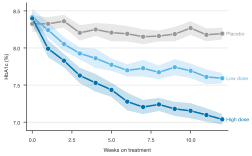
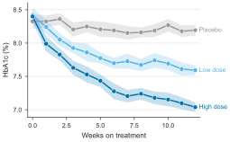
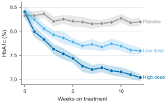
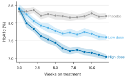
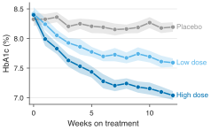
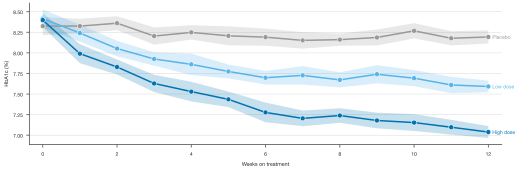
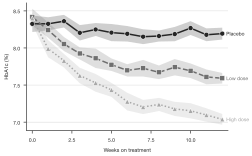

# Journal-ready figures

<p class="lead">Journals reject figures for the same few reasons: wrong width,
text too small or too large, missing fonts, low resolution. A SecretPlots
<b>preset</b> encodes those rules, so a figure is the right size and fonts are
embedded from the first draft.</p>

```python
import numpy as np
import pandas as pd
import SecretPlots as sp

sp.use(preset="nature")      # every plot from here on: 89 mm, 5–7 pt, 300 dpi
```

That one line is usually all you need. The rest of this page shows what a
preset changes, how to choose widths, and a checklist for submission.

## One figure, six journals

The same data and the same chain of options, with only `.preset()` changed.
Notice how width, text size, line weights and aspect follow each
destination's rules. (Previews are scaled to fit the page; the exported files
have the exact physical size.)

```python
rng = np.random.default_rng(7)
weeks = np.arange(0, 13)
cohort = pd.DataFrame(
    [
        {"week": w, "arm": arm, "patient": f"{arm}{i}",
         "hba1c": 8.4 - drop * (1 - np.exp(-w / 4)) + rng.normal(0, 0.22)}
        for arm, drop in (("Placebo", 0.2), ("Low dose", 0.8), ("High dose", 1.4))
        for i in range(20)
        for w in weeks
    ]
)
trial = (
    sp.line(cohort, x="week", y="hba1c", hue="arm", error="ci")
    .markers()
    .endlabels()
    .colors(["#999999", "#56B4E9", "#0072B2"])
    .labels(x="Weeks on treatment", y="HbA1c (%)")
)
```

=== "Nature"

    ```python
    trial.copy().preset("nature")
    ```
    <!-- figure: publication-nature -->

    

    *`nature`: 89 mm single column, 5–7 pt sans-serif, 300 dpi, PDF/EPS/SVG/TIFF.*

=== "Science"

    ```python
    trial.copy().preset("science")
    ```
    <!-- figure: publication-science -->

    

    *`science`: 90 mm single column, 6–9 pt, lines at least 0.28 pt.*

=== "Cell"

    ```python
    trial.copy().preset("cell")
    ```
    <!-- figure: publication-cell -->

    

    *`cell`: 85 mm single column, 6–8 pt Arial, lines at least 0.5 pt.*

=== "IEEE"

    ```python
    trial.copy().preset("ieee")
    ```
    <!-- figure: publication-ieee -->

    

    *`ieee`: 3.5 in column, text sized to match a 9–10 pt paper body.*

=== "PNAS"

    ```python
    trial.copy().preset("pnas")
    ```
    <!-- figure: publication-pnas -->

    

    *`pnas`: 87 mm single column, text at least 6 pt, lines at least 0.25 pt, 600 dpi.*

=== "Springer"

    ```python
    trial.copy().preset("springer")
    ```
    <!-- figure: publication-springer -->

    

    *`springer`: 84 mm single column, 8–12 pt Helvetica/Arial.*

Beyond journals, `"slide-16x9"`, `"poster"`, `"a4"`, `"letter"`, `"screen"` and
`"web"` size the same figure for talks, posters, theses and the web.

## Single or double column

Each journal preset names its allowed widths. Pass a name to `.size()`, or any
explicit length such as `"120mm"` or `"4.5in"`.

```python
(
    trial.copy()
    .preset("nature")
    .size(width="double", height="60mm")
)
```
<!-- figure: publication-double -->

{ .wide }

*`.size(width="double", height="60mm")`: 183 mm, the full Nature page width.*

| Preset | Named widths | Text (pt) | Max height | dpi | Formats |
|---|---|---|---|---|---|
| `nature` | single 89 mm · double 183 mm | 5–7 | 170 mm | 300 | pdf, eps, svg, tiff |
| `science` | single 90 mm · double 183 mm | 6–9 | | 300 | pdf, eps, svg, tiff, png |
| `cell` | single 85 · one-and-half 114 · double 174 mm | 6–8 | | 300 | pdf, eps, tiff, jpg |
| `pnas` | single 87 · one-and-half 114 · double 178 mm | ≥ 6 | 225 mm | 600 | pdf, eps, tiff |
| `aha` | single 80 · one-and-half 127.5 · double 177.5 mm | 6–10 | | 600 | tiff, eps, pdf |
| `elsevier` | minimal 30 · single 90 · one-and-half 140 · double 190 mm | ≥ 6 | | 500 | eps, pdf, tiff, jpg |
| `springer` | single 84 · small 119 · double 174 mm | 8–12 | 234 mm | 600 | eps, pdf, tiff |
| `ieee` | single 3.5 in · double 7.16 in | ~9–10 | 8.8 in | 600 | pdf, eps, ps, png, tiff |
| `acm` | single 84.7 · double 177.8 mm | 8–9 | | 300 | pdf, png |
| `neurips` | full 5.5 in | 8–10 | | 300 | pdf, png |

Each journal preset cites the publisher's author guidelines it was built from;
see [presets and themes](presets.md#built-in-presets) for the links. Guidelines
change, so check the current instructions before you submit.

## What a preset enforces

Presets set limits as well as defaults. If you set a value outside
the journal's range, SecretPlots keeps your choice and warns you:

```text
>>> sp.box(df, x="dose", y="viability").theme(font_size=10).save("fig2.pdf")
LimitExceededWarning: font_size=10 breaks preset 'nature' limits (text 8.5-14.5 pt,
nature allows 5 pt to 7 pt); kept because you set it. Set
SecretPlots.config.enforce_limits = True to apply the limits instead.
```

Set `sp.config.enforce_limits = True` to clamp explicit values too, or
`sp.config.strict = True` to turn every warning into an error (useful in CI for
a paper's figure scripts). When a style looks unexpected, ask where it came
from:

```python
plot = trial.copy().preset("nature")
plot.explain("font_size")        # which layer set it: plot, preset or theme
plot.style_report()              # every resolved value and every adjustment
```

## Colour that survives review

Around one in twelve men has a colour-vision deficiency, and many readers
print in greyscale. Two habits cover both:

- Choose colour-blind-safe palettes. The default palette is one, and
  `sp.colormaps()` flags maps that are not (`red-green`, `rainbow-like`).
- Encode groups twice. `.encode_groups()` adds distinct dash patterns and
  markers, and the `print-bw` theme renders the whole figure in greys.

```python
(
    sp.line(cohort, x="week", y="hba1c", hue="arm", error="ci")
    .theme("print-bw")
    .encode_groups()
    .endlabels()
    .labels(x="Weeks on treatment", y="HbA1c (%)")
)
```
<!-- figure: publication-print-bw -->



*`.theme("print-bw")` with `.encode_groups()`: each arm stays distinguishable
without colour. (Explicit `.colors()` would override the theme's greys, so
this chain leaves them out.)*

## Multi-panel figures

Most journals want a figure such as "Figure 2a–d" as one file. The most
reliable workflow is to export each panel at its **final physical size** and
assemble them in your layout tool (Illustrator, Inkscape, Affinity, or LaTeX
`subfigure`) without rescaling:

```python
half = {"width": "89mm", "height": "60mm"}     # two panels across a 183 mm page
panel_a = trial.copy().preset("nature").size(**half)
panel_b = trial.copy().preset("nature").size(**half).log("y")
panel_a.save("fig2a.pdf")
panel_b.save("fig2b.pdf")
```

Because each panel uses the same preset, text sizes and line weights match
across panels. Add the bold panel letters (**a**, **b**, …) in the layout tool,
where they are easy to align. To assemble the panels in matplotlib instead,
draw each plot into your own axes with `plot.render(ax=...)`: fonts, tick
sizes and line weights follow the plot's preset, while the figure size and
layout are yours, so create the figure at its final size; see
[data, formatting and export](usage.md#export-and-matplotlib).

## Submission checklist

!!! success "Before you upload"
    - [x] **Width** matches a column width: `.size(width="single" | "double")`.
    - [x] **Text** is within the journal's range; no `LimitExceededWarning` was printed.
    - [x] **Format** is vector (PDF/EPS/SVG) for plots; raster formats use the preset's dpi.
    - [x] **Fonts are embedded**: SecretPlots saves PDF and EPS with TrueType (Type 42) fonts.
    - [x] **Error bars are defined** in the legend: SD, SEM or 95% CI, and *n*.
    - [x] **Individual data points** are shown for small samples (`.points()`, `units=`).
    - [x] **Statistics are reported**: the test, the correction and the exact *P* values (`.test_results()`).
    - [x] **Gene and species names** are italic (`.ticklabels(italic=True)`).
    - [x] **Colour** is colour-blind safe and readable in greyscale.

## Your own journal or lab style

A preset is a small TOML file. Copy the closest bundled one, adjust widths and
limits, and register it:

```text
sp.presets.register("my_journal.toml")
sp.use(preset="my_journal")
```

See [presets and themes](presets.md) for the file format, and
[contributing](https://github.com/secretBiology/SecretPlots/blob/master/CONTRIBUTING.md)
if you'd like to add it to SecretPlots.
