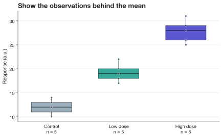

# Your first figure

Go from a small table to a labeled, styled figure and a publication export.
All examples below use synthetic data and run in order in a notebook or script.

## Install

SecretPlots requires **Python 3.12 or newer**.

```bash
python -m pip install SecretPlots
```

For a checkout of this repository, use `python -m pip install -e .` instead.

## Create a plot

```python
import pandas as pd
import SecretPlots as sp

measurements = pd.DataFrame({
    "treatment": ["Control"] * 5 + ["Low dose"] * 5 + ["High dose"] * 5,
    "response": [11, 13, 10, 14, 12, 18, 20, 17, 22, 19, 26, 29, 25, 31, 28],
})
plot = sp.bar(measurements, x="treatment", y="response", error="sd")
plot
```
<!-- figure: quickstart-basic -->


*`x` selects categories; `y` selects measurements. Replicates become a mean,
and `error="sd"` adds one sample standard deviation on each side.*

A plot is a reusable specification. In a notebook, put it on the last line of
a cell to display it. In a script, call `plot.show()` or `plot.save(...)`.
Rendering also happens when you access `.fig` or `.ax`.

## Add a visual hierarchy

```python
styled = (
    plot.copy()
    .colors({
        "Control": "#9baebc",
        "Low dose": "#36a99a",
        "High dose": "#5b57cf",
    })
    .values(".1f")
    .labels(x="", y="Response (a.u.)")
    .chrome(
        title="A clearer response at higher doses",
        subtitle="Mean response with ±1 SD · five observations per treatment",
        source="Synthetic demonstration data",
    )
    .size(width="7in", height="4.8in")
    .theme(font_size=11, grid="value", spines=("left",))
)
styled
```
<!-- figure: quickstart-styled -->


| Option | Visible effect |
| --- | --- |
| `.colors({...})` | Assigns a specific color to each named treatment. |
| `.values(".1f")` | Numbers above the error bars, to one decimal place. |
| `.chrome(...)` | Headline, explanatory subtitle, and source text. |
| `.size(...)` | Explicit physical canvas dimensions. |
| `.theme(...)` | Larger type, horizontal grid, and a single visible spine. |

The methods update the plot and return it for chaining. Use `.copy()` when you
want an independent version while preserving your original.

## Discover your next step

```python
styled.options()              # all chainable steps
styled.options("chrome")      # parameters, defaults, and descriptions
sp.theme_options()            # fields accepted by .theme(...)
```

Read [Find any option](options.md) for searching these tables, drilling into
plot-specific methods, and inspecting constructor arguments.

## Export

```python
styled.save("response.svg")
styled.save("response.png", dpi=300)
styled.save("response.pdf")
```

SVG and PDF retain vector lines and text; PNG is a raster image, so `dpi`
controls its resolution. The filename extension selects the format. Use
[export and reuse](usage.md#export-and-matplotlib) for Matplotlib access and
[the preset guide](presets.md) for physical sizes and journal constraints.

## Choose a different view of the same data

A bar summarizes the observations. A raincloud also shows their spread and
individual values. Here the small sample is better shown directly with a box
and points:

```python
(
    sp.box(measurements, x="treatment", y="response")
    .points(kind="swarm")
    .show_n()
    .colors({
        "Control": "#9baebc",
        "Low dose": "#36a99a",
        "High dose": "#5b57cf",
    })
    .labels(x="", y="Response (a.u.)", title="Show the observations behind the mean")
)
```
<!-- figure: quickstart-observations -->



Explore the [visual gallery](gallery.md) to choose a plot, then follow its guide
for complete input formats, options, and worked examples.
