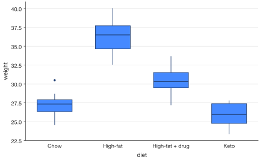
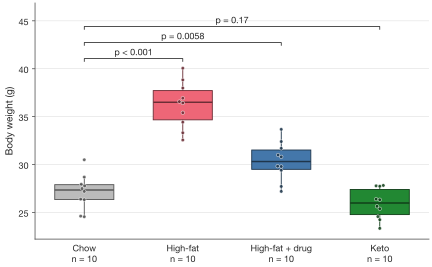
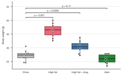

# Your first figure

<p class="lead">Five minutes from a table of measurements to a figure you can
submit. Each step adds one idea; run the blocks in order in a notebook or
script.</p>

## Install

SecretPlots needs **Python 3.12 or newer**. It builds on matplotlib, pandas
and [SecretColors](https://github.com/secretBiology/SecretColors).

=== "pip"

    ```bash
    python -m pip install SecretPlots
    ```

=== "uv"

    ```bash
    uv add SecretPlots
    ```

=== "From source"

    ```bash
    git clone https://github.com/secretBiology/SecretPlots
    cd SecretPlots
    python -m pip install -e .
    ```

## 1. Start from a tidy table

One row per observation, one column per variable. Here, the weight of 40
mice after eight weeks on four diets:

```python
import numpy as np
import pandas as pd
import SecretPlots as sp

rng = np.random.default_rng(4)
diets = ["Chow", "High-fat", "High-fat + drug", "Keto"]
mice = pd.DataFrame({
    "diet": np.repeat(diets, 10),
    "weight": np.concatenate(
        [rng.normal(mean, 1.8, 10) for mean in (27.5, 36.0, 31.0, 26.0)]
    ),
})
mice.head()
```

## 2. One line, one plot

Name the columns for each role. That's a complete plot:

```python
sp.box(mice, x="diet", y="weight")
```
<!-- figure: quickstart-basic -->



*The default `screen` preset: 6 in wide, sized for notebooks and slides.*

A plot is a lazy *specification*. Nothing is drawn until it is displayed
(the last line of a notebook cell), saved, shown with `.show()`, or you
access `.fig` / `.ax`. That's why you can keep chaining steps.

## 3. Add what reviewers ask for

Show every animal, test against the control, and give the axes real names
with units:

```python
figure = (
    sp.box(mice, x="diet", y="weight")
    .points()                                            # every animal
    .compare(ref="Chow", correction="holm")              # Mann–Whitney tests vs. Chow, Holm-corrected
    .show_n()                                            # n under each label
    .colors({"Chow": "#BBBBBB", "High-fat": "#EE6677",
             "High-fat + drug": "#4477AA", "Keto": "#228833"})
    .labels(x="", y="Body weight (g)")
)
figure
```
<!-- figure: quickstart-reviewed -->



| Step | What it adds |
|---|---|
| `.points()` | Every observation, jittered so none hide. |
| `.compare(ref="Chow", correction="holm")` | Brackets with multiplicity-corrected *P* values against the reference group. |
| `.show_n()` | Sample size under each category. |
| `.colors({...})` | A colour per group; grey for the control. |
| `.labels(...)` | Axis titles with units; `x=""` drops a redundant one. |

Need the numbers behind the brackets for your methods section? Call
`figure.test_results()`, which returns a table with the test, statistic,
raw and adjusted *P*.

## 4. Size it for the journal

Select a preset once, and every plot after it follows that journal's
rules for width, font sizes and resolution:

```python
sp.use(preset="nature")

paper = (
    sp.box(mice, x="diet", y="weight")
    .points()
    .compare(ref="Chow", correction="holm")
    .colors({"Chow": "#BBBBBB", "High-fat": "#EE6677",
             "High-fat + drug": "#4477AA", "Keto": "#228833"})
    .labels(x="", y="Body weight (g)")
)
paper
```
<!-- figure: quickstart-nature -->

{ .narrow }

*89 mm wide, 5–7 pt sans-serif text, ready for a single Nature column.*

To change only one plot, use `.preset("nature")` instead of `sp.use(...)`.
Use `.size(width="double")` for a full-width figure. Every journal preset is
listed on [journal-ready figures](publication.md).

## 5. Save it

```python
paper.save("figure1.pdf")              # vector, fonts embedded
paper.save("figure1.tiff")             # raster at the preset's 300 dpi
```

The extension picks the format. PDF, EPS and SVG keep text and lines as
vectors; raster formats use the preset's dpi unless you pass `dpi=`.

## How it fits together

<div class="grid cards" markdown>

-   :material-chart-box-outline: **Plot**

    ---

    `sp.bar`, `sp.box`, `sp.line`, … take your data and return a plot you
    keep refining with chained steps.

-   :material-ruler-square: **Preset: where it goes**

    ---

    Physical size, font limits, dpi and formats for a journal, a slide or a
    newsroom. `sp.presets.list()`

-   :material-palette-outline: **Theme: how it looks**

    ---

    Palette, fonts, grid and spines. Use `.theme(...)` for one field, or
    `sp.use(theme="dark")` for everything.

-   :material-magnify: **Options: discoverable**

    ---

    `plot.options()` lists every step; `plot.options("legend")` explains one.
    No need to leave your notebook.

</div>

## Where next?

- Browse the [gallery](gallery.md) for a figure like the one you need.
- Open the guide for your plot type, e.g. [box plots](plots/box.md).
- Learn to [find any option](options.md) from Python.
