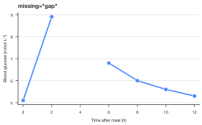
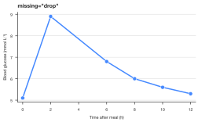
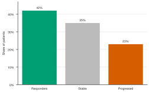

# Data, formatting, and export

Every plot constructor defaults to `missing="raise"`. Missing values (`None`,
`NaN`, `pd.NA`, `NaT`) and numeric infinities in the plotted fields produce an
error with the affected fields and instructions. Unrelated metadata columns
do not participate. Invalid numeric text still raises an error for every policy.

| Policy | Behavior |
|---|---|
| `"raise"` | Strict default: fix the input or explicitly choose another policy. |
| `"drop"` | Ignore affected observations. Lines connect the remaining points. Heatmaps remove incomplete matrix rows. Stacked areas remove incomplete x positions from every layer. |
| `"gap"` | Lines and areas preserve missing positions as gaps; heatmaps display missing cells. Available only for these plot types. |

```python
import numpy as np
import SecretPlots as sp

sp.line(x=[0, 1, 2], y=[1, np.nan, 3], missing="gap")
sp.bar({"a": 1, "b": np.nan, "c": 3}, missing="drop")
sp.heatmap([[1, np.nan], [2, 3]], missing="gap")
```

Gap mode requires valid x coordinates and group/unit identifiers. If a
replicate is missing, an aggregated line point and its interval become a gap.
For sparse stacks, a missing group at one x creates a gap across all layers.
Heatmap clustering still requires complete data; fill the data yourself or
select `missing="drop"` first. `.mask()` intentionally hides cells after input
validation and is independent of the missing-data policy.

For example, an error may say:

```text
Missing or non-finite data in y (1 row(s)). Use missing='drop' to ignore those
rows, or missing='gap' to preserve missing positions. Alternatively, fill the
values before plotting.
```

## Independent variants

Plots capture `sp.use(...)` at construction, even when rendering happens after
leaving the context. `.copy()` duplicates data and settings and discards rendered
artists. Direct changes to matplotlib artists are not part of the specification.

```python
with sp.use(preset="nature"):
    original = sp.line([1, 2, 3]).labels(y="Response")

paper = original.copy().preset("nature")
slides = original.copy().preset("slide-16x9").labels(title="Response increased")
```

## Axis formatting

Formatting affects displayed ticks only; `.source_data()` remains unchanged.
The axis names refer to the axes as drawn, including horizontal plots.

```python
sp.line([0.1, 0.2, 0.4]).format_axis("y", "percent", decimals=1)
sp.bar([1000, 2500]).format_axis("y", "currency", prefix="€")
sp.bar([1_000_000, 2_000_000]).format_axis("y", scale=1e-6, suffix=" million")
```

Percent formatting expects fractions: 0.25 becomes 25%. For data already in
percent units, use `scale=0.01`. For a datetime axis, use
`.format_axis("x", "date", date_format="%b %Y")`. Numeric formatting rejects
categorical/date axes rather than replacing their labels with numeric positions.

## Groups that remain distinguishable in grayscale

```python
import pandas as pd

data = pd.DataFrame({"day": [1, 2, 1, 2], "value": [1, 2, 2, 4],
                     "group": ["control", "control", "treated", "treated"]})
sp.line(data, x="day", y="value", hue="group").encode_groups()
sp.scatter(data, x="day", y="value", hue="group").encode_groups()
```

Lines get distinct dash patterns and marker shapes; scatter plots get distinct
marker shapes. This replaces an existing `style=` mapping with the hue mapping.
Use `.encode_groups(markers=False)` for lines if only dash patterns are wanted.
The available styles are finite; an error reports when there are too many groups.

## Narrow figures and text

`.chrome(...)` wraps titles, subtitles, notes and source text by measured width,
including long unbroken words. If the wrapped text leaves too little plot area,
increase `.size(height="5in")`, increase the width, or shorten the text. The
figure retains its requested physical dimensions; export does not silently
enlarge it to accommodate overflow.


## See missing-data policies

The same measurements can tell different visual stories when a time point is
missing. Choose the policy explicitly instead of silently changing the data.

```python
hours = [0, 2, 4, 6, 8, 10, 12]
glucose = [5.1, 8.9, np.nan, 6.8, 6.0, 5.6, 5.3]     # the 4 h sample was lost
sp.line(x=hours, y=glucose, missing="gap").preset("nature").markers().labels(
    x="Time after meal (h)", y="Blood glucose (mmol L⁻¹)", title="missing=\"gap\""
)
```
<!-- figure: usage-gap -->



*`missing="gap"` breaks the line around the missing position; `.markers()`
makes the observed values visible.*

```python
sp.line(x=hours, y=glucose, missing="drop").preset("nature").markers().labels(
    x="Time after meal (h)", y="Blood glucose (mmol L⁻¹)", title="missing=\"drop\""
)
```
<!-- figure: usage-drop -->



*`missing="drop"` removes the invalid observation and connects the remaining
points. This visual connection is not an imputed measurement.*

## Format numbers without changing them

```python
sp.bar({"Responders": 0.42, "Stable": 0.35, "Progressed": 0.23}).preset("nature").format_axis(
    "y", "percent", decimals=0
).values("{:.0%}").colors({"Responders": "#009E73", "Stable": "#BBBBBB",
                          "Progressed": "#D55E00"}).labels(x="", y="Share of patients")
```
<!-- figure: usage-percent -->



*`.format_axis("y", "percent")` controls ticks; `.values("{:.0%}")` controls
bar labels. The source values remain fractions.*

```python
sp.BarPlot.options("format_axis")
```

## Export and Matplotlib

Use SVG for sharp web graphics, PDF for vector artwork, and PNG for raster
output. A preset may warn if you choose a format outside its expected list.

```python
plot = sp.line([2, 3, 5, 4, 7]).labels(x="Time", y="Response")
plot.save("figure.svg")
plot.save("figure.pdf")
plot.save("figure.png", dpi=300)
```

`.fig` and `.ax` expose the underlying Matplotlib figure and axes. For a
multi-panel layout, supply axes you created yourself:

```python
import matplotlib.pyplot as plt

fig, axes = plt.subplots(1, 2, figsize=(8, 3), layout="constrained")
sp.line([2, 3, 5, 4, 7]).labels(title="Trajectory").render(ax=axes[0])
sp.bar({"A": 4, "B": 7, "C": 5}).labels(title="Comparison").render(ax=axes[1])
fig.savefig("panels.svg")
plt.close(fig)
```

Your figure owns the panel layout and dimensions when you pass `ax=`.
Make direct artist changes after finishing the SecretPlots chain: changing the
plot specification can trigger a fresh render. `.copy()` copies the specification
and data, not manual Matplotlib artist edits.

For data export, call `.source_data()` on plot types that provide it (see their
guides). This returns the data used for drawing, including summaries where
applicable; it is distinct from saving the figure.
